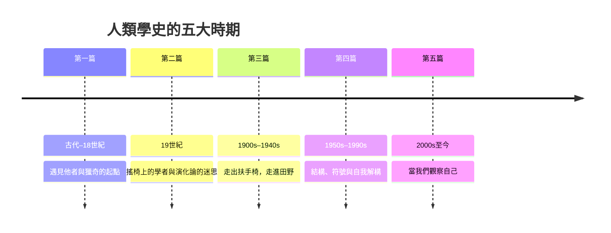

# 人類學的故事：從「他者」的鏡子到理解人類自身的史詩

本書講述人類學如何在數百年間，從大航海時代的獵奇探索、殖民帝國的偏見學問，蛻變為深入田野、打破種族偏見、解構文化與語言的嚴謹科學，最終回頭審視我們自己與現代社會。

全書貫穿三條轉變的主線：

1. 研究態度：俯視異族（殖民偏見）→ 平視異文化（文化相對論）→ 回頭審視自己（自我反思）
2. 方法論：扶手椅閱讀傳教士報告 → 住進部落的參與觀察 → 華爾街、矽谷與數位網路的多點田野
3. 核心課題：他們是誰？→ 我們與他們有何不同？→ 究竟什麼是「人類」？

## 目錄

### 第一篇：遇見「他者」與獵奇的起點（古代 – 18 世紀）

* 第1章-遠方的旅行者與奇聞異事
    * [1.1-希羅多德：最早記錄異族風俗的觀察者](01.1-希羅多德.md)
    * [1.2-伊本·白圖泰與馬可·波羅：跨文化接觸的第一手筆記](01.2-伊本白圖泰與馬可波羅.md)
* 第2章-大航海時代與「高貴野蠻人」的幻想
    * [2.1-地理大發現：美洲原住民與太平洋島民的衝擊](02.1-地理大發現.md)
    * [2.2-盧梭與啟蒙時代：高貴野蠻人的哲學思辯](02.2-盧梭與啟蒙時代.md)

### 第二篇：搖椅上的學者與演化論的迷思（19 世紀）

* 第3章-扶手椅上的人類學者與「文化單線演化」
    * [3.1-泰勒與《原始文化》：文化一詞的誕生](03.1-泰勒與原始文化.md)
    * [3.2-摩爾根與《古代社會》：親屬制度與演化階梯](03.2-摩爾根與古代社會.md)
* 第4章-帝國主義的助手與「金枝」的神話
    * [4.1-弗雷澤與《金枝》：全球神話的百科全書](04.1-弗雷澤與金枝.md)
    * [4.2-殖民地背景：人類學與帝國統治的雙刃劍](04.2-殖民地背景.md)

### 第三篇：走出扶手椅——走進田野的革命（20 世紀初 – 1940 年代）

* 第5章-波亞斯與「文化相對論」的曙光
    * [5.1-波亞斯：擊碎種族決定論](05.1-波亞斯與種族決定論.md)
    * [5.2-四大分支在美國的建立](05.2-四大分支的建立.md)
* 第6章-特羅布里恩島的帳篷——馬林諾斯基與田野調查
    * [6.1-困在孤島的敵僑：參與觀察法的誕生](06.1-參與觀察法的誕生.md)
    * [6.2-庫拉環：原始人的複雜經濟](06.2-庫拉環.md)
* 第7章-薩摩亞人的成年禮與親屬制度的奧秘
    * [7.1-米德與《薩摩亞人的成年》：天性還是文化](07.1-米德與薩摩亞人的成年.md)
    * [7.2-拉德克利夫-布朗與結構功能主義](07.2-結構功能主義.md)

### 第四篇：結構、符號與解構傳統（20 世紀中 – 20 世紀末）

* 第8章-李維-史陀與深層的「結構主義」
    * [8.1-《憂鬱的熱帶》與二元對立的心靈結構](08.1-憂鬱的熱帶.md)
    * [8.2-神話學與親屬結構的幾何美學](08.2-神話學與親屬結構.md)
* 第9章-深描與文化的「文本詮釋」
    * [9.1-吉爾茲與《文化的解釋》：深描的誕生](09.1-深描的誕生.md)
    * [9.2-峇里島鬥雞：一部文化的文本](09.2-峇里島鬥雞.md)
* 第10章-反思、寫文化與女性主義人類學
    * [10.1-《寫文化》：人類學家的權威危機](10.1-寫文化.md)
    * [10.2-女性主義人類學：解構男性中心的田野](10.2-女性主義人類學.md)

### 第五篇：現代人類學——當我們觀察自己（21 世紀至今）

* 第11章-醫療、物質、高科技與都市人類學
    * [11.1-法默與醫療人類學：疾病是結構的產物](11.1-法爾莫與醫療人類學.md)
    * [11.2-高科技田野：華爾街、矽谷與網際網路](11.2-高科技田野.md)
* 第12章-多於人類的人類學與未來的生存
    * [12.1-柯恩與《森林如何思考》：超越人類中心](12.1-森林如何思考.md)
    * [12.2-人類世：氣候變遷與未來的生存](12.2-人類世與未來的生存.md)
