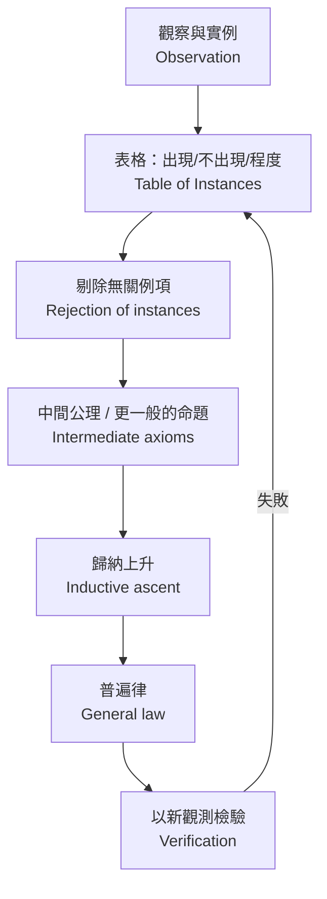

# 5.3 培根的新工具

1561年1月22日，弗朗西斯・培根（Francis Bacon，1561–1626）出生在英格蘭薩默塞特郡的一棟鄉間宅邸。父親尼古拉斯・培根是伊利莎白時代的首席法官（Lord Keeper of the Great Seal），被封為伯貴爵；母親安妮・庫克來自一個有商業頭腦的家庭。

培根一生要處理的核心問題，可以用一個提問概括：當一個有權勢、有才智的人被判為有罪、被剝奪一切時，這意味著什麼？這既是他的政治生涯，也是他的哲學生涯。

## 從法庭到方法

培根12歲進入劍橋的聖三一學院，15歲赴巴黎隨法國大使保羅・德・薩盧佐（Paul de Saluzzo）遊學，1580年返英後進入法律界。1584年他當選國會議員，1603年受封爵位，1613年出任首席檢察長，1617年升任大法官（Lord Chancellor）。1621年，他因貪污指控被免職並判刑；五個月後獲釋，此後在鄉間撰寫《自然史》等未竟之作，1626年4月9日去世。

他在政治上的失敗，與他的哲學主張是同一件事的兩面：他的《頭部論》與散文集裡，反覆出現一個主題——知識的進步不是靠天才的閃現，而是靠一整套方法的組織；因此，一個有方法的人比一個有天賦的人更有價值。而當他把這套方法用於政治現實、企圖以「經驗」改善財政與司法時，他撞上了既有權力網絡的反撲。

1620年，他出版了最著名的著作：《新工具》（Novum Organum）。書名本身是一次挑釁——亞里士多德的邏輯著作合稱「工具論」（Organon），而培根要說：亞里士多德給了我們一套談論的器官，卻沒有給我操縱自然、改造世界的器官。

他在書的開頭放進了那段著名的話：印刷術、火藥與羅盤這三樣發明，改變了整個世界的面貌與狀態。他接著指出，人類現有的知識有三個層次：來自感官與經驗的知識，來自推理的知識，以及來自經驗與推理之結合的知識——他稱最後一種為「確定的科學」，而這正是他要用新方法建立起來的。

## 四偶像

《新工具》第一卷處理「偶像」（idola），即阻礙認識的偏見。培根把偏見分為四類，這個分類後來被評價為認識論史上最成功的心理學分類之一。

第一類是「族群的偶像」（Idols of the Tribe）：人類共同的偏見，如「自然比人工更規則」這類把常見誤當必然的信念。

第二類是「洞穴的偶像」（Idols of the Cave）：個人特有的偏見，來自教育、偏好與偶然經歷。柏拉圖的洞穴比喻在此被反轉使用：每個人都被關在自己的洞穴裡，看見的是被自身條件過濾的世界。

第三類是「市場的偶像」（Idols of the Market）：語言的偏誤。這是最有趣的一類，也是培根最關心的一類——因為他是一個靠文字為生的人。他說：語言是經由人類的共同使用而形成的，它的意義不是自然賦予的，而是約定俗成的；而約定的力量如此之大，以致「人們用詞論述世界時，常常像拿著一個精確的度量衡器，卻根本沒有注意到底下的砝碼是隨意挑選的」。培根的具體例子是：世界在某些方面是「光滑的」，在某些方面是「毛糙的」——但人們會說「自然的」與「不規則的」，好像性質本身有分裂。這個例子後來被用來說明語言如何切割經驗。

第四類是「劇院的偶像」（Idols of the Theatre）：人為的學術體系。他說，各派學派像「蜂群」：蜜蜂從花中採蜜釀蜜，但蜂群之間彼此隔絕，每一群都以為自己的蜜是唯一的真理。學派之間的分歧不是來自世界，而是來自各自的框架。

這四類偶像的共同點是：它們都不是明顯的錯誤，而是人們不自覺地攜帶的「預設」。這是一個關於科學的極為現代的洞察：科學的危險不在於有人存心說謊，而在於整個研究共同體共享著看不見的前提。培根在《新工具》裡還說過一句常被引用的話：如果一個學派有時錯、有時對，那麼它就像一根時鐘——有時準，有時不準；但如果有某種學派連一根時鐘都不如（即從來不對），那麼它就是被虛構出來的。

## 歸納法

《新工具》第二卷的核心是方法。

培根要處理的問題是：歸納法怎麼才不會只是「歸納謬誤」？他的答案是一套相當精密的操作程序。

第一步是收集「實例」（instances），即所有相關的觀察，包括正面的與反面的。第二步是把這些實例整理成表格，按「是否出現」排列。第三步是排除那些必然與研究對象無關的例項——例如研究金屬的性質時，銅與鐵的實例要拿掉。關鍵在第三步：要排除的是那些「與之無關」而非「與之相反」的例項，否則就會有「例外推翻規則」的問題。

第四步，也是最關鍵的一步：不是直接從實例跳到規律，而是逐級上升。中間還要經過「更高的命題」或「中間公理」，例如金屬受熱會膨脹，受熱膨脹是因為物體的「膨脹傾向」在起作用——把這個普遍傾向單獨提出來檢驗。

這套程序有一個極重要的含義：歸納法不是把個別推向一般的一條直線，而是有層級、有反覆、有檢驗的一個過程。培根還強調「預先觀察自然」（praesagitio naturae）——研究者應帶著假設進入實驗，但必須願意放棄假設。他最著名的一句實驗格言是：自然的答案是「在自然回答之前，先讓問題被充分詢問」——自然的沉默往往來自問題的錯誤。

## 印刷機、方法與制度

《新工具》不是憑空寫成的，它有技術前提，而這些前提全都是前節講的印刷術。

第一，培根需要精確的文本。亞里士多德的著作在十六世紀經歷了大量校訂與重印，要「反對亞里士多德」，就必須知道他到底說了什麼。印刷術讓文本批評成為可能。

第二，「實例表格」是一種印刷品。培根設想的自然史研究，是一部關於「事物之生命與死亡」的巨著，需要全歐的觀測者持續地、大量地提交資料——這只有在一個有通訊、有出版、有索引的網絡裡才可能。

第三，也是最深的一層：培根的書名暗示了知識生產方式的變化。過去的哲學家面對的是「既有文本與既有意見」，方法是在既有的框架裡推演；培根面對的是「自然」，方法需要的是觀察、記錄、實驗與合作。他提出的機構方案——「自然的學院」（a college of nature），在大西洋島上設立一個有組織的實驗研究體系——正是現代研究機構的原型。

培根在1626年去世後出版的小說《新亞特蘭提斯》（New Atlantis）描述了那個學院：一群人在實驗室裡做各種試驗，收集「觀察的歷史」，直到某天他們收到命令停止；消息是海外有新的發現，學院成員要分成三組——一組做冒險，一組做觀察與建議，一組繼續做實驗並把結果編入報告。培根寫道，只有當知識與權力結合時，人類才可能飛向星空。這段文字後來被共濟會、啟蒙運動、共產主義者、以及20世紀的科技政策制定者反覆引用。

## 從培根到皇家學會

培根的方案在他死後七十年被部分實現。

1660年，倫敦的一小群自然學者在倫敦咖啡館（Gresham College 附近）開始聚會，後來成為「看不見的學院」（the Invisible College），1662年取得王室特許成立皇家學會（the Royal Society）。它的座右銘是「Nullius in verbo」（不以任何人的話為準），它的核心工作方式，是把觀測與實驗整理成可累積、可共享的「實驗史」。

最典型的案例是空氣幫浦。1672年，皇家學會委託儀器製造者羅伯特・胡克製造了一台更精密的空氣幫浦，用來重複托里拆利與波義耳的實驗。實驗的結果在1670年代引發了一場歐洲思想史上的著名衝突：以波義耳為首的一派主張「真空」（void）存在——這意味著構成物質的微粒之間有空間，宇宙在微粒層面是「不連續」的；以托里拆利、霍布斯、貝克萊等為首的一派主張「充實」（plenum），認為空間本身是物質的，承認真空就等於承認物質可以被分割到無限小，進而承認「運動不經中介可以傳遞」，最後會摧毀他們認為不可違逆的因果傳遞觀念。

這場論戰的意義在於：它證明「關於世界的問題」可以成為跨國的、有共同資料基礎的、可被實驗裁決的公共爭議；同時它也證明，共同資料並不保證共識——雙方都在用同一套儀器、同一批數據，得出相反的本體論結論。1985年，沙平與沙弗的《利維坦與空氣幫浦》把這場論戰重新分析為一次「實驗的社會安排」的締造。

另一條線是元素概念的轉變。波義耳在《懷疑的化學家》（1661）裡，用實驗（尤其是把玻璃容器倒置於水銀中的實驗）否定了亞里士多德的四元素與三要素說。他主張物質由「微粒」構成，這個主張直接繼承了德謨克利特與伊壁鳩魯的原子論——一條從希臘化時期斷裂了、卻在17世紀重新接上的線索。他並且區分了「元素」（不能被分解的物質成分）與「元素」（經過嚴格定義的化學物質種類）這兩個概念，現代化學的元素概念由此定型。

1687年，牛頓的《自然哲學的數學原理》問世，把行星運動、開普勒定律、伽利略的落體與潮汐現象統一在同一個框架裡。科學革命至此完成了它的第一輪整合。

## 培根的後世

培根在18世紀的啟蒙運動中被重新發現。伏爾泰稱他為「人類最聰明的聖人之一」；康德寫了一篇《論培根的論说》的演講；而在愛丁堡，休謨在《人類論》裡大量引用培根，特別是他的歸納法批判——休謨的問題是：歸納的根據是什麼？「太陽明天會升起」這個命題，既不能用經驗證明（因為經驗都在過去），也不能靠理性證明。培根的答案是「自然的預期」，休謨的答案是「習慣」。這個分歧一路延伸到20世紀的波普爾（否證法）與費耶阿本德（無方法論）。

19世紀，培根成了功利主義者的精神先驅。邊沁的門徒約翰・斯圖亞特・密爾在1836–37年寫了一系列「培根演說」（Bacon's Essays），把培根重新塑造為「功利的先驱」；麥考萊在1837年的評論文章裡稱培根是「人類過去、現在與未來最偉大的智識人物之一」。孔德則把培根當作「實證精神」的先驅，用他來論證科學的進步。

而在20世紀，培根的地位開始被重新評價。科學史家史蒂文・夏平（Steven Shapin）與伊丽莎白・舍弗（Elizabeth Schaffer）在1985年那本《利維坦與空氣幫浦》裡指出：培根本人的實驗從未真正操作過——他幾乎沒有動手做過任何一個實驗，他的《自然史》出版時，大部分內容還是別人替他收集的。培根的重要性，不在於他做了什麼，而在於他描述了一種制度。美國科學史家孔拉・科恩（C. K. Cohen）因此說：「培根的實驗史是把十七世紀的問題轉化為十九世紀的方案。」

這正好點出了哲學史上一個反覆出現的模式：概念的生產往往先於實踐的生產。培根描述了一個尚未存在的科學家，皇家學會把他描述的部分變成了現實；而五百年後，當我們今天談論「大科學」與「資料驅動的研究」時，我們其實是在重複他與他的方案。

下一章要講的笛卡兒，將把這個問題從「方法」移回「主體」：如果自然是機械的、方法是有規則的，那麼我們對自然的理解是從哪裡來的？笛卡兒的回答是：從一個思考著的自我開始。
