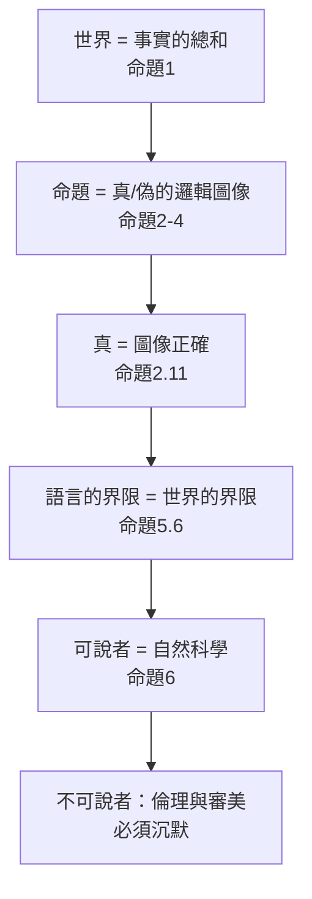

# 10.2 馬赫與維特根斯坦的邏輯哲學論

1886年，物理學家兼哲學家恩斯特・馬赫（Ernst Mach，1838–1916）出版了《感覺的分析》（Die Analyse der Empfindungen）。這本書的主張只有一句：

> 我們所直接把握的，不是外在的物體，而是感覺元素；所謂物體，不過是感覺元素的複合。

這句話把貝克萊的唯心論（見第6.3節）轉化成了物理學可以接受的語言，並且在二十世紀初的維也納，成為一群年輕物理學家與數學家共同的思想底色。他們的計劃是：用邏輯把科學的命題清除乾淨，把不可說的還給不可說——而這個計劃最著名的成果，是維特根斯坦的第一本書。

## 馬赫與「流體」

馬赫出生在摩拉維亞的布爾諾（Brünn），是當地一位不受歡迎的德語姓氏的實驗室守衛之子。他在小學裡被同學打得耳朵出血，因此此後一生有聽力障礙。1861到1866年他在維也納大學讀物理學，1867年取得Privatdozent資格，先在格拉茨，後來到布拉格（1883–1908），最後回到維也納。

他的科學成就包括：以馬赫數表示的流體速度測量；以「馬赫錐」與馬赫波的命名；以及「馬赫原理」——在加速運動的座標系中，物理定律保持形式不變，這個原理後來成為愛因斯坦的相對論的基礎之一。

他的哲學成就則是「感覺的分析」：他把知覺分析到不能再分解的元素（顏色、聲音、壓力、空間位置），然後說，所謂「物體」只是這些元素在時間與空間中穩定聯繫的「關係式複合」。這裡有一個極重要的方法論後果：如果物理學的基本語言是感覺元素，那麼把物理學建立在「物體」之上的那套形而上學，就有了被替換掉的機會。

但這套方案在1920年代遭到了一場狙擊。1918年，列宁寫了《唯物主義和經驗批判主義》，把馬赫的主觀唯心論與波爾克曼、索利特、以及上文提到的貝克萊並列批判。列宁的核心指控是：馬赫承認感覺是「唯一確定的東西」，卻沒有回答感覺是誰的感覺。他用了一個生動的比喻：馬赫的哲學就像電解——哲學是把溶液中的金屬析出的那個過程，而在馬赫的溶液裡沒有金屬。

而哲學家胡塞爾在《邏輯與認識論研究》（1929）裡則指出了另一個問題：馬赫把「感覺元素」當成不需解釋的東西，這本身仍是一個未經說明的哲學假定。

值得注意的是，這場戰役的參與者之一，就是維特根斯坦。他在1920到1930年代的講義裡明確站在馬赫一邊，但也發展了馬赫沒有的東西：語言。

## 邏輯的兩條源流

要理解維特根斯坦的《邏輯哲學論》，必須先理解當時「邏輯」這門技術的兩個源頭。

第一個源頭是弗雷格。哥特瓦德・弗雷格（1848–1925）原本是天文學家，1879年出版《概念演算》（Begriffsschrift），發明了一整套用於表達邏輯的符號系統：它能處理命題邏輯、量詞、否定、蕴涵，並且首次把「單一論述中的真值」與「概念內容」清楚地區分開來。弗雷格在1892年的《算術的基本概念》裡定義了數，試圖從純邏輯推出算術——這是一個大膽到荒謬的計畫，卻在邏輯史上開啟了「邏輯主義」的方向（後來被胡塞爾與波爾克曼批評，也被胡塞爾在《邏輯研究》第二卷中系統地批判）。

第二個源頭是布爾。喬治・布爾（George Boole，1815–1864）發明了「邏輯代數」；而把布爾的邏輯真正用來寫出《數學原理》（Principia Mathematica, 1910–1913）的，是伯特蘭・羅素（Bertrand Russell）與阿弗雷德・懷特海（Alfred North Whitehead）。這部三卷本巨著把全部數學從邏輯與集合論中推導出來，是「形式系統」這一概念的原型：只要有一套公理與推理規則，就能生成無限多命題——機器與人做的是同一件事。

而維特根斯坦在1914到1918年的筆記裡，正是從弗雷格與羅素出發。他的《邏輯哲學論》第一個版本寫於1918年，是德軍戰俘營裡的產物。

## 《邏輯哲學論》

維特根斯坦（Ludwig Wittgenstein，1889–1951）出身於維也納最富有的家族之一。他的祖父是鋼鐵工業家；他父親的家業是歐洲最大的鋼鐵企業之一，因此維特根斯坦從小就有錢到幾乎不必為生計煩惱——這筆財富的部分來源，正是工業革命的鐵軌與建築鋼。而他在1918年完成的《邏輯哲學論》裡，寫下了這樣一句話：

> 我的思想，在邏輯上，就是演算的命題。

這句話把哲學與數學接在一起：世界是可以被演算的。

全書的結構極為緊密：

命題1：「世界是所有事實的總和。」

命題1.1：「世界是所有事實的總和，而不是所有本質的總和。」——這句否定，針對的是柏拉圖式的「理念世界」。

命題2：「圖畫即模型。」

命題2.1：「圖畫之所以代表其所描繪的對象，是由於它的邏輯結構。」

命題2.11：「真的圖畫就是正確的圖畫。」

命題3：「邏輯的命題是事實的真假可能性之圖畫。」

命題4：「語句就是命題的邏輯表達。」

命題5：「只有從命題的邏輯才能看出命題的真假；必須能把命題的邏輯用於所有句子。」

命題5.6：「我的語言的界限就是我的世界的界限。」

然後是整本書最著名的兩段。第一段是關於「不可說」的：

> 當我說出「不可說者」的時候，我必須沉默；當我說出這個時候，我就已經超出了語言的合法範圍。

第二段是命題7與其附言：倫理屬於「神秘的部分」。他把「神秘」寫成那種使人不僅僅是動物、而具有藝術的東西；並說「即使關於上帝有再多的談論，也無法指出更多」，以及「生命」與「 Willen（意志）」在道德上的意義。

這本書在1921年以德文全文刊登在《哲學年報》（Annalen der Philosophie）上，並在1922年由維也納的 Rejane 書局出版單行本，同時附上 P. F. 斯特勞森與羅素翻譯的英文版（副題「一個論真理的哲學論著」，這是維特根斯坦堅持要加的副題）。

1929年9月，在劍橋召開了一場著名的「《邏輯哲學論》討論會」，與會者包括維特根斯坦、羅素、穆爾、凱恩斯、弗雷格（Frege 已於1925年去世，未能出席）、以及C. K. 奧格登。維特根斯坦在那裡發表了他對弗雷澤《金枝》的評論（後來以《論弗雷澤金枝的若干評論》為題出版），並且以他獨特的方式談論弗雷澤的書：宗教的儀式在形式上是迷信的，但在其內核裡卻是對情感的真實表達。

而維特根斯坦在劍橋的另一份工作，比《邏輯哲學論》影響更大：他在劍橋開設了以劍橋哲學系傳統聞名的「道德科學哲學講座」，聽眾包括莫里斯・奧斯汀（Maurice Austin）、Rush Rhees、Norman Malcolm、以及——關鍵的——圖靈（Alan Turing）。

圖靈在1934年來到劍橋時，正在處理希爾伯特提出的「判定問題」（Entscheidungsproblem）：是否存在一個機械的步驟，能對任何一階邏輯的公式判定其是否為真？1936年圖靈發表《論可計算數及其在判定問題上的應用》，答案是否定的。而維特根斯坦在1930到1931年的劍橋講稿裡，也處理了同一個問題：他把邏輯系統的「證明」與數學家「發現」證明的方式區別開來，並說數學家是在一個「誘惑」的引導下工作的——這段文字後來被稱為維特根斯坦對數學家的心理描述，比他對形式系統的處理更受重視。

## 維也納學派

維特根斯坦的第一本書出版之後，他立刻成了「邏輯實證主義」運動的旗幟。而這個運動的制度載體，是維也納學派。

1920年，物理學家菲利普・弗蘭克（Philipp Frank）在維也納成立了「恩斯特・馬赫學會」（Verein Ernst Mach），吸收了莫里茲・施利克、魯道夫・卡爾納普、奧托・紐拉特、漢斯・萊興巴赫、弗里德里希・魏斯曼等人。1929到1931年，卡爾納普、紐拉特等人在《認識》（Erkenntnis）期刊上發表了題為《科學的世界觀：維也納學派》的宣言，宣稱他們的目標是「把形而上學的所有命題都排除在科學之外」。

學派的核心是一個語義標準：**驗證原則**——一個命題的意義在於它可以被經驗證證實或證偽；純粹的形而上學命題既不能被證實也不能被證偽，因此不是命題。

這個標準立刻帶來兩個難題。第一個是「綜合先驗命題」（synthetic a priori）：康德說有些命題既是先驗的又是關於世界的（例如「每個事件都有原因」）。如果它們不能被經驗驗證，它們豈不沒有意思？卡爾納普用「形式式的語言」（der formal mode of speech）來處理：這類命題不是在斷言世界，而是在規定語言的框架，因此是「真」的，但屬於邏輯而非經驗。

第二個难题更嚴重：即使一個命題可以被經驗驗證，它是否「有意義」仍取決於整個命題系統的規定。於是有了卡爾納普的「協議句子」（Protokollsätze）與「世界圖景」（Weltbild）概念：語言的句法規則由整個系統決定，因此「語句的真假」不能逐一判斷，只能相對於整個系統。

1930到1931年，卡爾納普發表了〈論實證主義的兩條教條〉（Über die zwei Dogmen des Empirismus），第一條教條是「一切有意義的命題都是分析的」（即都可以只靠語言規則證明），這在邏輯上站不住腳；第二條教條是「綜合命題與分析命題的二元對立」，卡爾納普自己放棄了它。放棄第二條教條，等於放棄了「經驗主義」的一個基本預設——這是學派內部最痛苦的一次自我修正，也是實證主義分裂的開始。

1933年之後，維也納學派的成員在納粹統治下陸續流亡：紐拉特去了荷蘭（並在1934到1936年的「國際計劃經濟圖解」與戰後的「國際圖解主義」中發展他的設計方法——這是信息設計與視覺溝通的先驅）；卡爾納普先到布拉格（與塔爾斯克一起，後來在美國與芝加哥的哲學系任教）；萊興巴赫與施利克先到德國（哥廷根），後來都去了美國。

而學派的命運，也直接被政治決定：它是「紅維也納」（1919到1934年由社會民主黨執政的時期）與「德奧納粹主義」之間的後方。它標榜科學理性、反對「神秘主義」與「庸俗的唯物主義」——但它的科學理性恰好被兩種政治力量同時利用，也同時背叛。

## 第二個維特根斯坦

1938年之後，維特根斯坦放棄了《邏輯哲學論》的路線。他轉向語言遊戲、規則、形式的生活、恆常性（使用恆常性）這些主題，並且用一種完全不同的文體寫作。

《哲學研究》（Philosophische Investigations / Philosophical Investigations）由他的學生 G. E. M. 安斯康姆（G. E. M. Anscombe）編輯，1953年以英文出版，1956年出德文版。

全書以一個日常的語言遊戲的例子開篇：建築工人使用「磚頭」「柱子」這些詞。然後是那個著名的段落：

> 在我們使用「意義」一詞的許多情形中——雖然不是全部情形——它可以這樣定義：一個詞的意義就是它在語言中的用法。

以及「家族相似」（family resemblance）：遊戲之間的相似就像家族成員之間的相似——有的像，有的不像，但沒有一個共同的特徵。

以及「私人語言」（private language）論證（§243）：假設有一個人只在腦子裡記錄「E」這個符號來表示「疼痛」；那麼有什麼東西會使得「E」的用法是對的或錯的？如果沒有公共的校正與使用規則，那麼「正確」這個概念本身就無法成立——因為正確性預設了一個可以出錯、可以被他人發現的公共標準。

這套晚期哲學通常被稱為「治療式」的：它的任務不是給出答案，而是「解除誤導」（R. M. 黑爾的說法）；而它對20世紀哲學的影響，涵蓋了從「日常語言哲學」（奥斯汀的《如何以言行事》，1962）到羅素的《人類的知識》（1959）與後來的所有語言哲學。

晚期維特根斯坦最著名的私人悲劇，是他與1930年代在劍橋的學生、醫生與性伴侶 諾曼・馬爾科姆（Norman Malcolm）之間的關係；維特根斯坦在1951年的遺囑裡，把《邏輯哲學論》的大部分文稿與相關檔案留給了馬爾科姆。這一點與他的哲學直接相關：《邏輯哲學論》是一本禁慾的、極端形式化的書，而它的作者本人是一個被強烈情感佔據的人——這個反差，構成了20世紀哲學裡最持久的一個問題。

而維特根斯坦的遺產，在二十一世紀又有了新的用途：從自然語言處理到機器學習裡的「可解釋性」討論，從科學語言的「形式化理想」到「維特根斯坦的意義即用法」被重新解讀為一種反對資料驅動式語言研究的資源。而整個故事的最後一課是：語言轉向不是一個純粹的哲學運動，它是在一棟充滿了收音機、電話、電報與打字機的大樓裡，由一群需要精確處理符號的人做出來的。而它產生的那套工具，最後又被拿去造了一台會思考的機器。
