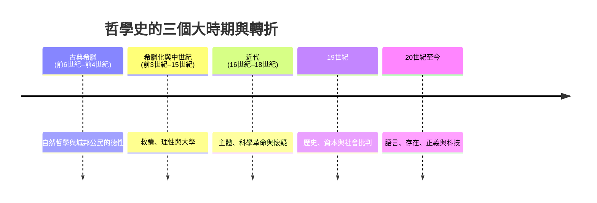

# 哲學的故事：從米利都的海風到資訊時代的語言轉向

哲學不是從書房裡長出來的抽象玩物。它每一個轉身，都對應著真實世界的變化：城邦民主給了蘇格拉底追問的舞台，印刷術讓懷疑得以傳播，資本主義重塑了「人」的意義，工業革命讓馬克思看見了資本的邏輯，兩次大戰與核威脅逼迫語言分析與正義理論回應現代性。本書沿著這些因果鏈條，把哲學史讀成一部「人類如何理解自己所处的世界」的技術史、制度史與經濟史。

全書依循四條交織的線索：

1. 提問的制度條件：誰有資格提問？哲學的場合從酒席、廣場、學園、宮廷、教會，到咖啡館、講堂與網路。
2. 思想的技術條件：紙草、羊皮紙、印刷術、航海術、望遠鏡、形式邏輯、形式語言、資訊網路。
3. 經濟與階級條件：奴隸制、公民陪審團、行會、大學的俸祿、商業革命、工業革命、資訊產業。
4. 思想與權力的張力：哲學家往往替現狀辯護（柏拉圖的哲學王、霍布斯的主權、黑格爾的國家），也往往成為它的掘墓人（伊壁鳩魯、馬克思、波伏瓦）。

## 目錄

* 第1章-海風與鹽：米利都的自然哲學（西元前6世紀）
    * [1.1-泰勒斯：預測日蝕的米利都人](01.1-泰勒斯：預測日蝕的米利都人.md)
    * [1.2-赫拉克利特：踏進同一條河的人](01.2-赫拉克利特：踏進同一條河的人.md)
    * [1.3-埃米佩多克爾：四根、愛與爭](01.3-埃米佩多克爾：四根、愛與爭.md)
* 第2章-廣場上的死亡：蘇格拉底與柏拉圖（西元前5世紀–前4世紀）
    * [2.1-製革廠裡的蘇格拉底](02.1-製革廠裡的蘇格拉底.md)
    * [2.2-公元前399年的陪審團](02.2-公元前399年的陪審團.md)
    * [2.3-柏拉圖的學園與理念論](02.3-柏拉圖的學園與理念論.md)
* 第3章-亞歷山大之後：希臘化世界的哲學（西元前4世紀–前1世紀）
    * [3.1-亞歷山大與東西方的門戶](03.1-亞歷山大與東西方的門戶.md)
    * [3.2-皮浪：無法被說服的懷疑者](03.2-皮浪：無法被說服的懷疑者.md)
    * [3.3-伊壁鳩魯的花園](03.3-伊壁鳩魯的花園.md)
* 第4章-上帝之城：奧古斯丁與中世紀大學（西元4世紀–14世紀）
    * [4.1-奧古斯丁的悔改](04.1-奧古斯丁的悔改.md)
    * [4.2-理性變成了僕人](04.2-理性變成了僕人.md)
    * [4.3-巴黎的辯論會與托馬斯·阿奎那](04.3-巴黎的辯論會與托馬斯·阿奎那.md)
* 第5章-印刷術、哥白尼與科學革命（15世紀–16世紀）
    * [5.1-古騰堡的活字與歐洲的知識爆發](05.1-古騰堡的活字與歐洲的知識爆發.md)
    * [5.2-哥白尼把地球搬到了邊上](05.2-哥白尼把地球搬到了邊上.md)
    * [5.3-培根的《新工具》](05.3-培根的新工具.md)
* 第6章-笛卡兒的方法與近代形上學（17世紀）
    * [6.1-我思故我在：笛卡兒的賭注](06.1-我思故我在：笛卡兒的賭注.md)
    * [6.2-斯賓諾莎：在必然性的幾何圖形裡](06.2-斯賓諾莎：在必然性的幾何圖形裡.md)
    * [6.3-貝克萊：存在就是被知覺](06.3-貝克萊：存在就是被知覺.md)
* 第7章-啟蒙的懷疑（18世紀）
    * [7.1-休謨：因果只是習慣](07.1-休謨：因果只是習慣.md)
    * [7.2-盧梭與社會契約](07.2-盧梭與社會契約.md)
    * [7.3-康德：哲學家的世界肖像](07.3-康德：哲學家的世界肖像.md)
* 第8章-德國觀念論：從萊比錫到柏林的辯證法（19世紀初）
    * [8.1-黑格爾與精神之螺旋](08.1-黑格爾與精神之螺旋.md)
    * [8.2-費爾巴哈與「隱祕的基督教」](08.2-費爾巴哈與「隱祕的基督教」.md)
    * [8.3-馬克思：資本的解剖學](08.3-馬克思：資本的解剖學.md)
* 第9章-功利、資本與邊際革命（19世紀）
    * [9.1-邊沁與穆勒：最大幸福](09.1-邊沁與穆勒：最大幸福.md)
    * [9.2-邊際效用革命與新古典經濟學](09.2-邊際效用革命與新古典經濟學.md)
* 第10章-實證主義與語言轉向（19世紀末–20世紀初）
    * [10.1-孔德：拒絕遺忘的社會學](10.1-孔德：拒絕遺忘的社會學.md)
    * [10.2-馬赫與維特根斯坦的《邏輯哲學論》](10.2-馬赫與維特根斯坦的邏輯哲學論.md)
* 第11章-戰後：分析、存在與正義（20世紀–21世紀）
    * [11.1-奎因與語言哲學的黃金年代](11.1-奎因與語言哲學的黃金年代.md)
    * [11.2-薩特：存在先於本質](11.2-薩特：存在先於本質.md)
    * [11.3-羅爾斯與正義的兩個原則](11.3-羅爾斯與正義的兩個原則.md)
    * [11.4-結語：哲學作為一種基礎設施](11.4-結語：哲學作為一種基礎設施.md)
