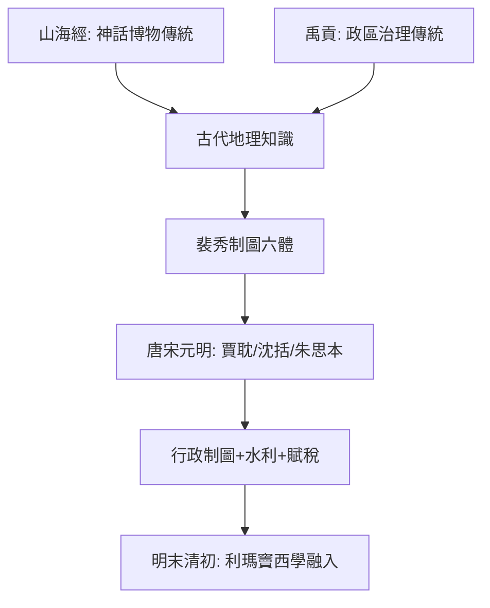

# 2.1 山海經禹貢與裴秀制圖六體

時間：從西周至西晉，跨越約一千三百年的中國古代地理傳統。

## 兩條古代地理的河流

中國古代地理學有兩條源流：一條是「神話—博物」傳統，《山海經》記山川、異獸、礦物與民族，是世界最早的地理百科之一（哪些是真實風物、哪些是傳說，至今仍有學者逐條比對）；另一條是「政區—工程」傳統，《尚書·禹貢》把「天下」分為九州，記述各州的土壤等級、田賦數量與順序，並詳列大禹治水的山川路線──這是治理型的地理：看土地，是為了能治理它。

《禹貢》大約成於戰國時期，其結構令人震驚地像一份統計年鑑：各州有其土壤類別（白壤、黃壤、斥鹵）、等級田賦（上上、上中、中下……）、貢品清單與進貢路線。它的底層邏輯是：土地被分類，是因為政治權力需要課稅、徵兵、組織貢獻。地理學在中國從一開始就與國家治理深度捆綁──這決定了它此後兩千年的演進方向：不只是「地圖」，而是「地圖＋戶籍＋水利＋貢賦」的行政系統。

## 裴秀的「制圖六體」：中國製圖學的座標系

真正把這門學問推向科學的，是西晉的裴秀（224–271）。他官至司空，主持編製《禹貢地域圖》（十八篇），歷史上被稱為中國早期最完整的地圖專著，並在序言中留下「制圖六體」──六條繪圖原理：

1. 分率：比例尺。
2. 準望：方位（相對方向）。
3. 道里：里程距離。
4. 高下：地形的高低起伏。
5. 方邪：坡度的斜直協正。
6. 迂直：路徑的曲直。

前三體需用於量與轉換；後三體告訴你──如果只記里程不記地形，地圖就會失真：同樣走五里路，山地與平路所費不同，里程數也許是直線距離的三倍。換句話說，他清楚地認識到「圖上距離不等於地表距離」，並列出轉換它們的必要條件。這與同時代歐洲的幾何球面法不同，卻同樣是「用數量方法處理空間」的早熟範式。裴秀編製的圖以此法採集各種地志、輿地傳說與第三手資料，重塑《禹貢》中的古代九州。

## 制圖六體之後的兩千年

裴秀的制度被唐宋政權繼續：唐代賈耽的《海內華夷圖》（八十幅、一寸百里，用裴秀的六體）刻在石上、廣採邊境資訊；宋代沈括《夢溪筆談》以木刻模型註記山川州域，並討論了飛島測距；元代的《輿地圖》系統（朱思本，1311–20）以方格法繪製，明代的《輿圖》在方格法基礎上配合利瑪竇帶入的三角測量：這些都是裴秀體系的延伸。

值得特別指出的是「方格法」：朱思本與明代輿圖以方格網度量平面，正是「用座標網格記錄空間」的另一路徑；不過中國傳統從未把世界畫成一個「球面網格」（托勒密式的天球投影），因為課題不同：中國地理的角色是治理這個政權的國土，而不是在想像全球型態。兩個文明各自的地理學反映了各自的政治地理學。

## 迷思破除

- 《山海經》不是純幻想文學：書中有實際山川與礦物記載（如玉石、金、銅的產地），至少部分內容基於真實旅行與口述；其迷信的部分也早已成為研究中古神話與民族誌的材料。
- 「中國古代沒有地圖學」是誤解：馬王堆漢墓出土的地圖（公元前2世紀）就已精繪地形與居民點。裴秀的貢獻不是第一張圖，而是一套可驗證的繪圖法。

方志與輿圖由官府主導，講究「全國一目了然」；但真正把「大地細節」寫活的，是一位用雙腿徒步三十年、拒絕科舉而只想看山的人，下一節的徐霞客。
