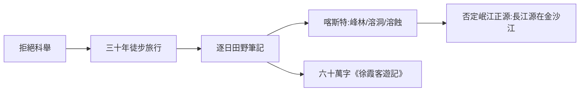

# 2.2 徐霞客遊記與喀斯特地貌

時間：1607–1641年，徐霞客三十餘年的旅行與日記寫作。

## 一個不考科舉的江陰書生

明萬曆年間的徐弘祖（號霞客，1587–1641），出身江陸縉紳家庭，本可循科舉做官，卻無意功名，立志「問奇於名山大川」。二十二歲起動身旅行，此後三十餘年間屢出屢返──北遊雁蕩、五嶽，南至羅浮，足跡遍及今日江浙、山東、福建、湖北⋯⋯最長的一次自1636年起持續四年，深入貴州、雲南。

他的方法不是官修方志的纂輯，而是一個人背包的野外調查：每到一地，逐日記錄地貌、水道、洞窟、岩石、道路里程、市集物價、民族風情與食宿狀況，幾乎不斷更。他去世後，遺稿被輯成六十萬字的《徐霞客遊記》，一般被視為明清日記作品中地質地貌價值最高的一部。此書在清代漸被刻印；二十世紀初，丁文江與竺可楨那一代科學家重讀它，將其列為「中國古典地理傳統中的現代樣本」。

## 喀斯特地貌的世界最早系統描述

《徐霞客遊記》在西南篇的核心成就是石灰岩地貌：

- 峰林與峰叢：他反覆描述桂林、柳州一帶「石峰參差、如筍成列」的景觀，並系統劃分不同亞型，記下峰巒間落水洞與伏流的關係。
- 洞穴：他一生探洞約三百餘，記錄洞內溫度、地下河走向、石鐘乳與石筍的位置相關，多次用火把、繩索與步點距離推算洞道的長度與結構。
- 侵蝕機理：「石質疏，水易滲穿」──他已意識到石灰岩「被水穿過就成溝穿洞」，與今日理解的溶蝕作用（碳酸鈣溶於溶有二氧化碳的水）方向一致。

歐洲對喀斯特（Karst）地貌的系統研究，在十九世紀中葉才出現。徐霞客的工作被二十世紀地質學家廣泛引用，等於把這門科學提前了數個世紀。更重要的判斷是水文方面：他實地循金沙江勘查、與傳統對照，否定了《尚書·禹貢》「岷山導江」以來把岷江當長江正源的千年說法，主張長江正源在金沙江──一次以身體丈量取代書本權威的方法革命。

## 旅行方法論：一個人的勘探隊

他沒有經紀與官方後勤，靠三件事做到大量數據：

1. 逐日筆記：每日記距離、方向、天氣、水域事件，不憑印象補寫。放在今天，那就是一份單人田野測繪報告，近似 GPS 軌跡＋記錄本的組合。
2. 多方求證：對通路與地貌現象反覆問農人、船夫、商隊，與自己實測互校。
3. 系統性地方描述：他不是「就事論事」，而是把沿路的水、山、洞、村、道路連成一串，看清彼此關係──這正是後世所謂「區域綜合地理」的早期樣態。

## 迷思破除

- 徐霞客不只是「旅行文學作家」，而是地貌調查者：西方地理學界常稱他為喀斯特研究的先驅。
- 他推翻「岷山導江」不是巧合：那時旅行路線恰可覆蓋川、黔、滇的長江水系上游，雖然他並未到達江源高地，其推理以嚴格比例的水文論證為據。
- 《遊記》的最後一卷（遊滇結束後）由友人和家人整理補成，非全部出自徐霞客親筆──今日引用需分別原文與後續整理。

同一時期，在半個地球之外，另一股旅行與地圖的動力正在成形：貿易、宗教與帝國官位交織的伊斯蘭世界。巴格達的「智慧之家」與羅傑之書的製圖師，正把古希臘遺產整理成中世紀的通用地理文本。
