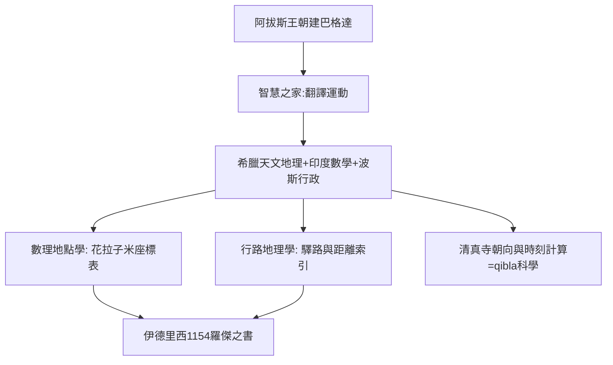

# 3.1 巴格達智慧之家

時間：西元9世紀起，阿拔斯王朝巴格達的智慧之家（Bayt al-Hikma）。

## 一座把自己定位為知識總部的王朝

西元750年前後建立政權的阿拔斯王朝，把自己定位為跨文明的中心：不只是信仰的政權，而是知識的總部。830年前後，哈里發馬蒙在巴格達設立「智慧之家」（Bayt al-Hikma），把翻譯、天文觀測、算學、邏輯與醫學整合為一個實際運作的研究機構。

這裡的「翻譯運動」規模空前：從希臘文與敘利亞文通往阿拉伯文，兩百年內完成的大典包括亞里斯多德全集、歐幾里得《幾何原本》、托勒密《天文集》（Almagest），當然還有《地理學指南》。主持其事的侯奈因·伊本·伊沙克等翻譯家本身即受過希臘—敘利亞醫學與學術訓練，翻譯精確而有注釋；資金的提供者是王朝、貴族與官員的資助網絡。

不到兩百年，阿拉伯世界成為唯一同時握有全套希臘科學典籍、印度數學、波斯行政水利與中國製紙術的文明。於是在5至10世紀的西歐仍處於拉丁修道院文化時，自然科學的重鎮在巴格達與中亞──歐洲的「中世紀」，正是伊斯蘭學術的黃金時代。

## 天文臺與地點學的分流

智慧之家的重要特色是「工作流程」：他們不只讀書，還要校對資料。自九世紀起，巴格達與附近設立了真實運作的天文臺，帶動一套「以觀測修正文本」的作風，這一原則延伸到地理學（地點學，ilm al-masalik wa-l-mamalik 之類的「路線與王國之學」）：資訊必須經現場驗證，不可僅據古籍抄錄。

地點學因此分流為兩支：

- 數理支：走向測量，把地點以經緯度精確標記，配天文臺與表格。代表人物是花拉子米（al-Khwarizmi，algebra 與 algorithm 二詞都源自其名），他依新的實測重修托勒密的經緯表，《地誌》（Kitab Surat al-Ard）成為以數據表取代描述的地理文本。
- 行路支：走向里程與行政。伊本·胡爾達茲比（9世紀）《路線與王國書》、馬格迪西（10世紀幾乎徒步走遍伊斯蘭世界）等，把帝國郵政系統（barid，負責驛站與情報）的資料寫成「路、驛站、距離」的索引，讀者是官員，用途是稅收、兵員與朝聖路線的管理。

兩支的共同點是「信任被驗證的資料」：距離與方向必須有人現場計量。這一標準在四百年後落到伊德里西那張世界圖上，也影響了後來歐洲復托勒密的作法。

## 清真寺：最早的地理計算基礎設施

伊斯蘭生活的三大數學需求與地理直接相關：確定每日五次禮拜的時刻、定出朝向麥加的方向（qibla）、以及齋月的月象判定。每一座在不同經緯度的城市，都要重新計算朝向與時刻，於是數學（球面三角）、天文（太陽高度與影子角）與地理學無法分家。阿爾·比魯尼等學者甚至用類似伊拉托斯提尼的方法（在地平面上量山谷開口與對岸視高差），重新估算地球半徑──的確，朝拜方向的每一筆計算，都是一座清真寺座標的應用實驗。

## 迷思破除

- 「智慧之家」在後世常被誇大為一座「亞歷山大圖書館式的大學」；嚴謹史料顯示它更像一個由王朝資助的研究與翻譯工作坊。但即使保守估計，其組織化翻譯＋校對＋觀測的模式，仍是「科研機構」的早期範型。
- 「阿拉伯人只是希臘文化的保存人」是過時的說法：他們有系統地修正與擴充──以實測資料重改托勒密的座標、改良球面三角、寫出新的地理指南，這些著作在文藝復興時反過來滋養了歐洲。

智慧之家的傳統以一個奇特的方式結出果實：一位來自北非的學者跑到義大利西西里，為一位追求完整世界圖的國王工作，留下一張佔據歐洲製圖學近四百年的地圖──伊德里西與他的《羅傑之書》。
