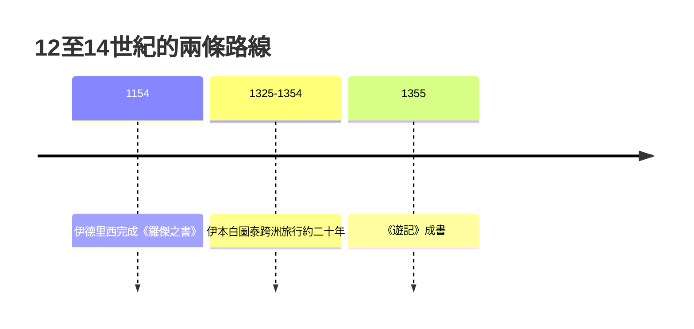

# 3.2 伊德里西與伊本白圖泰

時間：1154年《羅傑之書》成書；1325–1354年伊本·白圖泰的跨洲旅行。

## 一位逃難於政治的學者，與一位追求完整世界圖的國王

伊德里西（Muhammad al-Idrisi，約1100–1165），生於北非休達（今西班牙屬地），受教於科爾多瓦的圖書館系統。1130年前後，西西里的諾曼國王羅傑二世（Roger II）招攬他，出資支持他編製世界地圖。

參與這張圖的雙方背景值得留意：一方是熱衷科學的西西里諾曼王，一方是承襲阿拉伯智慧之家學統的穆斯林地理學家。十二世紀的西西里是基督教歐洲與伊斯蘭世界之間的交易關口──西西里宮廷裡希臘、拉丁、阿拉伯三個文種並行，這正是《羅傑之書》（Nuzhat al-mushtaq，即「Tabula Rogeriana」）得以出現的條件。

## 羅傑之書：一份查核過的世界指南

《羅傑之書》是一套系統而非單張圖，由三部分構成：

1. 一張70節點的世界圖：伊斯蘭世界的傳統做法把世界劃分為7個緯度帶，他再切分為70個經度帶，每區各有獨立的精細地圖。
2. 一部經多源核校的文本：伊德里西派人訪談各方旅行者與商人，對每個地點的資料回收至少兩份以上獨立報告再比對，凡與鄰近地點距離不符的描述一律修正。他人未到之處，他以「多中心查核」代替实地勘查──這實在就是一份早期的「多源交叉驗證」的出版編輯制度。
3. 一個座標軸上的調整：他把聖城麥加安排在圖上的中心位置，使整張圖既是描述世界，也服務於朝拜與行政之需。

《羅傑之書》在商路與航路的地理細節上優於托勒密，直到十五世紀大航海時代才被超越。原稿早已散佚，今日我們靠幾份中世紀抄本（如巴黎藏本與牛津藏本）追溯它──這說明它實際上被中世紀歐洲與穆斯林世界共同沿用。伊德里西在著作中接受了世界為圓球的天文認知──中世紀並非普遍相信「地平說」。

## 伊本·白圖泰：以旅行為生活方式

另一位主角是伊本·白圖泰（Ibn Battuta，1304–1369），摩洛哥丹吉爾的法學家。1325年，二十一歲的他為朝麥加而踏上旅途，卻走出了人類史上（以徒步而言）最長的一段旅行：北非、埃及、紅海沿岸、阿拉伯半島、東非（至蒙巴劄）、波斯、黑海草原、印度德里（受蘇丹聘為法官）、馬爾地夫、中國（杭州、泉州）、爪哇，歸返後再入西班牙，最後走過撒哈拉至西非的馬里帝國。累計行程估約十二萬公里，比同期的馬可·波羅路線多出三倍──他走遍了穆斯林世界的幾乎每一條路線。

他的制度支撐是穆斯林世界的「接待網」：學者只要有可驗證的推薦信且受當地穆斯林社群接待，就能免費住宿，甚至獲得聘為法官的機會；各朝聖路線上的驛站與商路也對他開放。他的《遊記》（Rihla）於1355年由摩洛哥蘇丹下令輯成，留下關於西非馬里帝國經濟、印度德里與馬爾地夫政制、以及中國泉州港商業的一手記錄。他最寶貴的價值，是把「路線＋地方＋民俗＋物產」寫成一份行政可閱的資料集。

## 與同代人的相比

伊德里西的羅傑之書是「多中心網格地理」──資料如蜂窩，可由任何旅行者補充；伊本·白圖泰則是「信仰與行政地理」──以朝聖與官職聘任為脈絡。這兩個形態代表中世紀地理學的兩條傳統：一條餵食皇廷與貴族（羅傑之書），一條餵食個人志業與法律網（白圖泰遊記）。

## 迷思破除

- 伊德里西沒有「替基督教國王放棄信仰座標」：他保留麥加為圖心；他的書在歐洲與伊斯蘭世界同時被引用，是中世紀少數的跨文化科學文本。
- 伊本·白圖泰對遠地（如中國）的描述常含轉述與誇張；研究其紀錄需與本地史料交叉核對。這也是他留下的寶貴之處──用清楚標明的口述來源，使我們能分辨他親見與傳聞。

真正要撕開地圖邊界並重塑「航行」概念的人，出現在接下來的一個世紀：一位把地球的圓面擰成長方形的佛蘭德製圖師，讓「沿一條直線航行」第一次成為可能──下一篇的主角，是麥卡托。
