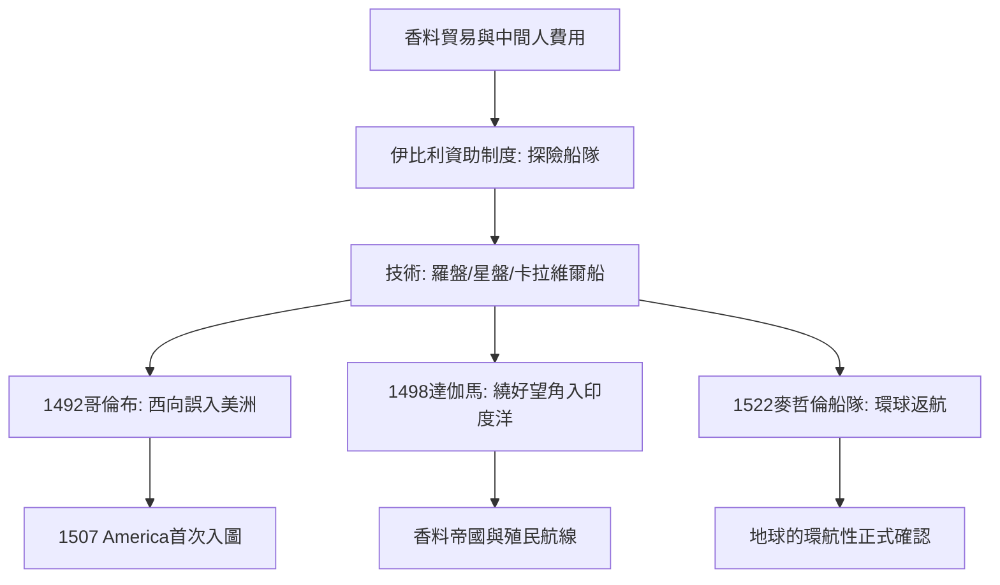

# 4.1 大航海時代粉碎地圖邊界

時間：十五世紀末至十六世紀初──哥倫布1492、達伽馬1498、麥哲倫船隊1519–22年。

## 為什麼是十五世紀的伊比利

大航海時代並不始於純粹的好奇心。葡萄牙成為先發者有三個條件：

- 經濟壓力：十五世紀的地中海貿易路線受奧斯曼勢力擴張與義大利轉口費高漲影響，里斯本想直接分食亞洲香料的利潤，必須另找航路。
- 技術累積：三項技術在此前百餘年相繼成熟──羅盤（經阿拉伯傳入）、星盤與象限儀（觀星量緯度）、卡拉維爾帆船（小型、靈活、可逆風行駛）。
- 制度化探索：葡萄牙在恩里克王子時代形成一種模式——由官方逐年資助船隊，沿非洲西岸逐步南下，返航時交付地理資訊與貿易收益。亞速爾、佛得角、聖多美、幾內亞各站由此一點點納入地圖。

也就是說，大航海不是「英雄精神」單獨促成的，而是貿易需求、可用技術與制度性資助三者合流的產物。哥倫布求的不是「新大陸」，而是一條直通東方的香料航路。

## 1492 哥倫布：被錯算的距離

哥倫布的西航論證建立在資料的誤差上：他把里程單位換算得過小，又引用了對亞洲幅員的擴大估算，於是「西航到亞洲」的距離被算得極短。1492年10月，他抵達巴哈馬的一座小島，誤認為亞洲外海。哥倫布至死堅持自己找到的是亞洲；真正把「新大陸」確立為獨立大陸的是亞美利哥·維斯普奇的航行報告（1499–1502），1507年瓦爾德澤米勒的地圖首次以「America」命名這片陸地。

## 1498 達伽馬：香料航路的開通

## 1498 達伽馬：香料航路的開通

達伽馬於1498年繞行非洲南端好望角，沿東非海岸借領航員之力渡往印度洋，5月抵達印度卡利卡特。這條航線直接打通歐亞海上貿易，葡萄牙隨後以要塞與艦隊控制沿印度洋的幾個關鍵港（果阿、麻六甲），成為十六世紀的「香料帝國」。亞洲原有的貿易網絡（阿拉伯、印度、爪哇航商）被歐洲武力重塑，這是近代世界貿易體系的起點之一。

## 1519–1522 麥哲倫船隊：地球確有其一

麥哲倫受西班牙資助，率五船由大西洋西行，在南美南端穿越以他命名的海峽進入太平洋，西向抵達菲律賓（麥哲倫於當地衝突中身亡）。殘剩的「維多利亞號」由埃爾卡諾率領，於1522年返回西班牙，完成第一次環球航行。這一壯舉不僅實證了地球的可環航性，也確認了太平洋的廣闊與美洲、亞洲之間的獨立聯繫，直接改寫世界圖。

## 迷思破除

- 哥倫布並未「證明地球是圓」：第十五世紀的受過教育者幾乎不懷疑地球為球（中世紀學者繼承希臘傳統）；真正的難點是距離估算而非形狀。
- 「環球航行」的完成者不是麥哲倫本人：他死在途中，環航一事由其殘餘船隻完成──這足以說明此行任務的危險。

世界已被航通，接下來的問題是：用什麼形式畫它。下一篇的主角，是那位把地球的圓面拉成長方形、讓「沿一條直線航行」第一次成為可能的製圖師：麥卡托。
