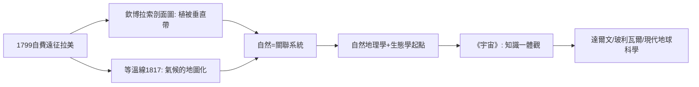

# 5.1 洪堡與植生帶與等溫線

時間：1799–1804年洪堡的拉丁美洲大探險；1807–1834年間《植物地理學論文》與《宇宙》各卷陸續出版。

## 一位自費的富家子如何改寫科學

亞歷山大·馮·洪堡（1769–1859）出身普魯士貴族，母親去世後他繼承了大筆遺產，辭去礦務官職，自費組隊遠征。1799年6月，他與法國植物學家邦普蘭登上南美洲，展開五年探險：委內瑞拉的奧里諾科河、安第斯山的欽博拉索峰（海拔6272米，當時人類登頂最高紀錄）、古巴、哥倫比亞、墨西哥。

他帶的裝備是當時最先進的氣壓計、溫度計、量雨器、經緯儀與測天儀，一路測量氣壓、氣溫、海拔、地磁、水溫與大氣成分。他不只想「看山」，而是想看「山上的所有變量如何一起變化」。

## 一座山的剖面：自然地理學的誕生

1802年6月，洪堡攀登欽博拉索。他在手記上以山體為縱軸，把不同海拔遇到的植物、氣溫、氣壓、岩石依次標注──這張著名的「欽博拉索自然剖面圖」成為科學史上的經典圖像：同一座山上，從熱帶的香蕉與棕櫚，到溫帶的橡樹，到高山苔原與雪線，物種像地層一樣排列。他稱之為「植被的垂直帶性」。

這個圖像的意義超越了分類。它說明了一件事：自然不是一袋孤立的物種，而是一個互相綁定的系統──海拔決定溫度，溫度決定植被，植被決定土壤與水，它們共同決定誰能活在哪裡。換句話說，洪堡把「自然」從「物品清單」變成「關聯網絡」，這是現代生態學與自然地理學的共同起點。

## 等溫線：把氣候變成地圖

洪堡也是第一個把溫度畫成地圖線的人。1817年他提出「等溫線」（isotherm）概念：把地球上溫度相同的各點連成線。這條線立即揭示了兩個反直覺的地理事實：

1. 緯度不等於溫度：同緯度的內陸與海濱、南北半球的同緯度地帶，溫度可差極大。氣候不是「緯度的函數」，而是緯度＋海拔＋洋流＋大陸性共同作用的結果。
2. 他由此確認了秘魯寒流（後被稱為洪堡寒流）對南美洲西岸乾旱氣候的決定性影響──將海洋與陸地的氣候連成一體。

等溫線之後，等壓線、等雨量線、等磁偏線接連出現，「把看不見的變量畫成可見的線」從此成為自然地理學的基本語法。今天天氣預報上的等壓線與氣溫色塊，語法都源自洪堡。

## 《宇宙》與「一體的自然」

洪堡晚年（1845–1862）寫《宇宙》（Kosmos），總結他一生的核心信念：自然是整體，知識也應是整體；詩歌、繪畫與科學測量是同一種「認識自然」的不同語言。這本書暢銷全歐洲，達爾文自承若無洪堡，《物種起源》的探索熱情不會被點燃；玻利瓦爾讀他的美洲遊記，深受其「殖民經濟剝削」的分析影響。他的名字被留在了數千個地名上：洪堡寒流、洪堡山、洪堡企鵝⋯⋯他去世時被稱為「繼亞里斯多德之後最偉大的博物學家」。

## 迷思破除

- 洪堡不是「殖民地探險家」的典型：他在著作中系統批判西班牙殖民制度的勞役與礦坑苛政，並在遺囑中提醒讀者注意奴隸制的不義。
- 「植被帶性」不是他憑空發明：對山地垂直分布的觀察在東西方古籍都有，他的貢獻是把它做成可測量、可比較、可複製的科學圖式。
- 他不是地質學家而是「綜合學者」：他同時測磁、測溫、測氣壓、觀星、採集植物，晚年也因此被後世視為地球系統科學的先驅。

與洪堡同時，柏林大學也有一位地理教授，他同樣相信自然與人不可分，但路徑相反──他從人類出發看自然。下一篇的主角是李特爾。
