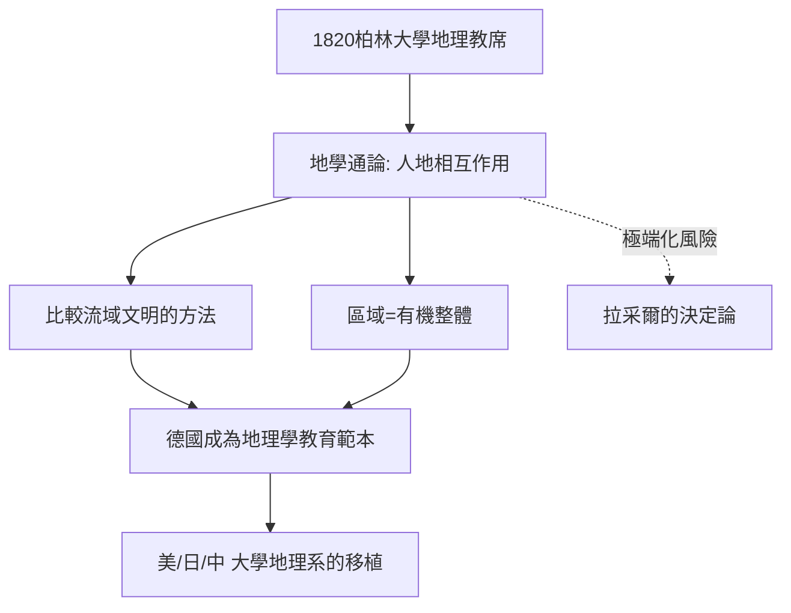

# 5.2 李特爾與人文地理學

時間：1820年起，卡爾·李特爾（Carl Ritter）在柏林大學執教地理學，直至1859年去世。

## 第一位大學地理學教授

1820年，柏林大學新設地理學教席，李特爾成為史上第一位大學地理學教授──這件事本身就是一個時代訊號：地理學從旅行見聞、貿易手冊與王室測繪部門的技藝，正式升格為大學學科。

他與洪堡同年出生（1779）、同年去世（1859），被並稱為現代地理學的雙星。兩人都反對把地理學做成「地名與物產的清單」，但路徑相反：洪堡從自然出發，測量系統；李特爾從人出發，看自然如何成為人類歷史的舞台。

## 「自然與人的相互作用」：《地學通論》

李特爾的巨著《地學通論》（Erdkunde，1817–1859）計劃寫遍全球，實際只完成了亞洲與非洲部分，但它確立了三個觀念，成為人文地理學的基礎：

1. 地理學的對象是「地球表面作為人類之家」。自然不僅是被描述的對象，而是與人類文明互相塑造的場域。
2. 比較的方法：他比較不同河川流域的文明（尼羅河與埃及、印度河與印度、黃河與中國），主張自然條件影響社會形態，但同時強調人類對環境的回應能力──同一條河，可以哺育神權農業，也可以哺育商業城市。
3. 整體的區域觀：每個地區是一個「有機整體」，自然、歷史、經濟、制度在同一地塊上互相纏繞，研究地理就是研究這種纏繞。

他最有名的一句話把職業精神說得透徹：地理學要「回到地表本身」，把大地的實際形態與人類的共同生活連起來看。

## 教育的制度效應：地理學進入大學與中小學

李特爾的講堂培養了整代地理學者，普魯士的教育制度隨後把地理學納入中小學課綱（與軍事測繪、殖民貿易的需求同時推動）。到十九世紀末，德國的地理學系統（萊比錫、柏林、海德堡）成為全世界的範本：美國早期地理學系多位創系者留學德國，日本明治時期的大學地理講座直接引進柏林模式，中國清末民初的地理教科書也多經日本轉譯德國體系。換句話說，今天大學裡「自然地理／人文地理」的分類骨架，很大程度是李特爾─柏林傳統的制度遺產。

## 一個被後世超越的時代局限

李特爾的論述也攜帶十九世紀的時代印記：他常以「進步」與「文明階梯」的線性史觀解讀各民族，把歐洲模式視為演化的較高階段。這種「目的論式的整體觀」為後來的環境決定論留了縫隙──下一位人物拉采爾將把「自然塑造人」的命題推向極端，甚至成為政治暴力的燃料。

## 迷思破除

- 李特爾不是「環境決定論者」：他強調的是相互作用與人類的自由回應，與拉采爾的決定論有本質區別；把兩人混為一談是常見的教科書簡化。
- 《地學通論》未完成並非能力不足：他的計劃是通論全球，以一人之力與十九世紀的資料條件，亞非部分已屬驚人。
- 他不是「書齋學者」：他年輕時做過家庭教師，隨學生遊歷歐洲多年，這些旅行是他方法的根基。

當「人與自然相互作用」的溫和命題遇上十九世紀末的帝國競爭，它會被翻轉成什麼模樣？下一篇的主角，是把國家看成生物體、並留下「生存空間」一詞的拉采爾。
