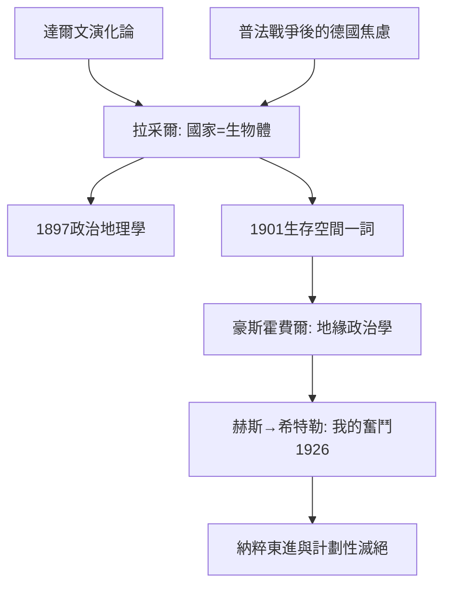

# 6.1 拉采爾與生存空間

時間：1897年《政治地理學》出版；1901年提出「生存空間」（Lebensraum）一詞。

## 從動物園管理員到政治地理學之父

弗里德里希·拉采爾（1844–1904）的學術起點不是地理而是動物學：他在慕尼黑做過動物標本管理員，達爾文《物種起源》（1859）的革命性衝擊貫穿他整個學術生命。普法戰爭（1870–71）中他從軍受傷，此後一路以記者身分觀察歐洲政治，最後在萊比錫大學成為德國第一位地理學教授。

他把兩條線索合流：達爾文的演化論＋十九世紀末的帝國競爭。結果是一本《政治地理學》（Politische Geographie, 1897），試圖為「國家」建立生物學式的理論。

## 國家是生物體：「生存空間」的誕生

拉采爾的核心命題是：國家像生物，土地像它的肢體；國家的成長需要空間，正如生物需要營養。他寫道，國家的疆界不是法律線，而是生物體與環境的接觸面，會隨擴張與衰退而移動。1901年，他在論文中正式使用「Lebensraum」（生存空間）一詞，主張人口成長的國家需要向「空閒的」土地擴張。

這個論述為什麼在當時有市場？因為它回答了德國的時代焦慮：德意志帝國統一（1871）較晚，殖民地在歐洲列強瓜分世界時所剩無幾，人口外流美國嚴重。拉采爾的理論把「我們需要更多土地」從慾望升格為「自然律」──既然是自然律，擴張就不是選擇，而是必然。

## 理論的遺傳：從拉采爾到納粹

拉采爾死於1904年，未能看到他的概念被扭曲到什麼程度。他的學生兼地緣政治豪傑豪斯霍費爾（Karl Haushofer）把「生存空間」發展為地緣政治學說；豪斯霍費爾的學生赫斯（Rudolf Hess）把這套語彙帶入希特勒的《我的奮鬥》。1926年，《我的奮鬥》第二卷明確寫入：德國的未來在東方，必須奪取俄羅斯土地作為「生存空間」。1933年後納粹的東進計劃（消滅或驅逐斯拉夫人口、德國農民殖民烏克蘭）正是這一概念的種族化執行──最終指向人類史上最大規模的計劃性屠殺之一。

這段譜系提醒我們：一個看似「自然科學式」的隱喻（國家＝生物），一旦與種族主義、帝國官僚與軍事計劃結合，其政治後果可以達到滅絕級。二十世紀的地緣政治學因此背上沉重的方法論包袱。

## 學術上的另一面

值得公允指出：拉采爾的學術貢獻不僅是「生存空間」。他是人文地理學系統化的關鍵人物──「人文地理學」（Anthropogeographie）一詞由他確立，他研究人口遷徙、城市分布、文化擴散（後來的「文化圈」理論也源於此脈絡），並且是最早把「報紙讀者分布」當作地理現象研究的學者。問題在於：他把生物學隱喻用在國家上時，缺乏任何可否證的機制，於是理論的可塑直接成為政治武器的可塑。

## 迷思破除

- 「生存空間」一詞不是納粹發明：它出自拉采爾，最初主要指生物與人口的空間需求；納粹把它種族化並用於滅絕政策，是概念的暴力挪用。
- 拉采爾本人並非納粹（他死於希特勒成名前），但他的有機體隱喻確實為後來的極端化提供了語法，這是學術史公認的教訓。
- 德國地緣政治學界在二戰後花費數十年清理這一遺產；「Geopolitics」一詞在德國學界曾長期成為禁忌，直到1970年代才逐步恢復使用。

下一篇的主角與拉采爾共享同一個時代的帝國焦慮，卻把地理變成了大戰略棋盤：麥金德與他的「心臟地帶」。
