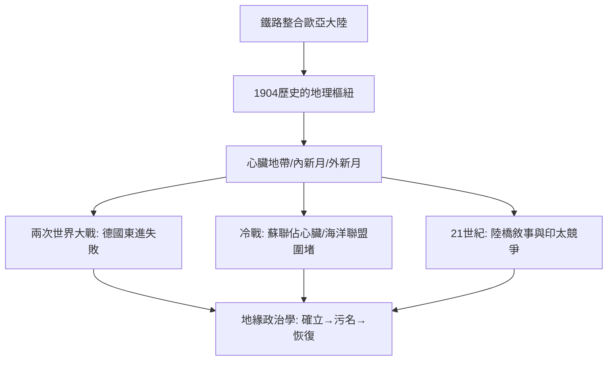

# 6.2 麥金德與心臟地帶理論

時間：1904年1月25日，麥金德在英國皇家地理學會宣讀〈歷史的地理樞紐〉。

## 鐵路時代的地理學家

哈爾福德·麥金德（1861–1947）是牛津首位地理學讀者（Reader）、倫敦政經學院（LSE）創院院長、後來的英國國會議員與駐南俄高級專員──集學者、教育家、官僚、外交官於一身。他宣讀論文的那一天，正是英國帝國焦慮的高峰：布爾戰爭剛結束，俄國在亞洲擴張，德國艦隊崛起，鐵路正把歐亞大陸內部縫合起來。

他的問題很簡單也很切身：帆船時代，海洋國家（英國）可以控制全球；鐵路時代呢？大陸內部若被一個強權以鐵路整合，海洋帝國是否會失去優勢？

## 〈歷史的地理樞紐〉：三大論點

麥金德把歐亞大陸切分為三層：

1. 心臟地帶（Pivot Area）：中亞內陸──伏爾加河到鄂畢河、裏海到蒙古。海洋力量進不去的廣大內陸。
2. 內新月形地帶：德國、奧匈、土耳其、印度、中國──心臟地帶的邊緣陸地。
3. 外新月形地帶：英國、南非、日本、北美──靠海的外圈。

核心論斷：若一個強權控制心臟地帶並以鐵路整合之，它將擁有資源、人力與不可攻入的縱深，然後逐步吃掉邊緣地帶，最後挑戰海洋世界。「誰統治東歐，誰就能控制心臟地帶；誰統治心臟地帶，誰就能控制世界島（歐亞非）；誰統治世界島，誰就能控制世界。」──這段話是他在1919年《民主的理想與現實》中完成的名句（當時加入了東歐）。

## 理論如何被歷史檢驗

麥金德理論的命運，是二十世紀大戰略的一條暗線：

- 兩次世界大戰：德國兩度嘗試向東歐與俄羅斯擴張，正是「進入心臟地帶」的實踐；兩度失敗。
- 冷戰：蘇聯佔據心臟地帶，美國以海洋聯盟（北約、島鏈）圍堵──西方戰略界實質上以麥金德的棋盤思考，圍堵政策的策士（如尼采〔Nitze〕一脈）明言受其影響。
- 後冷戰：1990年代一度被譏為「過時的陸權幻想」；但二十一世紀「一帶一路」的陸橋敘事、美中在歐亞邊緣地帶（印度洋—太平洋）的競爭，使心臟地帶語彙再度回到戰略討論。

同時也要看到它的兩個結構性缺陷：一是低估了海洋與空中力量的技術演變（航空、導彈、航運效率使「內陸不可攻入」不再成立）；二是把地理當成「永恆棋盤」，忽略了技術與制度可以改寫地理的約束力。

## 地緣政治學的確立與污名

麥金德與德國的豪斯霍費爾共享「大空間戰略」的語彙，但兩人政治命運相反：豪斯霍費爾的學說被納粹徵用，麥金德則是英國帝國的智囊。二戰後「Geopolitics」一詞因納粹污名而沉寂，1970年代起在英語學界逐步恢復──今天的地緣政治學已遠離有機體隱喻，回到資源、航線、聯盟與技術的空間分析。

## 迷思破除

- 「誰統治東歐…」的名句不是1904年的：那是1919年《民主的理想與現實》的版本；1904年的原始版本談的是「樞紐地區」（pivot area）與鐵路，尚未包含東歐三段論。
- 心臟地帶理論不是「反民主理論」：麥金德1919年的書名正是《民主的理想與現實》，他警告的是若民主國家忽視地理現實，將付出代價。
- 他不是單純的「陸權派」：他同時是海軍地理的倡導者；他的真正立場是「海陸力量平衡」的世界觀。

當地理學與帝國戰略這樣糾纏時，學科內部也開始自我反省：地理不該只是「為強權描述棋盤」，而該研究真實的人如何在真實的土地上生活並留下痕跡。下一篇的主角，是在加州提出「文化景觀」的卡爾·紹爾。
