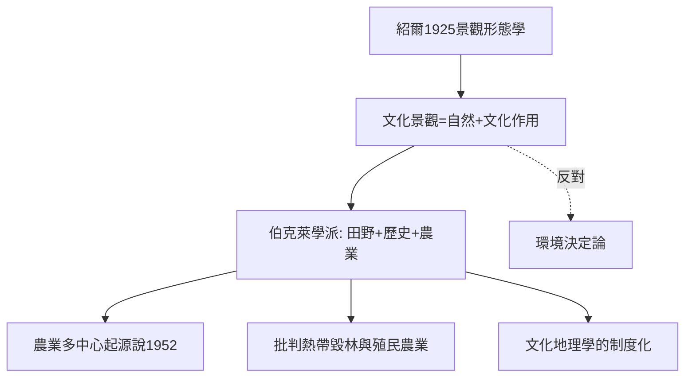

# 7.1 紹爾與文化景觀

時間：1925年〈景觀形態學〉發表；1920–1950年代伯克萊學派的成形。

## 一個從農場走出來的博物學家

卡爾·紹爾（Carl Sauer，1889–1975）生於密蘇里的德裔農家，童年在農場與荒野之間長大，後在芝加哥大學受地質與地形學訓練。1923年他到加州大學伯克萊分校建立地理系，執教近四十年，把伯克萊變成二十世紀美國文化地理學的重鎮。

他的一個著名做派：帶學生「走出教室，看土地」。他的野外方法接近博物學──徒步、觀察作物、院落、灌溉、樹種、廢墟，像地質學家讀地層那樣讀人類在大地上留下的痕跡。

## 「文化景觀」：大地上的文化刻痕

紹爾1925年的論文〈景觀形態學〉（The Morphology of Landscape）是文化地理學的奠基文本。他的核心命題可以寫成一條公式：

$$\text{文化景觀} = \text{自然景觀} + \text{文化群體的作用}$$

未經人類改動的「自然景觀」（pristine landscape）是文化的雕刻刀落下前的底版；農田、果園、梯田、牧場、村落、道路──是文化在自然之上的「媒體」。文化是一個「塑造者」（agent），自然景觀是「媒介」（medium），文化景觀是「結果」（result）。

這一命題的革命性在於它把地理學的中心對象從「自然區」移到「文化在土地上的作品」，並且明確拒絕環境決定論：不是自然決定文化，而是文化選擇性地使用自然。他舉的例子極生活化：同樣的地中海式氣候，西班牙人種葡萄與橄欖，加州人後來種柑橘與葡萄──作物組合是文化的選擇，不是氣候的命令。

## 伯克萊學派的方法：田野、歷史、農業起源

紹爾培養的學生（後稱伯克萊學派）發展出一套鮮明的方法：以田野調查＋歷史文獻＋農民訪談重建「一個地方的文化是如何一層層堆疊上去的」。他本人的兩項經典研究影響深遠：

- 《農業的起源與離散》（Agricultural Origins and Dispersals, 1952）：他主張農業不是「發明」一次，而是在多個「中心」（如東南亞、中南美洲、西亞）由定居型漁獵社會多次獨立起源。這一觀點啟發了考古學與作物遺傳學的後續研究（雖然其中一些細節後被修正）。
- 對熱帶毀林與殖民開發的批判：他早在1950年代就批判熱帶雨林的商業性濫伐與殖民單一作物經濟，被視為環境史與批判地理學的先聲之一。

## 與同代人的對比

紹爾與哈特向（見下一篇）代表了美國地理學的兩種氣質：紹爾重文化、歷史、田野與敘事；哈特向重區域差異的系統性、科學性與理論建構。兩人打過著名的筆戰（1950年代關於「地理學是系統科學還是區域綜合」），這場爭論實際上是後來「數量革命」前的學科內部總清算。

## 迷思破除

- 「文化景觀」不是紹爾原創的概念：德國學者施呂特爾（Otto Schlüter）早於1906年即提出「文化景觀」作為地理學的核心對象；紹爾的貢獻是把它系統化並在英語世界制度化。
- 紹爾不是「只懷舊的反現代派」：他的批評基於嚴謹的田野證據；他支持農民的小型多樣化農業，反對的是殖民式單一作物與濫伐，而非現代技術本身。
- 伯克萊學派不是「無理論的描寫派」：紹爾學生（如帕森斯、韋斯特等）的方法有明確的歷史生態學假設，只是理論以敘事形式呈現。

下一篇的主角，是與紹爾同代、把地理學定義為「區域差異之學」的哈特向──他是紹爾的學術對手，也是地理學作為科學的關鍵理論家。
