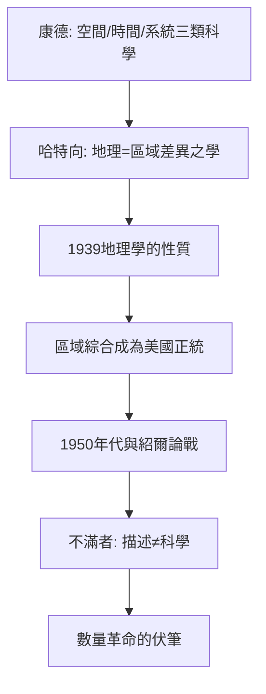

# 7.2 哈特向與區域差異

時間：1939年《地理學的性質》（The Nature of Geography）出版；1959年續作《地理學概論》。

## 一個為學科「立憲」的人

理查·哈特向（Richard Hartshorne，1899–1992）在芝加哥大學受業於地理學家巴羅斯，後任教於明尼蘇達與威斯康星大學。1939年他出版《地理學的性質》──不是教科書，而是一部學科「憲法」：他系統梳理了自康德、洪堡、李特爾、赫特納以來的地理學哲學傳統，並為美國地理學給出一個權威定義：

地理學是「對地球表面區域差異（areal differentiation）之描述與解釋的科學」。

關鍵詞是「差異」：地理學不研究「單一現象的法則」（那是經濟學、地質學的事），而研究「地表上現象的組合為何此地與彼地不同」。因此，地理學的單位是「區域」（region），其方法是「綜合」（synthesis）：把氣候、地形、土壤、作物、人口、制度在同一地塊上的相互關係整理成對「此地為何如此」的解釋。

## 哲學根基：康德的分類

哈特向的方法論骨架來自康德的知識分類：他把科學分為三類──研究現象「系統關聯」的（物理、化學）、研究「時間演變」的（歷史）、研究「空間關聯」的（地理）。地理學與歷史一樣屬於「綜合的、個體的」科學：它的對象是獨一無二的區域，而非可以重複的抽象法則。

這一定義在1939至1950年代成為美國地理學的正統：大學課程以區域研究為主軸，博士論文的標準格式是「某區域的自然＋人文綜合分析」。哈特向本人以「副產品」方式示範：他的〈美國中西部玉米帶的區域分異〉等研究，是區域綜合的範本。

## 與紹爾的筆戰

1950年代，紹爾與哈特向就「地理學的對象是否應包括『文化景觀之外的自然因素』」「地理學應偏描寫還是偏法則」展開一場公開論戰（主要在《年鑑》〔Annals〕上）。結果是一場沒有勝負的學科內部清理：兩人都堅持地理學是「綜合的科學」，差別在於紹爾偏文化史敘事、哈特向偏區域系統。這場論戰為下一場革命──「數量革命」──清出了舞台：當新一代研究者不滿於「每個區域都值得寫一本書」的描述傳統，他們將轉向尋找「空間的一般法則」。

## 哈特向遺產的兩面

哈特向的功勞是給地理學一個自洽的科學哲學定位，使它在大學制度化並與歷史學、社會學並列。他的代價也很明顯：「區域差異」作為定義，理論上很難推出可檢驗的假設；到1950年代末，新一代學者（如艾薩克〔Isard〕、加里森〔Garrison〕、貝里〔Berry〕）認為這種「綜合描述」不是科學，只是「有學問的新聞寫作」。他們要的是：能不能有「空間行為的一般法則」？──這就是下一篇的數量革命。

## 迷思破除

- 哈特向不否認「法則」的存在：他否認的是地理學應以法則為核心；他承認系統地理學（研究單一現象的分布）的價值，但堅持其科學根基在「區域綜合」。
- 「區域差異」定義不是哈特向原創：德國地理學家赫特納（Alfred Hettner）早已提出；哈特向的貢獻是把赫特納─康德傳統用英語世界可接受的方式系統化。
- 他不是「反對數量方法」的人：他反對的是「為了統計而統計」；他的問題是理論定位，不是工具偏好。

下一篇的主角，是那場把描述變成方程式的革命──1950年代的數量革命，與它留下的都市空間模型。
