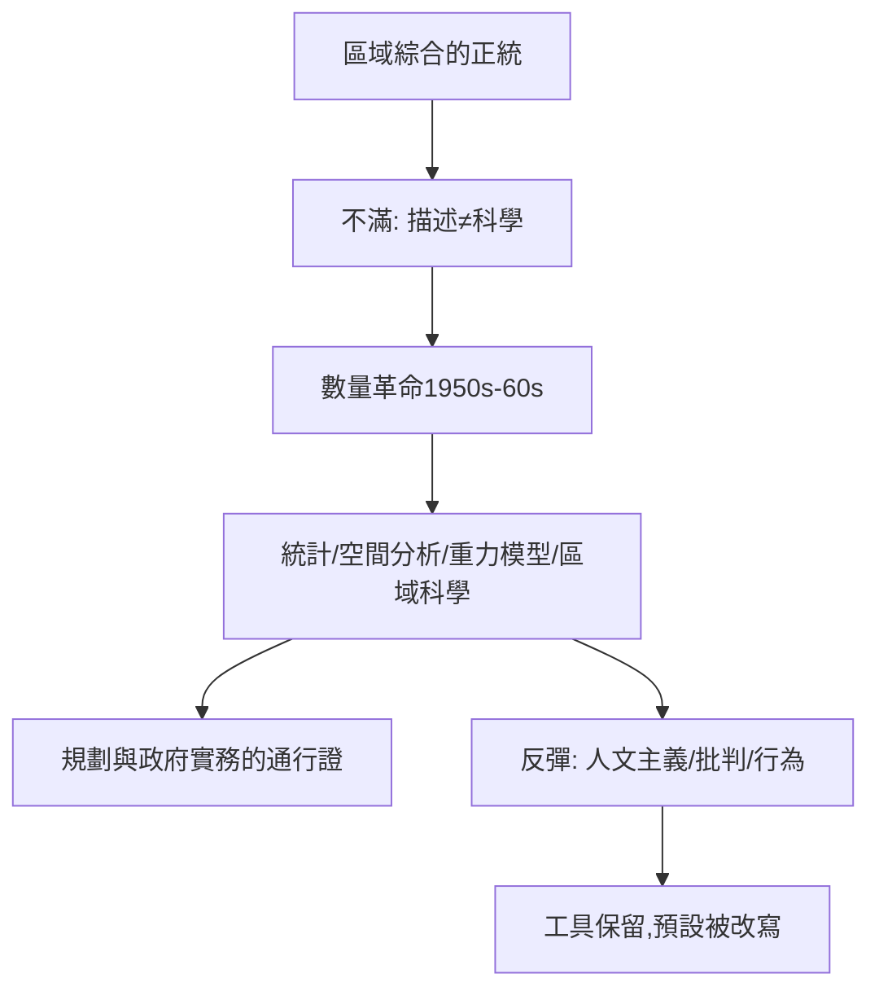

# 8.1 數量革命與空間分析

時間：1950年代中至1960年代末，美國華盛頓大學與其他中心的空間分析轉向。

## 一個不滿的世代

1950年代的美國地理學由哈特向的區域綜合主導：博士生最標準的訓練是「選一個區域，把它的自然與人文綜合寫成一本專著」。但戰後的時代在變：城市快速擴張、規劃需求爆發、軍方與聯邦機構需要可操作的預測工具，新一代研究者受過統計學與經濟學訓練，他們的問題是──「地理學有沒有一般法則？」

革命的地點在華盛頓大學（西雅圖）：地理系的加里森（William Garrison）在1950年代開設統計與運籌學的研討班，學生包括貝里（Brian Berry）、邦奇（William Bunge）、查林（Richard Chorley）等，後來幾乎全都成為學科的重塑者。他們的宣言式的觀點很簡單：地理學不該問「此地為何如此」，而該問「空間上的現象有什麼一般規律」──距離如何影響互動？城市為何如此分布？人口如何移動？

## 核心工具：從統計到模型

數量革命引入的工具箱徹底改變了學科面貌：

1. 統計推論：回歸分析、因子分析、區位商數，把「區域差異」量化為可比較的指標。
2. 空間分析：點型分布（聚落）、網絡分析（交通）、鄰近度（距離衰減），首次以幾何與代數處理「空間關係」本身。
3. 模型化：重力模型（$I_{ij}=k P_i P_j / d_{ij}^\beta$，以牛頓萬有引力類比城市間互動）、人口潛能模型、擴散模型（哈格斯特蘭〔Hägerstrand〕的創新擴散波）。
4. 區域科學：經濟學家艾薩克（Walter Isard）在1954年建立區域科學協會，把區位理論（韋伯、克里斯塔勒、廖什）與投入產出分析整合為可計算的空間經濟學。

這場革命的效果是雙向的：地理學從「描述性學門」轉向「法則性科學」，獲得了進入規劃、交通、選址、軍事後勤等實務崗位的通行證；但代價也很明顯──「人」從模型中消失了：誰在居住？誰在遷徙？模型裡只有「人口」這個變量。

## 反彈：從「空間科學」到「人」

1960年代末，反彈來自三個方向：

- 人文主義地理學（段義孚、雷爾夫〔Relph〕）：模型忽視了人的情感、意義與經驗；「空間」不等於「地方」。
- 批判地理學（哈維、史密斯〔Neil Smith〕）：模型假定自由市場與理性行為者，掩蓋了資本、階級與權力如何塑造空間。
- 行為地理學：用心理學修正「經濟人」假設，研究真實決策的有限理性。

有趣的是，這三種反彈都不否認數量方法，而是挑戰其「理論預設」。空間分析的工具保留至今（今天地理學的機器學習與空間計量經濟學是它的直系後代），但其「中立科學」的自我想像已被永久改寫。

## 迷思破除

- 數量革命不是美國單獨的：瑞典隆德的哈格斯特蘭早在1950年代就開創空間擴散模型，華盛頓大學的加里森班與英國的劍橋、布里斯托群體互相流通。
- 它不是「拒絕傳統」：多數核心模型（克里斯塔勒的中心地理論、杜能的農業圈層）直接取自十九世紀與二十世紀初的德國區位傳統；革命是「方法升級」而非「思想斷裂」。

下一篇的主角，是數量革命最古老的理論支柱──克里斯塔勒的中心地理論，以及它與都市空間模型的現代生命。
