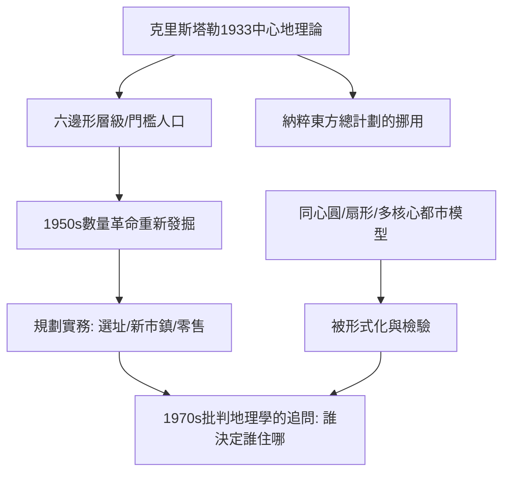

# 8.2 中心地理論與都市模型

時間：克里斯塔勒1933年《南德國的中心地》；1950–1960年代被數量革命重新發掘。

## 一位測量員的六邊形宇宙

華特·克里斯塔勒（Walter Christaller，1893–1969）不是學院教授，而是一位以自由測量與寫作維生的研究者。1933年他出版《南德國的中心地》（Die zentralen Orte in Süddeutschland），提出一套形式化的城鎮體系理論：中心地理論（Central Place Theory）。

他的問題是：為什麼德國南部的城鎮呈現某種規律的分布？他的答案建立在三個假設之上：

1. 均質平原：消費者與土地均質分布，各方向交通條件相同。
2. 理性行為：消費者到最近的中心地購買，以省下交通成本。
3. 範圍門檻：每一種商品有其「門檻人口」（最低需求量）與「最大服務半徑」（顧客願意走的距離）。

在這些條件下，不同等級的服務（日常雜貨 vs 高級專門服務）會形成層級：低級中心地數量多、間距小；高級中心地數量少、間距大。每個高級中心地同時提供下級全部服務。其幾何形式是六邊形蜂窩──六邊形是能無縫鋪滿平面而圓形服務半徑之間重疊最小的形狀。他給出三種變形（K=3市場原則、K=4交通原則、K=7行政原則），分別對應市場、交通與行政的優化邏輯。

## 一個理論的政治命運：納粹的「Reichsplanung」

克里斯塔勒的理論在1930年代末被納粹佔用：1940年前後，他加入黨衛軍策劃的「東方總計劃」（Generalplan Ost）團隊，用中心地模型規劃被征服波蘭土地上的德國殖民城鎮體系──理論的六邊形被用於安置移入的德國人、清除原有波蘭與猶太居民。這是地理學史上最黑暗的一頁之一：一個描述性的城鎮等級模型，成為滅絕性人口工程的分析工具。戰後克里斯塔勒轉向旅遊地理，1969年去世，其理論的學術生命則由英語世界接手。

## 重新發掘：數量革命的地基

1950年代，美國地理學家重讀克里斯塔勒：貝里（Brian Berry）以實證資料檢驗中心地層級（芝加哥都會區的商業中心分級），證實了其核心預測──城鎮規模分布與服務類型確有層級結構（雖然不是完美的六邊形）。中心地理論成為數量革命最堅實的理論遺產，也成為規劃實務的工具：新市鎮選址、商業設施布局、零售連鎖的選址分析，都以其為原型。

## 都市空間結構模型的平行發展

與中心地理論並行，都市內部結構的模型在美國社會學與地理學交界處成形：

- 同心圓模型（伯吉斯〔Burgess〕，1925）：城市由中心商業區向外一圈圈擴散（過渡帶、工人住宅區、中產住宅區、通勤帶）。
- 扇形模型（霍伊特〔Hoyt〕，1939）：高級住宅沿交通走廊成扇形向外伸展。
- 多核心模型（哈里斯與厄爾曼〔Harris & Ullman〕，1945）：現代大都市是多個功能核心（CBD、工業區、大學城、機場區）的組合。

這些模型在數量革命中被形式化、被檢驗、被修正；1970年代後，它們又成為批判地理學的分析對象──哈維問的不是「城市如何分區」，而是「誰有權力決定誰住在哪裡」。

## 迷思破除

- 中心地理論的假設（均質平原）注定現實不吻合：它的價值不在「完美預測」，而在揭示「服務層級」這一結構確實存在於城鎮體系中。
- 六邊形不是「設計出來的」：它是均質假設下服務範圍重疊最小的幾何必然；真實城市體系因此常近似（而非精確）呈現六邊形格局。
- 克里斯塔勒的納粹經歷長期在英語教科書中被省略；自1990年代起，學界已將這段歷史寫回理論傳播史，作為科學與政治糾纏的警示。

下一篇的主角，是把「人」重新放回地圖上的段義孚──空間如何成為地方，地方如何承載記憶與愛。
