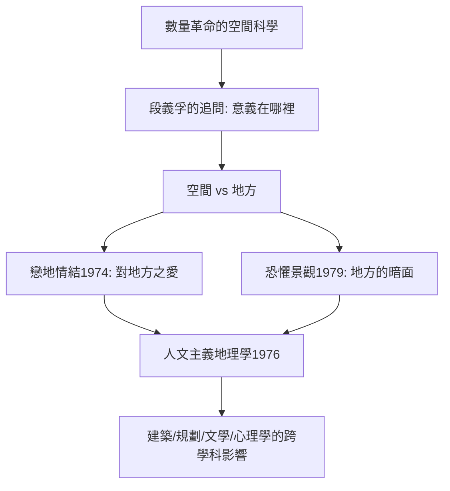

# 9.1 段義孚與戀地情結

時間：1974年《戀地情結》（Topophilia）出版；1976年〈人文主義地理學〉宣言。

## 一位戰亂中成長的地理學家

段義孚（Yi-Fu Tuan，1930–2022）生於天津，父親是外交官；童年隨家人因戰亂與公務輾轉重慶、悉尼、倫敦、牛津、伯克利──他自嘲「我一生都在搬家」，這種「無地方性」的身世，反而使他對「地方」的意義異常敏感。他先在加州大學伯克利讀地貌學，後轉向文化地理，最後在威斯康星大學麥迪遜分校執教數十年，成為人文主義地理學的奠基者。

1976年，他在《美國地理學家年鑑》發表〈人文主義地理學〉（Humanistic Geography），正式為這一取向命名：地理學不只研究「空間的物質組織」，也研究「人如何經驗空間、賦予意義、建立歸屬」。

## 空間 vs 地方：一組改變學科的區分

段義孚最著名的貢獻，是把「空間」（space）與「地方」（place）做為一對概念嚴格區分：

- 空間是抽象的、無差異的、可測量的──是幾何與座標的世界。
- 地方是被賦予意義、記憶與情感的空間──當你「知道自己在哪裡」，空間就成為地方。

一個例子說明一切：對GPS來說，「家」是一組座標；對你來說，「家」是味道、燈光、母親的聲音與安全感。同樣三十平方米的空間，被「住過」之後就成了地方。段義孚說：地方的安全感反過來意味著空間的自由──兒童先有地方（家），長大後才需要空間（世界）；旅人恰恰相反。地方與空間的張力，是人類存在的基本結構。

## 戀地情結：愛一個地方的時候

《戀地情結》（Topophilia，源自希臘文 topos ＋ philia，意為「對地方之愛」）一書考察人類感知環境的整個譜系：嗅覺、觸覺、聽覺與視覺如何塑造地方感；城市、荒野、故鄉各自召喚什麼樣的情感；從中式的風水到西方的田園理想，文化如何教導人「看」風景。

他的問題永遠是雙面的：「地方感」給人歸屬與安頓，但也可能滑向排他與狹隘。他後來的《恐懼景觀》（Landscapes of Fear, 1979）研究人類環境中恐懼的一面──鬼屋、監獄、貧民窟的污名、自然災害的想像；《逃避主義》（Escapism, 1998）則指出：人類文明的許多偉大成就（旅行、園藝、宗教、幻想）都源自「想離開此處」的衝動。地方感與逃避、歸屬與出走，永遠是一體兩面。

## 人文主義地理學在學科中的位置

段義孚的取向是對數量革命「空間科學」的直接回應（見8.1的反彈），但他的態度不是攻擊而是補充：他從未否認統計與模型的價值，而是指出它們「測不到」的東西──意義、情感、記憶──同樣是地理事實。他的文風是學界罕見的：清晰、溫柔、無學術黑話，因此其著作越出學科，成為建築學、城市規劃、文學批評與心理學的常引書。1972年他以人文地理學貢獻獲美國地理學家協會榮譽獎；2013年獲美國地理學界最高榮譽之一──瓦特林·路德獎章（Vautrin Lud Prize，有「地理學諾貝爾獎」之稱）。

## 迷思破除

- 「地方」不是「鄉愁」：段義孚明確區分「地方感」與「懷舊」；他研究的是認知與情感的一般結構，不是對過去的美化。
- 人文主義地理學不是「反科學」：它主張意義與經驗是可被系統研究的對象，只是方法不同（現象學、文本、深度訪談），而非放棄嚴謹。
- 他不是「只寫溫情」：《恐懼景觀》與《逃避主義》直面人類環境經驗的陰暗與矛盾；把段義孚讀成「田園詩人」是常見的簡化。

下一篇的主角，與段義孚同屬1970年代的反思浪潮，但從另一端切入：大衛·哈維的批判地理學──城市空間不是中性的，它是資本與權力的作品。
