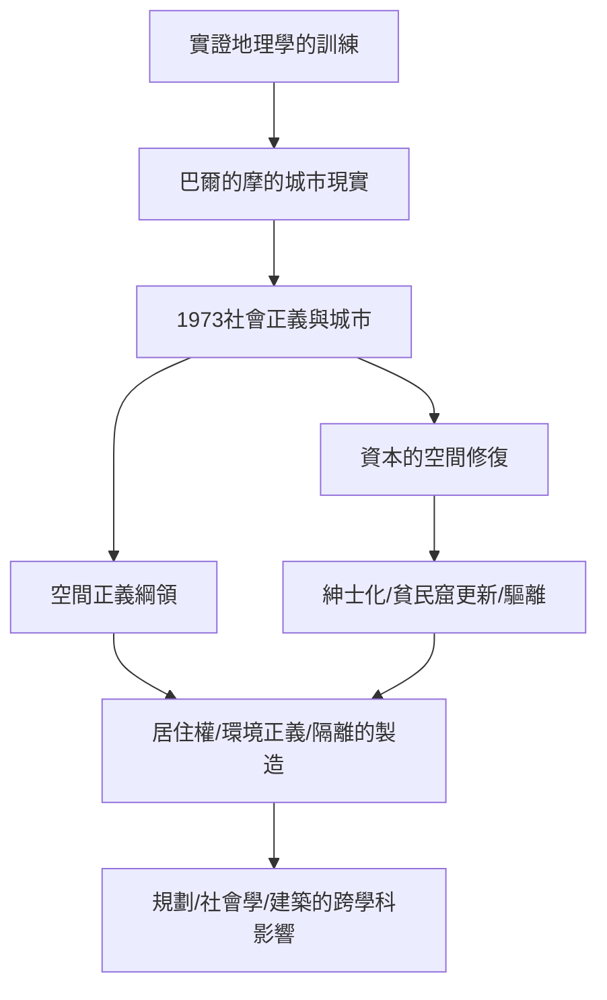

# 9.2 大衛哈維與空間正義

時間：1973年《社會正義與城市》出版；1970–1980年代批判地理學的成形。

## 從鄉村到巴爾的摩：一個地理學家的轉向

大衛·哈維（David Harvey，1935–）生於英國肯特郡，在劍橋大學受嚴格的實證地理學訓練，1969年出版《地理學中的解釋》（Explanation in Geography），是數量革命方法論的權威教科書。同年他移居巴爾的摩的約翰·霍普金斯大學──親眼目睹美國城市的種族隔離、貧民窟更新與資本主義的城市重建。

四年的轉向之後，1973年他出版《社會正義與城市》（Social Justice and the City），明確宣告：地理學不能只描述空間，必須追問「空間是如何被誰、為了誰的利益而生產的」。此後他以馬克思主義政治經濟學重讀地理學，成為批判地理學最重要的代表人物。

## 資本的空間修復：城市如何被生產

哈維的核心洞見是：資本主義有內在的過度積累危機，而解決危機的辦法之一是把資本「固定」到空間裡──修建鐵路、高速公路、下水道、摩天樓、新城。他稱之為「空間修復」（spatial fix）：資本以改變地理的方式暫時逃離危機，卻把危機推遲並放大。

城市的更新是典型過程：貧民區地價低，資本與政府聯手「更新」，原居民被驅離，地價上漲，新的資本進入──這被稱為紳士化（gentrification）。哈維追問：誰受益？誰被迫遷離？答案是結構性的：空間的生產遵循利潤邏輯，而非居住需求邏輯。他的名言「在城市裡，資本的自由是以人的不自由為代價的」表達了這個判斷。

## 空間正義：誰有權住在哪裡

從這套分析中，哈維與其後繼者發展出「空間正義」（spatial justice）的研究綱領：

- 居住權（right to the city）：列斐伏爾（Henri Lefebvre）1968年的概念，經哈維發揚──城市居民應有權參與決定城市空間如何被生產，而非僅做為消費者被安排。
- 環境正義：污染設施為何總是選在貧窮與少數族裔社區？1980年代美國的研究證實了這種系統性偏置，形成環境正義運動。
- 空間隔離的製造：從種族限制條款、紅線貸款（redlining）到高速公路選線，制度如何以「空間」為工具固化不平等。

## 影響與局限

哈維的影響是跨學科的：城市規劃、社會學、人類學、建築理論（如對新自由主義城市主義的批判）都以他為理論支柱；《新自由主義簡史》（2005）與《十七個矛盾與資本主義的終結》（2014）使他成為左翼公共知識分子的旗手。批評者則指出：他的框架過度經濟決定，對文化、性別與族群動力著墨不足；而「空間修復」的解釋力雖強，可否證性卻常被質疑。段義孚式的「意義」與哈維式的「權力」，構成1970年代後人文地理學的兩極張力──一個研究人如何愛地方，一個研究資本如何塑造地方。

## 迷思破除

- 哈維不是「否定一切空間科學」：他本人是實證方法的專家；他的批判是針對「方法中立」的宣稱，而非方法本身。
- 「空間正義」不是抽象口號：它有明確的政策內容（可負擔住宅、租戶保護、污染設施選址的社群同意權），並已在多國城市法規中落地。
- 列斐伏爾的「城市權利」不是「免費住房」：它指的是對城市空間生產過程的參與權與改造權。

當批判地理學在揭露權力的空間邏輯時，另一場革命正在把地圖變成電腦螢幕上的活資料。下一篇的主角，是把地圖從紙本變成資料庫的羅傑·湯姆林森與GIS。
