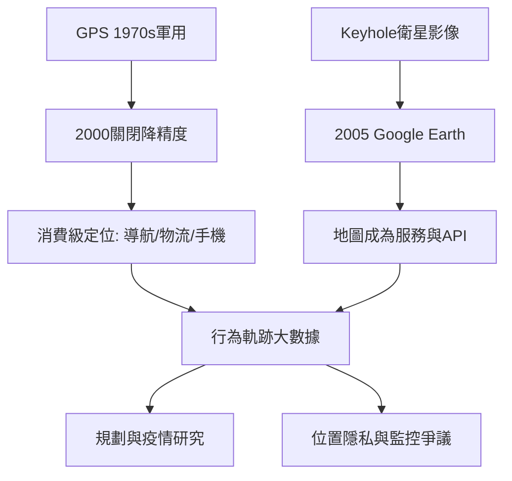

# 10.2 Google Earth GPS與數位空間

時間：2000年5月美國關閉GPS民用降精度（Selective Availability）；2005年Google Earth上線。

## GPS：把經緯度變成每個人的口袋

GPS（全球定位系統）由美國國防部自1970年代部署，24顆以上衛星繞行地球，任何人在地表任何處接收四顆以上衛星訊號，即可三角定位出自己的三維位置。關鍵的歷史節點在2000年5月1日：美國政府關閉了刻意降低民用精度的「選擇可用性」（Selective Availability），民用定位精度從百米級躍升至米級。

這項政策變更的直接後果是一場消費革命：車用導航、戶外運動、物流追蹤、手機定位（2007年iPhone及2008年Android的內建GPS）在十年內普及。今天，「我在哪裡」的回答不再需要任何專業訓練──托勒密在《地理學指南》裡建立的座標索引，被縮進了口袋。

## Google Earth：地球的界面

2001年，Keyhole公司開發的衛星影像串流技術被Google收購；2005年6月Google Earth上線──使用者可從太空一路縮放到自己家的屋頂。同時Google Maps（2005）把網頁地圖做成可拖曳、可縮放、可疊加的服務，並開放API讓第三方嵌入地圖。

其影響遠超「方便」：

- 空間認知的大眾化：數十億人第一次以衛星視角「看」自己的城市與地球，地緣政治的空間想像（領土、邊界、島嶼）進入日常視覺文化。
- 地理資料的商業化：Google 的街景車（2007起）一邊造街景一邊記錄Wi-Fi熱點；位置資料成為廣告與服務的核心資產──「你願意用位置隱私換取便利嗎」成為時代問題。
- 權力與衝突的新界面：2007年起多國軍方關注Google Earth洩露軍事設施影像；印度與中國就邊界地名的標註爭議不斷；俄烏戰爭期間，開源衛星影像（如Planet、Sentinel）與OSINT分析成為公眾可見的戰場透明化工具。

## 大數據空間：被記錄的生活

GPS＋智慧手機＋社群平台，產生了一種新型地理資料：人的「行為軌跡」。你造訪的商店、通勤路線、停留時間，構成比任何戶口普查更精細的空間資料。這帶來兩面：

- 正面：交通規劃有了即時流量、疫情接觸追蹤成為可能、城市研究從「普查十年一次」變成「即時」。
- 負面：位置資料可反推宗教場所（清真寺造訪）、就診（診所）、性傾向（特定社區）──2018–2020年美國多起「資料仲介賣手機位置給政府」的醜聞證實了這種風險；歐盟GDPR與美國州級隱私法開始規制「敏感地點」資料。

這正是10.1所說「監控資本主義下的數位空間」的具體形態：地圖不再只服務你，它也在持續記錄你。而本書第一章伊拉托斯提尼的座標網格，如今是一台持續發問「你在哪裡」的機器。

## 迷思破除

- GPS不是「免費的公共設施」那麼簡單：它由美國軍方維護，訊號可被區域性降級或干擾；歐盟的Galileo、中國的北斗、俄羅斯的GLONASS正是各國對這種依賴的回應。
- Google Earth的影像不是「即時」的：多數衛星影像有數月到數年的更新週期；「即時監看全世界」仍是科幻。
- 位置隱私不只是「個人選擇」：即使你關閉定位，基地台與Wi-Fi定位、照片EXIF、App背景請求都可能洩露位置──這是需要制度（法規）而非僅靠自覺解決的問題。

下一篇進入本書終章：人類自己已成為地質營力──人類世、氣候變遷與被重塑的邊界。
