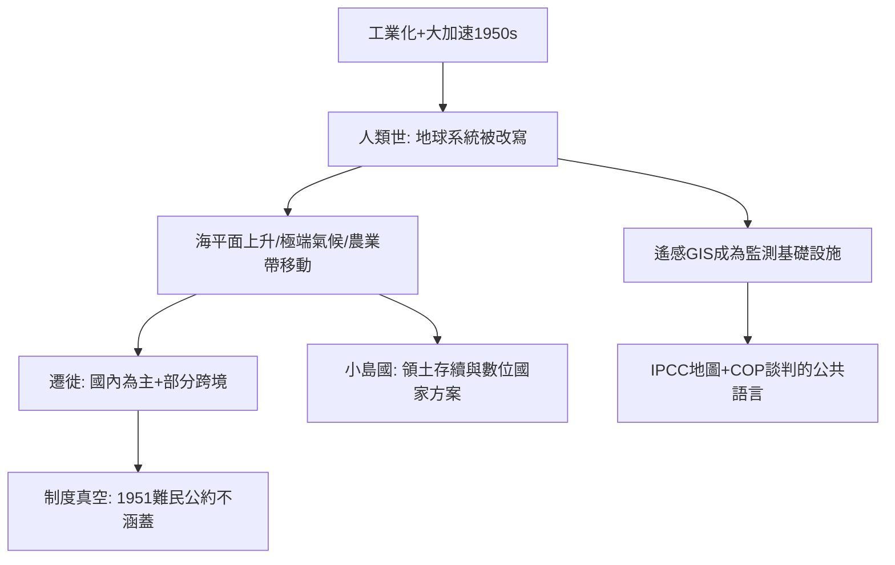

# 11.1 人類世與生態難民

時間：2000年克魯岑提出「人類世」；2010年代起，氣候遷徙成為制度議題。

## 一個新地質時代的提名

2000年，大氣化學家保羅·克魯岑（Paul Crutzen，諾貝爾化學獎得主）在科學會議上打断發言：我們已不在全新世（Holocene），人類活動已成為改變地球系統的地質營力──這個時代應稱為「人類世」（Anthropocene）。

證據涉及整個地球系統：二氧化碳濃度從工業化前280 ppm升至420 ppm以上（速率遠超地質紀錄）；合成氮肥使活性氮循環翻倍；塑膠、混凝土、鋁的總量已成為地層特徵；核彈試驗的放射性同位素（1950年代的碳-14尖峰）被地質學家視為潛在的「地層標誌」。「人類世何時開始」有農業說（數千年前）、工業說（1800年前後）、大加速說（1950年後）等主張，國際地層委員會的人類世工作組曾建議以1950年代為起點（2024年其提案未獲正式批准，「人類世」作為正式地質年代仍在審議中）──但作為描述地球狀態的概念，它已被科學界與公共領域廣泛接受。

## 海平面與極端氣候：邊界的物理重劃

氣候變遷正在以幾種方式重寫地圖：

- 海平面上升：二十世紀全球平均海平面已上升約20公分，速率仍在加快。低地三角洲（孟加拉、越南湄公河三角洲、尼羅河三角洲）與小島國（圖瓦盧、馬爾地夫、基里巴斯）面臨鹽水入侵、風暴潮加劇與長期淹沒風險。圖瓦盧等國已啟動「數位國家」計畫──把國家檔案、文化甚至「數位分身」放上雲端，作為領土可能失去時的國家延續方案。
- 極端事件：熱浪、野火（澳洲2019–20、加州近年、加拿大2023）、洪水（巴基斯坦2022年三分之一國土受淹）的頻率與強度上升，直接改變宜居性。
- 淡水與農業帶移動：冰川退縮改變大河補給（喜馬拉雅、安第斯）；農業氣候帶向極地移動，改寫糧食產區。

## 生態難民：一個制度尚缺的名詞

「氣候難民／生態難民」一詞在1985年由聯合國環境署學者提出，但它至今不是任何國際公約的法律類別：1951年《難民公約》只保護「因種族、宗教、國籍、政治見解受迫害」者，不涵蓋氣候因素。這造成一個制度真空：因海淹或旱災跨境者，在法律上是「移民」而非「難民」，缺乏強制保護。

數字爭議很大：世界銀行2021年報告估計，至2050年僅撒哈拉以南非洲、南亞與拉美三地區，因氣候相關因素而內部遷徙者可能達2.16億；多數遷徙是國內的（農村到城市），這意味著壓力主要落在城市貧民窟──空間正義（9.2）與氣候問題在此交會。

## 地理學的回應

人類世的地理學回應是雙向的：

- 分析端：遙感與GIS（第10章）成為監測冰蓋、森林、海岸線、城市擴張的基礎設施；IPCC報告的地圖與情景模型是全球氣候治理的公共語言。
- 規範端：地理學者參與「損失與損害」（loss and damage）談判的科學基礎工作；2022年聯合國氣候大會（COP27）首次同意設立「損失與損害基金」，正視已發生的不可逆損害──這是「空間正義」原則延伸到國際尺度的案例。

## 迷思破除

- 「人類世」作為正式地質年代尚未定案：2024年國際地層委員會的表決未通過 Crawford Lake 提案，「人類世」目前仍是科學論辯與公共概念，不是正式的地質分期。
- 「到2050年將有十億氣候難民」之類的數字需要小心：多數來自情景模型的推估，且定義（是否含國內遷徙）差異巨大；世界銀行的2.16億估計是最常被引用的審慎版本。
- 氣候遷徙不是「等海淹才走」：實證研究顯示多數遷徙由緩慢因素（旱災、生計衰退）驅動，且貧窮者常「走不了」──「受困人口」（trapped populations）是比「難民潮」更常見的現實。

下一篇，也是本書的最後一篇：地理學如何引導人類在動盪的地球上尋求永續棲居──這不僅是技術問題，更是空間正義的問題。
