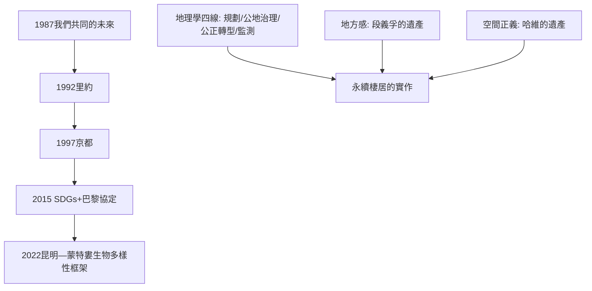

# 11.2 永續棲居與地球的重議

時間：1987年《我們共同的未來》；2015年SDGs與《巴黎協定》；2022年昆明—蒙特婁生物多樣性框架。

## 「永續發展」的發明

1987年，聯合國世界環境與發展委員會（布倫特蘭委員會）發表《我們共同的未來》，提出日後定義全球環境政治的句子：「永續發展是滿足當代需求而不損及後代滿足其需求能力的發展。」

這個定義的巧妙與曖昧同在：它把「環境」與「發展」從對立變成必須同框──既是對「保護主義要求窮國凍結發展」的回應，也是對「無限增長論」的限制。此後的國際制度化沿此推進：1992年里約地球高峰會（議定書與《21世紀議程》）、1997年京都議定書（工業國減排）、2015年兩份文件同年誕生──聯合國永續發展目標（SDGs，17項、169個指標，涵蓋貧窮、水、城市、不平等）與《巴黎協定》（把升溫控制在工業化前水準以上「遠低於2°C」，並努力限制在1.5°C）。

## 空間的重新議價：地理學的貢獻

永續問題本質上是空間問題──誰使用哪片土地、誰承擔什麼代價。地理學在此的具體貢獻有四條線：

1. 空間規劃與生態系統服務：把森林的「碳匯、水源涵養、生物多樣性」價值畫成地圖，納入土地使用決策；「基於自然的解決方案」（NbS）成為城市防洪、降溫的主流工具（如海綿城市、城市綠廊）。
2. 公地治理：歐斯特羅姆（Elinor Ostrom，諾貝爾經濟學獎得主）對漁場、牧地、灌溉系統的跨案例研究證明：在地社群的自主治理制度常常勝過「國有化」或「全面私有化」兩個極端──「地方知識＋明確邊界＋分層規則」是公地永續的實證配方。
3. 轉型正義的空間維度：化石燃料開採地（如煤炭產區）在轉型中的就業與補償（「公正轉型」，just transition）已被寫入多國法律與巴黎協定序言──空間正義原則（9.2）在能源政治中的應用。
4. 監測與透明：衛星遙感使毀林、甲烷洩漏、非法捕撈可被即時追蹤；全球森林觀察（Global Forest Watch）等平台把「看見」變成公民與企業的治理工具。

## 個人層面：住居與地方感的重建

宏觀條約之外，永續棲居也在日常尺度成形：緊湊城市與步行可達性（減少通勤碳）、社區能源（德國的能源合作社）、都市農園與食物里程、修復式農業（regenerative agriculture）。這些實踐的共同點，恰好呼應段義孚的命題（9.1）：當人們與一個地方建立深度關係（知道水的來處、土壤的歷史、鄰居的名字），他們治理這個地方的方式會改變──地方感不只是情感，也是治理資源。

## 終章回望：從丈量大地到重議地球

本書從伊拉托斯提尼以影子丈量地球開始。兩千三百年後，人類面對的問題倒轉了：不再是「地球有多大」，而是「我們的經濟與生活要如何放進地球的邊界裡」。經緯網格（托勒密）、殖民航路（麥卡托）、自然系統觀（洪堡）、文化景觀（紹爾）、空間正義（哈維）、數位地球（GIS）──這些工具如今都指向同一個任務：在物理邊界與社會正義之間，重新安排人類的棲居。

利維坦式地說：地圖永遠是權力的作品；問題是，這一次，誰來畫、為誰畫。答案不在某本書的結尾，而在每一座城市的規劃聽證會、每一片被社區守護的濕地、每一次你選擇如何抵達一個地方。

## 迷思破除

- 「永續發展」不是「繼續增長但更乾淨」那麼簡單：SDGs內部存在張力（經濟增長目標與生態上限的衝突），這是學界持續辯論的「degrowth vs 綠色增長」問題。
- 巴黎協定不是「自動達成」：各國的國家自定貢獻（NDC）總和目前仍使升溫落在約2.5°C上下；1.5°C路徑要求2035年前全球排放減半以上──制度承諾與實際軌跡之間的落差，正是當前地理與氣候政治的核心戰場。
- 「個人碳足跡」概念最初由BP石油公司於2000年代推廣，有轉移責任之嫌：系統性改變（能源、交通、土地制度）的影響遠大於個人消費選擇，兩者不應互相替代。

---

## 全書總結：四條線索的合流

回顧本書的四條核心提問，可以看到它們在終章合流：

- 世界觀的擴張（Where）：從井影算出的地球，到口袋裡的衛星視角。
- 研究焦點（What）：從繪製形貌，到自然系統、文化景觀、空間法則的綜合。
- 視角的批判（Why）：從帝國的棋盤，到揭露不平等與環境正義的武器。
- 地方的意義（Meaning）：從座標上的點，到承載記憶、歸屬與責任的場所。

地理學的故事，最終是一個學科不斷追問「誰的地表、誰的敘事、誰的未來」的故事。而在人類世，這個追問不再只是學術問題──它是每一個人棲居地球的方式。
