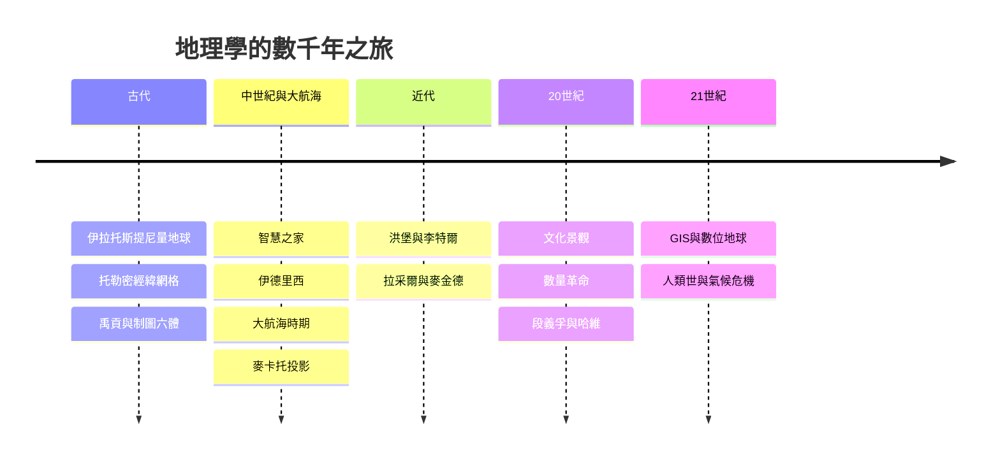

# 地理學的故事：從繪製世界邊界、征服未知海洋到數位地球的正義史詩

本書跨越數千年，講述人類如何從古文明對土地的丈量與地圖繪製開始，經歷大航海時代的地理大發現、地理決定論的爭議、空間分析革命，一路演變成結合 GIS 衛星技術、人文景觀解構與氣候變遷危機的現代綜合科學。

全書圍繞四條核心提問展開：

1. 世界觀的擴張（Where）：地方性封閉地圖 → 全球經緯網格 → 衛星與數位虛擬空間。
2. 研究焦點（What）：繪製大地形貌 → 分析自然法則 → 探討人地互動與文化景觀 → 空間結構數學化。
3. 視角的批判（Why）：地理作為帝國擴張的工具 → 地理作為揭露社會不平等與環境正義的武器。
4. 地方的意義：幾何座標上的抽象點 → 充滿人類情感、記憶與歸屬感的場所。

## 全書結構總覽

---

## 目錄

* 第1章-地圖的起源與古希臘的幾何地球（約西元前6–西元2世紀）
    * [1.1-伊拉托斯提尼量出地球](01.1-伊拉托斯提尼量出地球.md)
    * [1.2-托勒密地理學指南與未知的南方大陸](01.2-托勒密地理學指南與未知的南方大陸.md)
* 第2章-東方方志、禹貢與絲路地圖（約西元前3–西元17世紀）
    * [2.1-山海經禹貢與裴秀制圖六體](02.1-山海經禹貢與裴秀制圖六體.md)
    * [2.2-徐霞客遊記與喀斯特地貌](02.2-徐霞客遊記與喀斯特地貌.md)
* 第3章-阿拉伯世界的地點學與世界地圖（西元9–14世紀）
    * [3.1-巴格達智慧之家](03.1-巴格達智慧之家.md)
    * [3.2-伊德里西與伊本白圖泰](03.2-伊德里西與伊本白圖泰.md)
* 第4章-麥卡托投影與征服海洋的羅盤（西元15–17世紀）
    * [4.1-大航海時代粉碎地圖邊界](04.1-大航海時代粉碎地圖邊界.md)
    * [4.2-麥卡托投影重塑世界圖景](04.2-麥卡托投影重塑世界圖景.md)
* 第5章-現代地理學的雙星（西元1799–1859年）
    * [5.1-洪堡與植被帶與等溫線](05.1-洪堡與植生帶與等溫線.md)
    * [5.2-李特爾與人文地理學](05.2-李特爾與人文地理學.md)
* 第6章-地理決定論與帝國主義的影子（1890–1920年代）
    * [6.1-拉采爾與生存空間](06.1-拉采爾與生存空間.md)
    * [6.2-麥金德與心臟地帶理論](06.2-麥金德與心臟地帶理論.md)
* 第7章-區域地理學與景觀的解讀（1920–1950年代）
    * [7.1-紹爾與文化景觀](07.1-紹爾與文化景觀.md)
    * [7.2-哈特向與區域差異](07.2-哈特向與區域差異.md)
* 第8章-數量革命與地理學的實證轉向（1950–1960年代）
    * [8.1-數量革命與空間分析](08.1-數量革命與空間分析.md)
    * [8.2-中心地理論與都市模型](08.2-中心地理論與都市模型.md)
* 第9章-空間政治學與人文主義地理學（1970–1980年代）
    * [9.1-段義孚與戀地情結](09.1-段義孚與戀地情結.md)
    * [9.2-大衛哈維與空間正義](09.2-大衛哈維與空間正義.md)
* 第10章-從GIS衛星眼到演算法地圖（1960年代至今）
    * [10.1-湯姆林森與GIS誕生](10.1-湯姆林森與GIS誕生.md)
    * [10.2-Google Earth GPS與數位空間](10.2-Google-Earth-GPS與數位空間.md)
* 第11章-人類世、氣候變遷與邊界重塑（21世紀至今）
    * [11.1-人類世與生態難民](11.1-人類世與生態難民.md)
    * [11.2-永續棲居與地球的重議](11.2-永續棲居與地球的重議.md)

---

## 閱讀路線建議

- 想理解「世界觀如何擴大」：1.1 → 1.2 → 3.2 → 4.1 → 10.2
- 想理解「地理如何被政治化」：5.2 → 6.1 → 6.2 → 9.2
- 想理解「人地關係的演變」：2.1 → 5.1 → 7.1 → 11.1
- 想理解「地方的情感意義」：2.2 → 7.1 → 9.1 → 11.2
