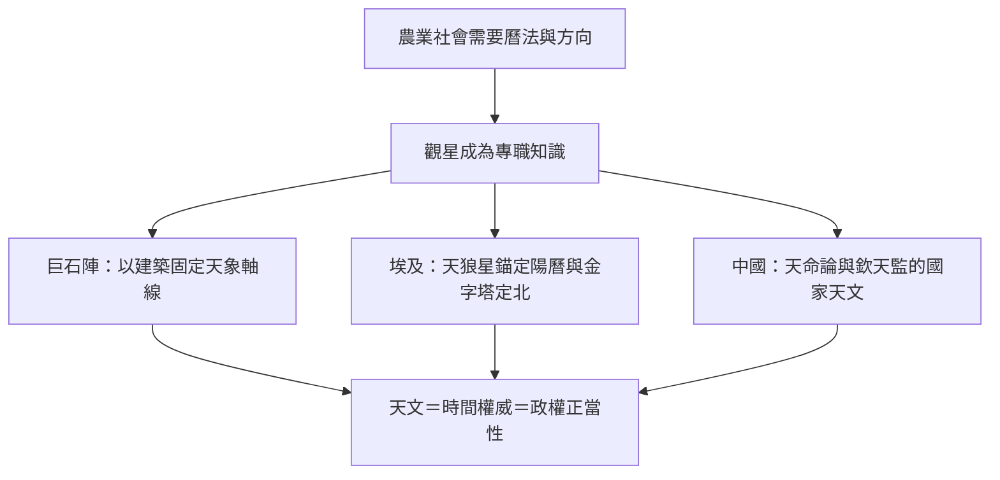

# 1.1 巨石陣與金字塔：史前與古文明的觀星術

## 為什麼人類第一門科學是天文學

在人類所有的自然科學中，天文學是唯一在文字發明之前就已有系統實作的學科。原因很實際：太陽與星辰是遠古世界唯一的時鐘與羅盤。何時播種、何時氾濫、何時遷徙、向哪個方向走，都取決於對天象規律的掌握。農業革命之後，社會需要有權威來「宣布時間」，於是觀星者成為最早的知識階層，天象與王權從此結合。

## 巨石陣：新石器時代的天文對位

英國索爾茲伯里平原上的巨石陣（Stonehenge），主體石陣約建於西元前2500年。其最著名的天文對位是：夏至那天，日出方向恰好與「大道」（Avenue）軸線及三石塔（trilithon）的排列對齊；冬至日落亦與另一軸向相合。考古學主流看法認為，巨石陣至少兼具曆法與儀式功能——它不一定是一座「天文台」，但確實是一座「以天空為對照表的建築」。對一個沒有文字的社會而言，用巨石固定天象方位，就是把曆法物質化，讓時間本身可以被一代代傳承。

## 吉薩金字塔與北極星的問題

古埃及的工程更顯示出精確的天文測量。約西元前2560年建成的吉薩大金字塔，四邊幾乎精確朝向東南西北（誤差僅數分之一度）。學者提出多種定北方法：例如利用夜晚某顆恆星升降到同一高度時的兩個方位取中線，即可得真北——這方法的好處是不依賴單一恆星，因為地球自轉軸會緩慢進動（歲差，週期約25,800年），當時的北極星並不是今天的北極星（勾陳一 Polaris）。換句話說，古埃及人必須動態地理解「北極是移動的」，這是對天球幾何的深刻掌握。

埃及的曆法同樣驚人：一年365天的陽曆，以天狼星（Sothis）與太陽同升之日預告尼羅河氾濫季的開始。天狼星的偕日升起，成為行政年度的錨點——這是把天象直接接上官僚體系與稅收的早期案例。

## 中國：天文作為國家機器

東亞傳統把天文制度化到極致。從周代的「司天」到明清的欽天監，中國歷代朝廷設有專職觀測機構，晝夜不息地記錄天象。這些紀錄的現代價值驚人：1054年宋代官史記錄的「天關客星」（白天可見、持續二十餘日），今天確認為蟹狀星雲超新星；漢代以降對太陽黑子、哈雷彗星每次回歸的記錄，都是現代天文學家回溯歷史數據的寶庫。

中國傳統的天文政治學是「天命」：異常天象被解讀為上天對施政的警告，皇帝須下詔罪己。因此天象紀錄是國家機密，民間私習天文長期受禁。天文學在這裡不只是科學，更是政權正當性的技術基礎——這與後文托勒密宇宙觀被教會接納，有異曲同工之處：誰掌握天，誰掌握解釋世界的權力。

## 理論化的等待

三大古文明解決的是「何時、何方」的實用問題。把天象變成一套幾何模型、能夠「預測」行星何時順行逆行的，是古希臘人。他們的巔峰之作——托勒密的《天文學大成》——將統治人類宇宙觀長達一千三百年。這是下一節的主題。
