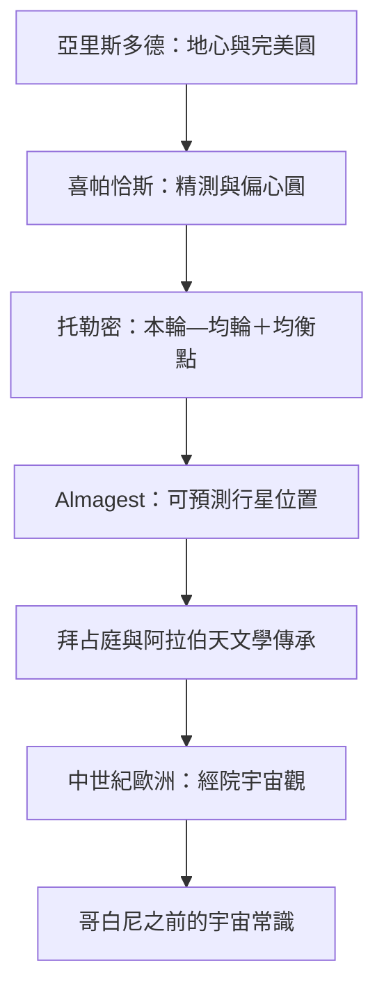

# 1.2 托勒密《天文學大成》：統治宇宙觀一千三百年的地心說

## 從幾何思辨到綜合體系

古希臘人對天象的貢獻不是觀測精度，而是提出「模型」的習慣：天象應該可以用幾何解釋。薩摩斯的阿里斯塔克斯（Aristarchus，約西元前3世紀）甚至提出過日心說與地球自轉的猜想，並估算日地距離；但主流世界觀仍以亞里斯多德為基礎：地球靜止於宇宙中心，天體由「以太」構成，沿完美的圓軌運行。

難題在於行星。行星在星空中有時順行、有時停滯、有時逆行，完美的圓軌解釋不了。西元前2世紀的喜帕恰斯（Hipparchus）以精確觀測與偏心圓（eccentric）概念改進模型；兩百年後，亞歷山卓城的克勞狄烏斯·托勒密（Claudius Ptolemy，約西元100–170年）把兩個半世紀的希臘天文學整合成一座完整的數學大廈。

## 《天文學大成》（Almagest）的內容

這部十三卷巨著原名《數學文集》（Mathēmatikē Syntaxis），阿拉伯譯本冠以「至大」（al-Majisṭī）之名，即「Almagest」的由來。它的核心發明是本輪—均輪（epicycle–deferent）系統：行星不在大圓上直接運行，而是沿一個小圓（本輪）轉動，本輪圓心再沿大圓（均輪）繞地球轉。當行星位於本輪內側時，從地球看去就出現逆行。配合偏心圓（圓心偏離地球）與後來的均衡點（equant，勻角速而非勻線速的虛擬點），托勒密可以任意逼近行星的視位置。

模型有多準？托勒密對行星位置的預測誤差在當時觀測精度內幾乎無法證偽。更關鍵的是，書中包含一份1,022顆星的星表（承襲喜帕恰斯），使《大成》同時是模型、教科書與觀測手冊。此後一千三百餘年，從拜占庭、阿拉伯世界到中世紀歐洲，所有專業天文計算都在這套體系內進行。

## 為什麼地心說這麼「耐用」

托勒密體系能長壽，不是因為教會鎮壓（它被吸收為基督教宇宙觀是後來的事），而是因為它好用。第一，它與直覺一致：我們看不見地球在動，卻看得見太陽每天移動。第二，它物理上自洽：以太與完美圓配合亞里斯多德的自然哲學。第三，它計算上精確：占星、曆法、航海都靠它。第四，它在概念上是開放修正的——天文學家可以添加本輪、修正參數，模型遇到偏差就「補一個本輪」，永遠修得下去。

這也預示了科學哲學的一課：一個理論的存活與否，取決於它能否在實務上維持「可修正的精確性」。托勒密體系直到觀測精度（第谷的儀器）與理論替代方案（哥白尼—克卜勒）同時成熟，才真正退場。

## 阿拉伯橋樑與「不完美」的裂縫

值得注意的是中間一千年的傳承：8–15世紀，阿拉伯天文學家（如巴塔尼 al-Battānī、伊本·沙提爾 Ibn al-Shatir）保存、校訂《大成》，並對月球模型與參數做出實質改進；伊本·沙提爾的月球理論與後來哥白尼的數學結構驚人地相似，顯示文藝復興時期歐洲天文學直接受惠於伊斯蘭黃金時代。同時，馬拉蓋學派（如圖西 Nasir al-Din al-Tusi）早已批評均衡點違反勻速圓周的精神——地心體系內部始終存在著「不夠完美」的批評聲浪。

## 大廈的裂縫

到15世紀，曆法問題提供了最實際的動機：儒略曆（西元前45年制定）累積誤差過大，復活節日期失準，教會亟需天文學校準曆法。天文學第一次有了迫在眉睫的「社會訂單」。而就在這個訂單上，一位波蘭教士提出了一個讓太陽取代地球的方案。下一章，就是1543年那本臨終才付印的《天體運行論》。
