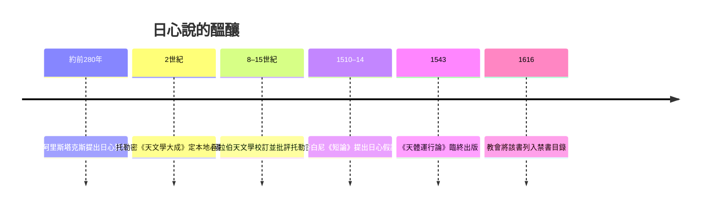

# 2.1 哥白尼《天體運行論》：1543年，太陽站上中心

## 一個拖延了三十年的革命

尼古拉·哥白尼（Nicolaus Copernicus，1473–1543）生於托倫，就讀克拉科夫與義大利的波隆那、帕多瓦，受過教法、醫學與天文訓練，回國後擔任弗倫堡教會的教士，終身以行政與醫務為業，天文只是業餘。大約1510–1514年間，他寫成《短論》（Commentariolus）的手抄小冊，提出地球自轉、地球繞太陽公轉、行星以繞日圓軌運行的七大假設。此後三十年，他持續觀測、推算、修訂，卻始終不肯出版完整的著作。

原因不難理解：日心說在當時面對三重阻力。物理上，若地球在轉，拋體應該落後、雲與飛鳥應該被甩走（這要到伽利略的相對性思想才解決）；觀測上，地球公轉應造成恆星的周年視差，卻從未測到（事實上視差小到19世紀才測得——恆星遠得超乎想像）；宗教上，聖經字面（約書亞令日停於空中）指向地球不動。哥白尼的對策是謹慎：以「假設」的形式論證，題獻給教皇保祿三世，並在序中向教會表示此書是為了改革曆法。

1543年，臨終的哥白尼終於見到《天體運行論》（De revolutionibus orbium coelestium）印成。傳說他在病榻上摸到自己的著作後去世。

## 溫和的外表，激進的內核

弔詭的是，《天體運行論》外表上極為保守。它仍使用圓軌與本輪，全書的數學結構與托勒密體系相當，哥白尼甚至沿用了均衡點的變體（他以此為恥，試圖避免）。它真正的革命只有一個動作：把太陽放進中心，讓地球降格為一顆行星。

但這一個動作產生連鎖效應：

- 恆星視差之謎有了答案：恆星極遠，視差小於觀測精度。
- 行星逆行不再是本輪的把戲，而是地球與行星各自繞日的相對運動——外行星逆行只是地球超車的自然投影。
- 天體的「等級」被重排：地球與天體同屬一類，天與地的二分開始動搖。
- 「和諧」成了新的論證語言：哥白尼認為以日為中心的安排最簡潔美麗，宇宙如鐘錶般各就其位。

這種「簡潔性即真理」的論證方式，成為此後科學革命的核心美學：克卜勒的橢圓、牛頓的萬有引力，都在追尋更簡的解釋。

## 出版、傳播與審查的弔詭

本書的出版史本身就是一段科學社會學。路德派神學家奧西安德（Andreas Osiander）受託監印，擅自加了一篇匿名前言，聲明書中內容只是「計算假設」，不必當真——這篇前言兩百年間成功為哥白尼學說提供了保護護傘。諷刺的是，《天體運行論》出版後並未立即遭禁：1616年，天主教會才在伽利略事件前夕將其列入禁書目錄（要求修正，直到1835年才解禁）。更弔詭的是經濟史的一筆：哥白尼的官方職務其實包含管理貨幣，他寫過一篇貨幣論文，早於格雷欣法則提出「劣幣驅逐良幣」的實質內容——文藝復興的知識人，常在看似不相干的領域間自由穿行。

## 半個革命的意義

史家庫恩稱哥白尼革命為「典範轉移」的教科書案例，但《天體運行論》本身其實是「半成品」：它換了中心，卻沒換幾何；預測精度與托勒密體系相當，並未立刻勝出。真正把日心說從「有趣的假設」變成「不得不信的圖像」的，是兩位與哥白尼相遇的人：一位擁有肉眼觀測史上最精確數據的丹麥貴族，一位數學貧困、靠替人算命餬口的德意志青年。他們的師徒決裂與生死傳承，就是下一節的故事。
