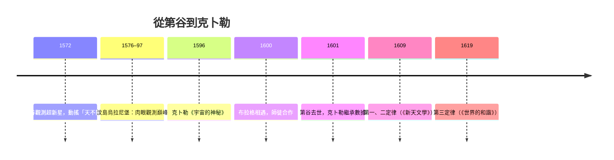

# 2.2 第谷的天文台與克卜勒三大定律：橢圓軌道的數學密碼

## 第谷：肉眼觀測的絕對巔峰

第谷·布拉赫（Tycho Brahe，1546–1601）是丹麥貴族，20歲時因觀測到1572年「新星」（今知為超新星）證明亞里斯多德「天不變」的教條有誤而聲名鵲起；1577年的大彗星觀測更顯示彗星軌道可穿越行星天層，擊碎「固晶天球」的想像。

1576年，丹麥國王腓特烈二世把波羅的海上的汶島（Hven）贈給第谷，資助他建造烏拉尼堡（Uraniborg）天文台——這是史上第一座由國家重金支持的專業天文機構，配上巨大的象限儀、渾天儀與自製的精密刻度。第谷的儀器精度達到肉眼的極限（約1角分），他對行星位置連續二十年的系統記錄，是肉眼時代最完整的觀測數據庫。

第谷本人反對日心說：他認為若地球在動，應有視差與聖經相牴觸。他提出了折衷的「第谷體系」：太陽繞地球轉，行星繞太陽轉——在數學上與哥白尼體系等價，只是保住了靜止的地球。

## 克卜勒：從替人算命到接手數據

約翰尼斯·克卜勒（Johannes Kepler，1571–1630）出身德意志符騰堡的貧困家庭，靠公費在圖賓根神學院受教。他年輕時就癡迷一個近乎神秘的想法：行星軌道的比例應與五種正多面體嵌套相合（《宇宙的神秘》，1596）。這本書寄給第谷後，第谷看出這個年輕人是唯一能善用其數據的人。

1600年，兩人相遇於布拉格。第谷以皇帝魯道夫二世的「皇家數學家」身分，雇克卜勒為助理。關係緊張而關鍵：第谷視數據為命根，克卜勒急於驗證自己的理論。1601年，第谷在宮廷宴會後急病去世（後世考證多認為死因是尿毒或相關感染，傳說與「禮儀上不忍離席如廁」有關，未必屬實），克卜勒接任皇家數據庫的繼承人——包括火星長達二十年的觀測紀錄。

## 八角分的堅持：橢圓的誕生

克卜勒選擇火星，因為它偏心最顯著、最難用圓軌套住。他先假設軌道為圓，計算出的位置與第谷觀測差了8角分（約0.13度）。若是別人，會把這誤差當觀測噪音；克卜勒卻說：既然上天賜予如此精確的觀測，我們沒有權利浪費它。他放棄圓軌，嘗試卵形，最後落在古希臘人研究過的曲線——橢圓。1609年，他在《新天文學》中發表前兩條定律：

1. 行星沿橢圓軌道運行，太陽位於其中一個焦點。
2. 行星與太陽的連線在相等時間內掃過相等面積（等面積定律）。

1619年，他在《世界的和諧》發表第三條：

$$T^2 \propto a^3$$

即行星週期的平方與半長軸的三次方成正比。諷刺的是，克卜勒為此放棄了他珍愛的正多面體模型——和諧以數學比的形式回來了，比他原本的幾何幻想更深刻。

## 為什麼這對組合不可取代

第谷與克卜勒是「數據」與「理論」的完美（且互相折磨的）配對：沒有第谷的分級精度，火星的8角分會被噪音吞掉；沒有克卜勒近乎偏執的數學執著，數據只是堆積的表格。克卜勒由此確立了近代科學的方法論原則：理論必須向觀測精度投降。這個原則將在伽利略（望遠鏡觀測）與牛頓（把克卜勒三定律從經驗規則升級為引力的必然推論）手中進一步發揚。

克卜勒晚年因三十年戰爭流離，1630年死於討債途中。他生前從未享有學術主流的地位，但他的三條定律將成為1687年《自然哲學的數學原理》的基礎數據——而把望遠鏡第一個指向天空、讓世人「看見」日心證據的，則是同一時代的另一位天才：伽利略。
