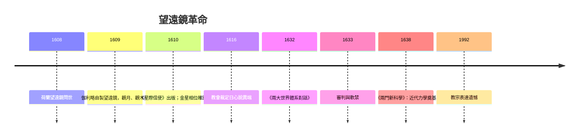

# 3.1 1609年伽利略：第一架指向天空的望遠鏡

## 一個荷蘭玩具，改變了科學

1608年，荷蘭眼鏡匠漢斯·李伯希（Hans Lippershey）申請「能看遠的鏡筒」專利，望遠鏡作為軍事觀測玩具迅速傳遍歐洲。1609年中，帕多瓦大學數學教授伽利略·伽利萊（Galileo Galilei，1564–1642）聽聞此事，未見過實物，僅憑光學原理自行磨製，數週內將放大率從3倍提升到20倍以上。8月，他向威尼斯元老院展示望遠鏡——元老們可以從聖馬可鐘樓看清海上來船，威尼斯的貿易與防務價值立現；元老院隨即將其終身教授薪水加倍。這是科學儀器第一次展現直接的經濟與軍事價值。

1609年底到1610年初，伽利略把鏡筒轉向夜空。他看到的每一樣東西，都直接打擊亞里斯多德的天觀：

- 月面：不是完美的光滑天體，而是有山有谷、明暗交界處山峰投下可測的影子——天與地是同質的。
- 木星：發現四顆衛星繞木星運轉（後稱伽利略衛星）——這是肉眼時代宇宙中從未見過的「繞行他者」的系統，直接反駁「萬物繞地球」的直覺。
- 金星：像月亮一樣有相位變化（滿相與弦相），只有在繞太陽旋轉時才可能出現——這是對托勒密體系最直接的判決性觀測（第谷體系也能解釋金星相位，但對伽利略而言，證據的重量已傾向日心）。
- 銀河：看似霧狀的帶子被分解成無數星星。
- 太陽黑子：太陽也會「變」，且黑子移動顯示太陽自轉。

1610年，他以拉丁文短著《星際信使》（Sidereus Nuncius）發表這些發現，震動全歐洲，也為自己贏得托斯卡尼大公科西莫二世（美第奇家族）的首席數學家與哲學家職位——他機智地把木星四衛命名為「美第奇之星」。

## 從觀測到判決：宗教裁判所的來臨

望遠鏡使日心說第一次擁有了「可見的證據」，但也使爭議從學術走入神學。1616年，教會裁判所裁定日心說「在哲學上荒謬、至少在信仰上異端」，《天體運行論》被要求修正；同年，伽利略被口頭警告不得公開護衛日心說。1632年，他以《關於兩大世界體系的對話》試圖折衷出版（對話形式、結論「中立」），卻被判違反1616年禁令；1633年審判，伽利略在酷刑威脅下認罪、被判終身軟禁，《對話》被禁。傳說他離庭時低語「然而地球仍在轉動」——此語無文獻實證，是後世的流傳。

值得一提的是伽利略的晚年與科學方法的遺產：軟禁期間，他完成《兩門新科學》（1638），總結自由落體與材料力學研究，奠定實驗＋數學的近代物理方法。1992年，教宗若望保祿二世正式為伽利略案的處理表達遺憾。

## 為什麼望遠鏡如此關鍵

望遠鏡革命的深層意義是「知識的民主化與工具化」。過去天文的權威在於誰看得多、算得準；望遠鏡使任何一個拿著鏡筒的人，都能親自驗證「天是完美不變的」是否為真。權威從書本與機構，轉移到儀器與公開可重複的觀測。這一轉移是科學革命的政治核心：真相不再由經院裁定，而由實證檢驗。

## 剩下的拼圖：解釋「為什麼」

到17世紀中葉，日心圖像有了觀測證據（伽利略）與軌道定律（克卜勒），卻仍缺最後一塊：行星為什麼這樣運行？誰在「推動」它們？笛卡爾的渦旋說、惠更斯的圓周力學都在競逐答案。把它一勞永逸解決的，是1665年一場瘟疫期間回鄉的劍橋學生——艾薩克·牛頓。下一節，就是1687年那本改變人類理解力的《原理》。
