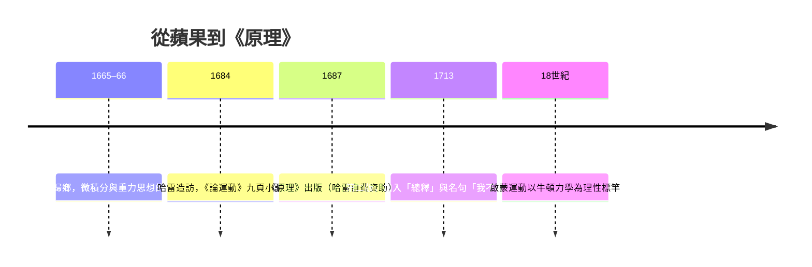

# 3.2 1687年牛頓《原理》：萬有引力統合天地

## 大瘟疫的兩年：奇蹟之年

1665–1666年，倫敦大瘟疫使劍橋大學停課，23歲的艾薩克·牛頓（Isaac Newton，1643–1727）回到故鄉烏爾索普莊園。這兩年被稱為他的 annus mirabilis（奇蹟之年）：他發展出流數術（微積分的前身）、以稜鏡實驗證明白光由彩色光組成，並開始思考一個驚人的問題——使蘋果落地（此事的「蘋果」成分後世有誇大，但牛頓晚年確曾向訪客威廉·斯蒂克利提及果園中的觸發情境）的力量，與維繫月亮繞地球的力量，是否是同一種？

問題的核心是數學：需要證明一個隨距離平方反比的力，能同時導出蘋果的落體加速（伽利略的實驗結果）與月球軌道的週期（克卜勒與觀測的數據）。牛頓當時已能粗略驗證（月地距離約60倍地球半徑，重力強度應減為1/3600，與月球「向心加速度」的數量級吻合），但精確的計算需要新的數學工具與更準的地球半徑數據，他把這個問題擱置了近二十年。

## 哈雷的敦促：《原理》的誕生

1684年初，天文學家愛德蒙·哈雷（Edmond Halley）、克里斯多福·雷恩與胡克（Robert Hooke）在倫敦討論：什麼樣的力能產生橢圓軌道？三人無法證明。哈雷專程到劍橋拜訪牛頓；牛頓答「橢圓，我算過」，並在數月後交出一份九頁的小論《論運動》（De motu）。哈雷意識到眼前的東西足以重寫物理學，他以自費編輯的承諾敦促牛頓擴寫成書——這也是科學出版史的美談：《原理》全書的出版費用主要由哈雷承擔（當時皇家學會財務困窘）。

1687年7月5日，《自然哲學的數學原理》（Philosophiæ Naturalis Principia Mathematica）出版。全書以拉丁文寫成，以幾何論證呈現（而非牛頓私下使用的微積分），結構為定義、公理（三大運動定律）、三卷命題。

## 《原理》說了什麼

三大運動定律：

1. 慣性定律：無外力時，物體保持靜止或勻速直線運動。
2. 加速度定律：$\vec{F} = m\vec{a}$（牛頓原始表述為動量變化率正比於力）。
3. 作用與反作用定律。

以及萬有引力定律：

$$F = G\,\frac{m_1 m_2}{r^2}$$

任何兩個有質量的物體，以正比於質量乘積、反比於距離平方的力互相吸引。牛頓在《原理》第一、三卷證明：由平方反比力可以推出克卜勒三定律；反之，由觀測的行星軌道可反推引力的性質。同時用同一條定律解釋潮汐、歲差、彗星軌道與地球的扁率。天地二分徹底瓦解：天上的月亮與地上的蘋果服從同一條定律。

## 「我站在巨人的肩上」與科學的社會史

牛頓與胡克的終生恩怨留下了那句名言：1676年牛頓致胡克的信中寫道「若我看得更遠，是因為站在巨人的肩上」——表面謙遜，實則尖刻（胡克身材矮小且兩人正處於優先權爭執）。這句話在科學史上被反覆引用，恰好說明《原理》的知識來源：伽利略的力學、克卜勒的定律、胡克與雷恩的引力猜想、哈雷的敦促與資助、惠更斯的擺鐘與圓周力學。科學革命不是孤膽英雄的作品，而是歐洲學術網絡（通信、爭執、出版、資助）的共同產物。

《原理》的影響遠超天文學：它確立了「數學化的因果解釋」作為科學的黃金標準，啟蒙運動直接以牛頓為偶像（伏爾泰與夏特萊侯爵夫人將其譯介到法國），拉普拉斯把太陽系變成一台完美可計算的鐘錶。兩百多年間，天體力學的成功幾乎讓人相信宇宙是完全決定論的——直到1905年，一位伯爾尼專利局職員將以新的時空觀再次顛覆它。

## 舉起望遠鏡的下一棒

牛頓不只是理論家：為解決折射鏡的色差，他於1668年製成第一架反射望遠鏡（主鏡為金屬鏡面），日後的赫歇爾、羅斯伯爵、以及現代所有大型望遠鏡（包括哈伯與韋伯）都走在牛頓式反射的技術譜系上。帶著這條譜系，我們進入18世紀：一位德意志裔音樂家將在英國以自磨的望遠鏡，看到太陽系的第七顆行星。
