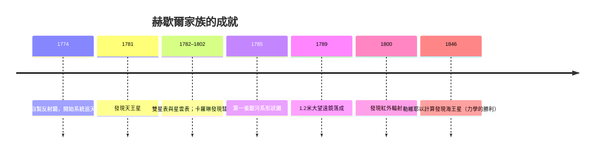

# 4.1 赫歇爾：發現天王星與描繪銀河的磨鏡師

## 樂手的副業

威廉·赫歇爾（William Herschel，1738–1822）生於漢諾威，19歲移居英國謀生，職業是音樂家：管風琴師、樂團指揮、作曲家（一生作有交響曲與大量器樂作品）。26歲那年，他讀到一本音樂理論書背後附的天文學入門，從此入迷。他有嚴格的職業纪律：白天教音樂，夜晚觀星；買不起大鏡，就自己磨。他在妹妹卡羅琳·赫歇爾（Caroline Herschel，1750–1848）的協助下，發展出當時世界第一流的反射鏡磨製工藝，先後製成數百面反射鏡，最著名的是1789年完成的1.2米口徑、12米焦距的「大望遠鏡」——四十餘年間世界最大的望遠鏡。卡羅琳本人後來也發現多顆彗星與星雲，是史上第一位受薪女性天文學家。

## 1781年3月13日：太陽系多了一顆行星

那天夜裡，赫歇爾在巴斯自家後院，用口徑6.2吋的反射鏡巡查雙星時，注意到雙子座附近一個不同於恆星的盤狀天體。他起初（謹慎地）記為彗星；隨後的軌道計算顯示，這是繞太陽公轉的行星——太陽系的第七顆行星，後命名為天王星（Uranus）。

這個發現的意義超出一顆行星：自古人類認知的行星只有五顆（肉眼可見的水金火木土），哥白尼與克卜勒的世界仍以這五顆為限。天王星證明太陽系比古人所知更大、更豐富，也證明「業餘者＋自製望遠鏡」可以做出劃時代發現。英王喬治三世任命赫歇爾為皇家天文學家（他起初把新行星命名為「喬治之星」向國王致敬），並資助其後續工作——天文學第一次在英國成為有王室預算的專業。

天王星的發現還帶來一條隱藏線索：它的軌道總是「跑不準」，偏差大得無法用已知行星的攝動解釋。1846年，勒維耶與亞當斯以純力學計算預言了一顆更遠的行星，柏林天文台按圖索驥在預報位置1度內找到海王星——「以筆尖發現行星」成為牛頓力學最壯觀的勝利（此處是《原理》故事的下回分曉）。

## 銀河的輪廓：統計天文學的誕生

赫歇爾的第二項革命是方法：他不再只看個別天體，而是系統地「數星星」。他沿不同天區方向清點望遠鏡視野中的恆星數目，假設恆星大致均勻分布，則某方向星星多＝該方向銀河系延伸得遠。1785年，他據此畫出第一張銀河系形狀圖：一個扁圓的磨盤狀系統，太陽位於中心附近。

結論有對有錯：形狀對（銀河確是盤狀系統），位置錯（太陽並非中心——此誤要到1918年沙普利以球狀星團測量才矯正）。但「以計數重建看不見的結構」這個方法論，是天文統計學的起點，也是20世紀銀河系研究的原型。赫歇爾還系統編製雙星表與星雲星團表，發現紅外輻射（1800年以溫度計測量太陽光譜紅端之外的熱），並提出「星雲可能是宇宙島」（galaxies）的猜想——這個猜想要到170年後才被證實。

## 從「是什麼」到「是什麼做的」

赫歇爾時代的天文學回答「天上有什麼、在哪裡、怎麼動」。但一個更深的問題無法用望遠鏡的成像回答：恆星是什麼做的？溫度如何？在燃燒什麼？距離多遠？這些問題的答案藏在星光的一個微妙性質裡——顏色與光譜。下一節，一位德意志鏡片師在太陽光譜裡畫出的細線，將成為恆星的化學身份證。
