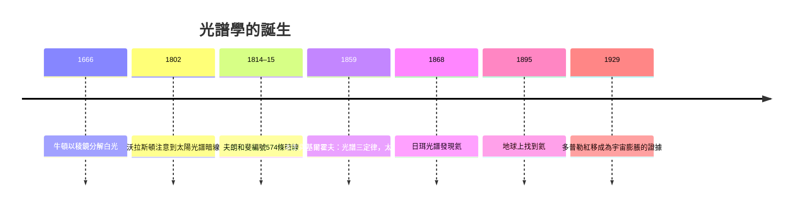

# 4.2 夫朗和斐與基爾霍夫：光譜——恆星的化學身份證

## 從牛頓的彩帶到暗線之謎

1666年牛頓以稜鏡證明白光由彩色光組成，但他看到的太陽光譜是連續的色帶。1802年，英國化學家沃拉斯頓在太陽光譜中注意到幾條暗線，以為是色界；真正的系統發現來自德意志的玻璃工匠。

約瑟夫·夫朗和斐（Joseph von Fraunhofer，1787–1826）出身悲慘（孤兒、玻璃學徒，傳說其作坊倒塌時被巴伐利亞選帝侯親手從瓦礫中救出），在慕尼黑的烏特施奈德光學作坊成長為世界最頂尖的光學工藝家，磨製出當時最好的稜鏡與消色差透鏡。1814–15年，他為了給透鏡提供精確的校準波長，用自製的分光儀檢視太陽光譜，發現並編號了約574條暗線（後稱夫朗和斐線，其中A、B、C、D……的命名沿用至今）；他也在金星與恆星光譜中看到類似暗線。他不知道這些線是什麼，只把它們當作精確的「標尺」——這個實用主義的錯誤，反而使暗線被精確測量、記錄、傳世。

夫朗和斐1826年39歲死於肺結核（可能與玻璃作業的化學暴露有關），他至死不知道自己握著的是恆星的化學身份證。

## 基爾霍夫的三定律與「天上也有鈉」

答案要等到四十多年後的實驗室。1859年，海德堡的本生（Robert Bunsen）與基爾霍夫（Gustav Kirchhoff）合作研究火焰光譜：不同元素受激發時發出特定波長的明線（如鈉的雙黃線），且特定元素的蒸氣會從連續光譜中「吸走」同樣波長的光形成暗線。基爾霍夫據此提出光譜三定律：

1. 熱的稠密物體發連續光譜。
2. 熱的稀薄氣體發離散明線光譜，線的位置由元素決定。
3. 較冷氣體置於連續光源之前，在相同波長處產生暗線（吸收光譜）。

用三定律讀太陽：太陽內層是高溫連續光源，外層較冷的氣體（色球與光球上層）吸收特定波長——暗線即外層大氣的元素指紋。基爾霍夫在太陽光譜的D線位置找到了鈉的印記，隨後鐵、鎂等逐一對上。這是天文史上里程碑式的時刻：人類從未離開地球，卻確知恆星是由與地球相同的元素構成。哲學上這是哥白尼原則的化學版：天與地同質。

1868年，法國天文學家讓桑與英國的洛基爾各自在日食的日珥光譜中發現一條地球元素對不上的黃線，猜測是太陽獨有的新元素，命名為氦（helium，源自希臘語「太陽」）。27年後（1895年），拉姆塞在地球的釔鈾礦中找到氦——一個元素先在恆星上被「發現」，再於地球上被找到，光譜學的勝利達到頂點。

## 多普勒效應：量出宇宙的速度

1842年，奧地利物理學家多普勒提出：波源移動會造成觀察者接收頻率的偏移。光譜學使這原理成為天文測速計：譜線整體偏紅（波長變長）表示光源在遠離，偏藍表示接近。1868年哈金斯測得天狼星的視向速度，開啟「光譜測速」時代。這把看似純技術的工具，將在1929年成為測量整個宇宙膨脹的鑰匙——沒有夫朗和斐的暗線，就沒有哈伯定律。

## 天體物理學的到來

光譜學把天文學從「定位與運動」升級為「物理與化學」：恆星溫度、成分、密度、視向速度、乃至自轉，都可從星光讀出。這門新學科獲得新名字——天體物理學（astrophysics）。有了它，20世紀的天文學家才能追問：恆星為什麼發光？能量從哪來？恆星如何誕生與死亡？而這些問題的解答，需要一場物理學自身的革命——1905與1915年，愛因斯坦的兩次相對論。那將是下一章的故事。
