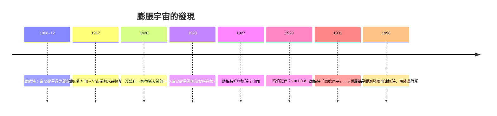

# 5.2 1929年哈伯：宇宙在膨脹

## 一場「宇宙尺度」的戰爭

20世紀初，天文界激烈爭論「星雲」（nebulae）的本質：它們是銀河系內的氣體雲，還是銀河系之外的「宇宙島」？1920年4月，美國國家科學院舉行了著名的「沙普利—柯蒂斯大辯論」：柯蒂斯（Heber Curtis）主張旋渦星雲是遙遠的獨立星系；沙普利（Harlow Shapley）則主張它們在銀河系內，且銀河系就是整個宇宙。

決定性證據來自威爾遜山天文台——當時世界最大的2.5米（100吋）胡克望遠鏡。1923年10月，愛德溫·哈伯（Edwin Hubble，1889–1953）在仙女座星雲（M31）中找到造父變星（Cepheid variable）。造父變星的週期與光度有固定關係（1908–12年亨莉愛塔·勒維特發現的週光關係），因此可作為「標準燭光」量距。哈伯測得該造父變星距離遠超銀河系尺度——仙女座是獨立星系。哈伯在底片上寫下激動的註記「VAR!」。1924年公布結果：宇宙是由無數星系構成的，銀河系只是其中之一。這是哥白尼革命的最後一擊：人類的位置，從宇宙中心一路退到一個普通星系裡的普通恆星旁的普通行星上。

## 紅移與距離：膨脹的直線

哈伯接著回答更深的問題：星系在動嗎？斯利弗（Vesto Slipher）早在1910年代已測得旋渦星雲光譜的紅移，多數星系在遠離我們，且速度高得驚人（部分逾每秒千公里）。哈伯與助理米爾頓·哈馬森（Milton Humason）系統測量更多星系的距離與紅移速度，1929年發表那篇著名論文：星系退行速度與距離成正比。

$$v = H_0 \, d$$

即哈伯定律，$H_0$ 為哈伯常數。所有遙遠星系都在遠離，且越遠的退得越快——這不是地球位居「爆炸中心」的證據，而是空間本身在均勻膨脹的結果（想像氣球上的點，互相遠離，無一點特殊）。哈伯本人謹慎，並未宣布「宇宙在膨脹」的結論；把它與理論對接的是勒梅特（Georges Lemaître，比利時神父兼物理學家）：他在1927年已從弗里德曼的廣義相對論解推導出類似的速度—距離關係，並於1931年提出「原始原子」假說——宇宙從一個極熱極密的起點膨脹而來，即大爆炸模型的雛形。

## 對愛因斯坦的平反

膨脹宇宙使愛因斯坦在場方程中加入的「宇宙常數」（cosmological constant Λ，1917年為了得到靜態宇宙解而手動加入的項）顯得多餘；愛因斯坦對勒梅特說這是他「一生最大的錯誤」（此語出自勒梅特的轉述）。歷史的弔詭在1998年：兩個超新星觀測團隊發現宇宙膨脹在加速，需要一個推動加速的暗能量——而Λ正是最自然的數學形式。宇宙常數以另一種身分復活，成為當代宇宙學的中心謎題。

## 為什麼這條直線重要

哈伯定律把宇宙從「靜態永恆」改寫為「有歷史的動態系統」。既然星系在遠離，往回推，宇宙有一個起點；既然在膨脹，就必須回答：多老？未來如何？宇宙學第一次成為可以用觀測檢驗的科學（哈伯常數的準確測量直到1990年代哈伯望遠鏡的「關鍵計畫」與2000年代WMAP／普朗克衛星才臻於精確）。同時，星系的紅移使我們能繪製宇宙的大尺度結構，而望遠鏡也因此面臨新的使命：看得更遠、更暗、更早——這直接催生了20世紀後半的巨型地面望遠鏡、以及把望遠鏡送上太空的決心。

但在人類能造出太空望遠鏡之前，得先解決另一個更基礎的問題：怎麼離開地球？答案藏在一個被體制拒於門外的俄國教師、與一個在自家果園炸出火球的麻省教授身上。下一章，火箭的誕生。
