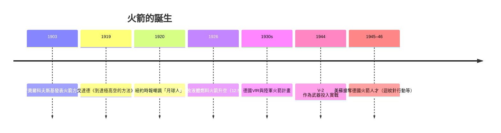

# 6.1 齊奧爾科夫斯基與戈達德：火箭方程式與液態火箭

## 俄國教師與他的方程式

康斯坦丁·齊奧爾科夫斯基（Konstantin Tsiolkovsky，1857–1935）生於俄國梁贊，少年因病幾乎失聰、無法正規就學，靠自學成為中學數理教師，一生大部分時間在博羅夫斯克與卡盧加的小鎮度過。1903年，他在《科學評論》發表《以反作用裝置探索宇宙空間》，提出改變太空史的公式：

$$\Delta v = v_e \ln\frac{m_0}{m_f}$$

即火箭速度增量等於噴氣速度乘以質量比的對數。這條「齊奧爾科夫斯基火箭方程」揭示了一個殘酷的現實：化學火箭的噴速有限，要達到軌道速度（約每秒7.9公里）必須攜帶遠超載荷的推進劑——所以火箭必須「多級」：用完的空殼要拋棄，以提高質量比。多級火箭、液氫液氧作為最高能推進劑的構想，都是他首先系統提出的。

齊奧爾科夫斯基還寫下被後世奉為太空時代精神的宣言：「地球是搖籃，但人不能永遠生活在搖籃裡。」他是純粹的紙上英雄——從未親手造出飛上天的火箭，蘇聯在生前幾乎不重視他；但他教育出的思想譜系（包括後來設計Sputnik火箭的科羅廖夫所敬仰的傳統），使他被尊為蘇聯太空計畫的理論之父。

## 戈達德：果園裡的第一響

羅伯特·戈達德（Robert Goddard，1882–1945）是美國麻州人，16歲讀威爾斯的《月球歷險記》後立志造火箭。1907年就讀克拉克大學起，他以固體火箭做實驗；1919年發表《到達極高空的方法》，計算火箭到達月球所需的條件，被媒體嘲諷為「月球人」（《紐約時報》1920年社論譏其不懂基本物理——因為真空中火箭無處「蹬地」推進；該報到1969年阿波羅登月前夕才鄭重收回此論）。這個公開羞辱使他此後極度保密。

1926年3月16日，在麻州奧本姑媽的農場雪地裡，戈達德點燃了人類第一枚液體燃料火箭（液氧與汽油），飛行2.5秒、高度約12.5米、距離56米。這短短一飛，是齊奧爾科夫斯基構想的第一次物質化。他隨後發明並驗證了現代火箭的關鍵組件：渦輪泵、慣性導航用的陀螺儀控制、推力向量控制、多級火箭概念（1932年專利）。1930年代，他的實驗地遷往新墨西哥的羅斯威爾，達到近每秒超音速、數公里高度的飛行。

## 德國接棒：V-2 的誕生

戈達德的成果在美國幾乎無人問津（1920–40年代，軍方與學界對火箭興趣寥寥），卻在德國開花。柏林工業學生的「太空飛行協會」（VfR）成員包括年輕的沃納·馮·布朗（Wernher von Braun）；1930年代，德國陸軍彈道部門資助火箭研究，最終製成A-4——即V-2火箭：單級、液氧酒精、推力約25噸、射程300公里、速度超音速五倍。1944年起納粹德國向倫敦與安特衛普發射逾3,000枚V-2，每枚的生產伴隨米特爾瓦克集中營強制勞工的血債（估計逾萬名勞工死亡）。

火箭技術的道德悖論自此確立：這項夢想本是為了飛向行星，第一批成熟的載具卻是殺人武器。戰後美蘇競相搶奪德國火箭人才與資料：美國的「迴紋針行動」把馮·布朗等百餘名工程師帶到美國（馮·布朗成為陸軍紅石兵工廠與後來NASA馬歇爾中心的靈魂人物），蘇聯則接收德國工廠與部分人員。冷戰的太空競賽，兩邊的起跑線都是V-2。

## 政治的燃料

值得注意的是火箭為何能從玩具變成國家工程：不是科學好奇，而是武器競賽與意識形態對抗。齊奧爾科夫斯基的理論在斯大林時代被重新發掘，作為「蘇聯人民先於西方想像太空」的意識形態資產；美國在1950年代則以火箭運載核彈頭為優先。當1955年，美蘇先後宣布將在「國際地球物理年」（IGY，1957–58）發射人造衛星時，兩國的本意都是展示飛彈實力。誰先發射？下一節的答案是：一個直徑58公分的鋁球，讓全世界聽見了太空時代的啼叫。
