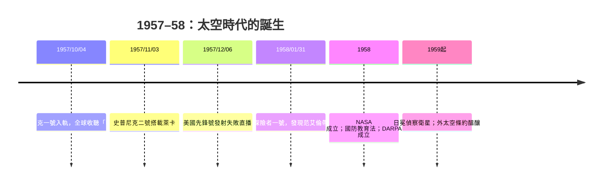

# 6.2 1957年史普尼克一號：太空時代與冷戰競賽的開端

## 一顆83.6公斤的鋁球

1957年10月4日，蘇聯以R-7火箭從哈薩克拜科努爾發射場，將「史普尼克一號」（Sputnik 1，俄語意為「旅伴／衛星」）送入軌道。這是一顆直徑58公分、重83.6公斤的拋光鋁合金球，裝著兩台無線電發射器，每0.3秒發出一次「嗶—嗶—」的信號，持續21天，直到電池耗盡；它在軌道上飛了三個月，於1958年1月燒毀於大氣層。

技術上，史普尼克是樸素的：沒有相機、沒有實驗儀器，只有無線電信標。但它的政治與心理衝擊是核彈級的。全世界業餘無線電愛好者都能收到蘇聯衛星飛越自己頭頂的信號；《紐約時報》與美國各大報以頭版報導，美國國會連日舉行緊急聽證，「導彈差距」成為大選議題。人們想的很直接：能把83公斤衛星送上天，就能把核彈頭送到紐約。蘇聯的火箭是從洲際飛彈改裝的（R-7），這在當時是事實。

## 美國的雙重屈辱與制度性回應

兩個月後（1957年12月6日），美國海軍先鋒計畫（Vanguard）的電視直播發射以火箭在發射台上爆炸告終，報紙譏之為「弗洛普尼克」（Flopnik）。美國政府隨即展開一連串制度性建設，其影響延續至今：

- 1958年2月：成立國防高等研究計畫局（DARPA）。
- 1958年7月：《國家航空暨太空法》通過，10月1日正式成立國家航空暨太空總署（NASA）——把陸軍、海軍、NACA的分散資源整合為民用太空署。
- 1958年：《國防教育法》大舉投入科學數理教育——史普尼克直接改寫了美國的課綱與獎學金體系。
- 1958年1月31日：陸軍（馮·布朗團隊以紅石火箭改裝的丘比特-C）成功發射美國第一顆衛星「探險者一號」，其搭載的蓋革計數器由范艾倫（James Van Allen）設計，發現環繞地球的輻射帶（范艾倫帶）——美國第一顆衛星就做出了真正的科學發現，挽回顏面。

## 史普尼克的姐妹與動物先驅

1957年11月3日，蘇聯發射史普尼克二號，搭載小狗萊卡（Laika）——第一個進入地球軌道的活體。計畫設計時並未考慮回收，萊卡死於發射後數小時內的過熱（蘇聯官方長期說法為缺氧安樂死，2002年資料揭露真相）。這一悲劇揭示了載人航天的核心問題：生命如何在火箭的震動、過載與真空中存活。1958年起，蘇聯以狗（多次成功回收）驗證生保系統；美國則用黑猩猩漢姆（Ham，1961年1月）驗證逃逸與操縱。動物試驗為加加林與謝潑德鋪好了軌道。

## 為什麼衛星是「信任技術」

史普尼克還意外解決了一個國際法難題：若衛星飛越他國領空是侵犯主權，太空競賽將處處受阻。蘇聯率先發射，反而確立了「軌道即過境許可」的先例；美蘇1959年聯合國提案（後成1967年《外太空條約》的基礎）確認外太空不得主張主權。太空從誕生之初就被制度性地設計為「全人類的公共領域」——儘管其實際動機是軍事偵察的便利（雙方都需要公開的偵察衛星權利）。1960年8月，美國第一顆「日冕」偵察衛星成功回收膠片，太空正式成為冷戰情報戰的主戰場。

## 赫魯曉夫的下一張牌

蘇聯在1957年的雙重勝利（洲際飛彈＋衛星）使赫魯曉夫意識到「太空宣傳」的價值：便宜、看得見、全球震撼。1959年，月球二號撞擊月面（第一個抵達月面的人造物）；1960年，月球三號拍下月球背面照片。當1960年美國總統大選，年輕的參議員甘迺迪以「導彈差距」議題攻擊艾森豪時，沒有人預料到：不到一年後，他將做出一個讓美國押上國家運氣的承諾——十年內，把人送上月球，並安全帶回。
