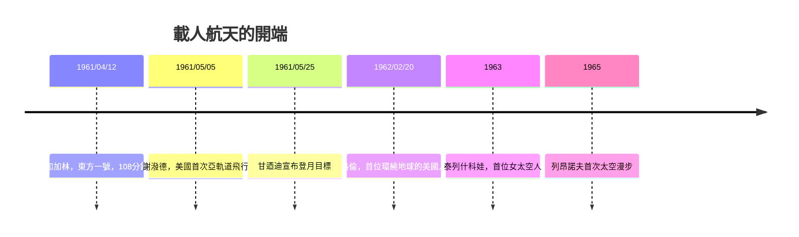

# 7.1 1961年加加林：第一位進入太空的人類

## 東方號：保密的低調與全球的轟炸

1961年4月12日，蘇聯哈薩克的拜科努爾發射場，27歲的空軍少校尤里·加加林（Yuri Gagarin，1934–1968）搭乘「東方一號」（Vostok 1）升空。飛行全長108分鐘，繞地球一圈，最高軌道約327公里；重返大氣層後，加加林依設計彈射離艙、以降落傘落地（此細節當時保密，因國際航空聯合會要求飛行員需與飛行器一同著陸才承認紀錄）。

蘇聯刻意壓低預熱：發射前幾乎無預告，入軌後數小時才由塔斯社正式公布。但當消息傳出，全球媒體的轟動遠超史普尼克——這次是人，是一個名叫尤里的年輕人替全人類走出了搖籃。莫斯科以盛大儀式迎接，赫魯曉夫立即將他升為少校（降落後三小時），並安排他巡迴全球數十國；「尤里！」成為當年世界的流行語。聯合國、古巴、印度、埃及——冷戰雙方都在爭奪這位象徵的每一次握手。

## 東方一號的技術現實

東方號計畫由謝爾蓋·科羅廖夫（Sergei Korolev）主導——這位「首席設計師」的真名與職務長期是國家機密（蘇聯官方稱其為「總設計師」），直到1966年去世，西方才知他才是R-7火箭、史普尼克、加加林背後的靈魂。東方號的設計哲學是「簡單可靠」：單人座艙、自動控制為主（加加林原則上不手動操縱，操縱密碼裝在密封袋中，以防緊急情況）、無法機動變軌（那一代的蘇聯技術路線，強調以最可靠的方式創造第一）。飛行全程由地面自動下達指令，最後一段因姿態異常，由自動系統矯正完成重返——沒有動用手動控制的必要。

## 蘇聯連勝與美國的焦慮

加加林之前，美蘇互有得失；之後，蘇聯連續創紀錄：1961年8月季托夫繞地17圈（一天）；1962年起女性（1963年泰列什科娃成為首位女太空人，單獨飛行，紀錄保持至今）；1964年起三人艙（上升號）；1965年3月列昂諾夫完成人類首次太空漫步。蘇聯以一連串「第一」佔據新聞頭版，美國水星計畫則以艾倫·謝潑德（1961年5月5日，亞軌道15分鐘，繼加加林三週後）與約翰·格倫（1962年2月，首位環繞地球的美國人）逐步追趕。

美國的焦慮在1961年4月20日化為具體指令：甘迺迪致函副總統詹森，問「我們能在哪些方面打敗蘇聯？」詹森諮詢馮·布朗等人的結論是：登月。蘇聯火箭強、經驗多，但登月需要巨型火箭與長期工程積累，是美國憑經濟實力可望反超的賽道。

## 1961年5月25日：登月的承諾

加加林升空後43天，甘迺迪在國會兩院聯席會議上宣布：「在這十年結束之前，把人送上月球並安全帶回地球。」這是美國史上少見的以行政承諾界定科學工程的案例。它同時是一場政治豪賭：阿波羅計畫從1961年佔聯邦預算約0.6%迅速膨脹到1966年約4.4%，全盛時期僱用40萬人、2萬餘家企業與大學。詹森繼任總統後在1964–66年間持續投入，使阿波羅成為冷戰時期最大的單一科技工程。

## 為什麼「第一個人」如此重要

加加林的108分鐘，確認了三件事：人體能在火箭的過載與軌道的失重中存活；簡單的生保系統（氧氣、壓力、溫控）可行；人可以從軌道上親眼看見地球。這三點構成後續一切載人航天的起點。同時，他樹立了太空飛行的儀式性——著陸後的微笑、機艙門檻上的軍禮——人類太空探索從此不僅是工程，也是敘事：一個關於誰能代表人類先走到哪裡的故事。

## 通往月球的窄門

承諾易下，工程極難。阿波羅的登月方案（月球軌道交會）、巨型火箭（土星五號）、以及登月艙的設計，都經歷了慘烈的爭論與失敗（包括1967年阿波羅一號的地面大火，三名太空人殉職）。八年後，這個承諾在一個夏日清晨被兌現——下一節，就是1969年7月20日靜海基地上那「一小步」的完整故事。
