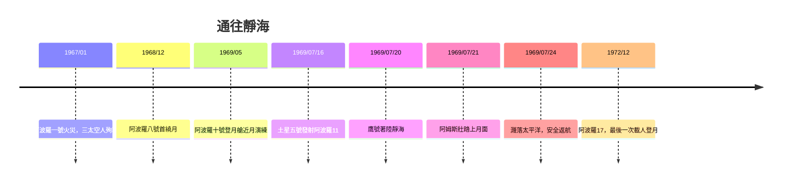

# 7.2 1969年阿波羅11號：人類的一大步

## 為什麼是「月球軌道交會」

登月的工程方案在NASA內部辯論近兩年。直接登月（一枚巨型火箭直上直下）需要不可思議的推力；地球軌道交會（先在地球軌道組裝）需要多次發射與太空對接技術。最終勝出的是約翰·霍博特（John Houbolt）力推的「月球軌道交會」（LOR）：一艘母船（指令艙＋服務艙）與一個輕小的登月艙；登月艙只登陸並返回月球軌道，母船全程不落月。代價是複雜的對接與捨棄保護（登月艙兩段各自拋棄），收益是火箭重量可觀地減小——這使「土星五號」的規模變得可行。

土星五號是馮·布朗團隊的傑作：三級、全高111米、起飛推力約3,400萬牛頓（相當於34,000噸重物），第一級液氧煤油、第二三級氫氧。它至今仍是唯一能把45噸級月球飛船送入地月轉移軌道的火箭，其可靠性紀錄（13次發射零失敗）仍是工程神話。

## 兩次火災與一次大膽的節奏

阿波羅的路並不平坦。1967年1月27日，阿波羅一號地面測試中，純氧環境的一次電火花引燃艙內材料，三名太空人（格里索姆、懷特、查菲）殉職。事故迫使NASA全面重設計座艙（艙門改為快速開啟、材料換阻燃）與安全文化；延宕21個月後，阿波羅七號恢復飛行。蘇聯方面同樣受阻：1967年聯盟一號的降落傘故障使科馬羅夫殉難；蘇聯的N1巨型火箭四次發射全部失敗，登月夢在技術與政治雙重打擊下擱淺。

1968年是驚險的追趕：阿波羅八號在12月完成人類首次繞月飛行（聖誕夜直播，太空人讀《創世記》，全球估計數億人收看）。1969年5月，阿波羅十號完成登月艙至距月面約15公里的「乾跑」。7月，一切就緒。

## 7月20日：靜海基地

7月16日，阿波羅11號由土星五號自甘迺迪角發射。7月20日，登月艙「鷹」（Eagle）脫離指令艙「哥倫比亞」，尼爾·阿姆斯壯（Neil Armstrong）與巴茲·艾德林（Buzz Aldrin）下降，邁克爾·柯林斯（Michael Collins）留守母船。下降過程的經典一幕：電腦因雷達資料超載發出「1202警報」，年輕的飛控工程師傑克·加曼當場判斷「繼續下降」；接著導航點偏離，阿姆斯壯接管手動，越過一片亂石區，在燃料僅剩約30秒的邊緣以4.5米/秒輕觸月面，回報「休士頓，靜海基地，這裡是鷹，我們已著陸」。

幾小時後（休士頓時間20日夜，格林威治21日2:56），阿姆斯壯踏上月面，說出那句被全球六億觀眾聽到的話：

「這是我個人的一小步，卻是人類的一大步。」

（His line, as he later clarified, was "one small step for a man"——單數「一個人」，但無線電傳輸吞掉了冠詞，後世紀錄為 "for a man" 或 "for man" 皆有依據。）

兩人在月面停留21.6小時（艙外活動2.5小時），採集21.5公斤月岩，插上美國國旗與象徵和平的銘牌，完成科學實驗（包括月球射電反射器，今日仍用於地球月球距離的雷射測量）。7月24日，安全濺落太平洋。尼克森總統迎接，宣布「上帝保佑你們，晚安——來自月球基地的人們」。

## 阿波羅的遺產

- 科學：382公斤月岩改寫了月球形成理論（後支持「大撞擊假說」）；射電反射器至今服務月地測距。
- 技術：積體電路、電腦導航（阿波羅導航電腦是早期嵌入式系統的經典）、材料與生保系統，形成後世航天的技術庫。
- 經濟與社會：阿波羅巔峰占聯邦預算約4%，但它同時催生了1970年代的「航天產業群」與工程教育熱潮。
- 政治與文化：登月是冷戰「太空宣傳」的頂點，也是人類第一次在「同一張照片」上集體看見自己（見第8章的暗淡藍點）。登月之後，太空競賽的敘事開始轉向「和平利用」與科學探索——此轉變正是下一章的主題。

## 為什麼阿波羅17之後人類不再登月

1972年12月阿波羅17號之後，登月計畫因冷戰降溫、越戰與經濟壓力而終止。太空探索的重心轉向兩條路線：一條是把「看」推向更遠——無人探測器替人類先走一步；一條是把「住」推向更久——近地軌道的太空站。第8章，就從兩艘將飛出太陽系的探測器說起。
