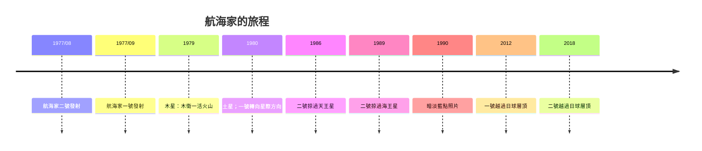

# 8.1 航海家一號與二號：暗淡藍點與星際之旅

## 一個176年一遇的機會

1977年，木星、土星、天王星、海王星恰好排成一條罕見的幾何線，使一艘探測器可以借助連續的重力彈弓（gravity assist），以一次發射訪問全部外行星——這樣的幾何排列每176年才有一次。NASA抓住這個窗口，於1977年8月20日與9月5日先後發射航海家二號與航海家一號（先發的是二號，因一號的軌道更快、更早抵達木星）。

兩艘探測器各重約722公斤（含燃料），以核電池（放射性同位素熱電發電機 RTG，釷-238衰變供電）為能源——因為外太陽系陽光太弱，太陽能不可行。它們攜帶一張「金唱片」（Golden Record）：由卡爾·薩根（Carl Sagan）主持挑選，含55種人類語言的問候、90分鐘世界音樂（包括巴赫、貝多芬與非洲、亞洲傳統音樂）、地球的聲音與115張影像。這是人類第一次向「未來可能撿到的人」寄出自我介紹。

## 珍珠串般的行星巡禮

航海家一號1979年3月飛掠木星，拍下木衛一上活躍的火山（第一個地球以外天體的活火山）、木衛二冰殼下的海洋暗示；1980年11月飛掠土星，發現土衛六厚重大氣。隨後的軌道選擇使其無法繼續外行星，遂沿太陽系北極方向直奔星際。航海家二號則完成「大巡禮」：1986年掠過天王星（發現十顆新衛星、行星側躺自轉）、1989年掠過海王星（發現大暗斑與海衛一冰間歇泉）。這是迄今唯一一次（至今）近距離訪問天王星與海王星。

1990年2月14日，應薩根多年倡議，航海家一號在約60億公里外回頭拍攝太陽系全家福。照片中地球只是一個不到一像素的淡藍色小點。薩根1994年為此寫下著名的《暗淡藍點》（Pale Blue Dot）演講與同名書：

「再看看那個光點。就在這裡，就在那裡，那就是家，那就是我們。……我們的假裝重要、我們自認在宇宙中享有的特權地位，都被這一點挑戰了。」

這張照片成為環境思潮與「宇宙視角」的經典意象，與1968年阿波羅八號的「地出」（Earthrise）照片並列為20世紀最深刻的地球影像。

## 進入星際空間

航海家一號持續外飛，2012年8月，探測器周圍的電漿密度陡變、帶電粒子環境改變——確認它越過了日球層頂（heliopause，太陽風與星際介質的邊界），進入星際空間，成為第一個離開太陽系影響範圍的人造物。2018年11月，航海家二號同樣跨過邊界（在不同緯度，提供了星際邊界的第二個測點）。兩船目前相距逾240億公里，仍以約17公里/秒的速度外飛，攜帶著金唱片，約四萬年後將先後掠過其他恆星。它們的RTG電力持續衰減，NASA正逐一關閉儀器，預計2030年代完全失聯——但它們的旅程與訊息將永續在星際中傳播。

## 為什麼航海家重要

技術上，航海家開創了三項範式：重力彈弓成為深空探索的標準手法；核電池使外行星探索成為可能；「一器多用」（遙測、成像、電漿、磁場、粒子同時測量）成為行星科學的探測器設計模板。科學上，它第一次把外行星從望遠鏡中的小點變成有地質、有大氣、有衛星海洋的「世界」，徹底改寫了行星形成理論（冰巨星、活衛星、海洋世界）。

哲學上，航海家把「人類在宇宙中的位置」這個問題從抽象思辨變成具體照片：一顆懸浮在陽光中的塵粒。而當我們回頭望向最鄰近的行星——那顆在1970年代曾被兩艘探測器「摸過」的紅色星球——人類展開了另一場長達半世紀的追問：火星上，有過生命嗎？
