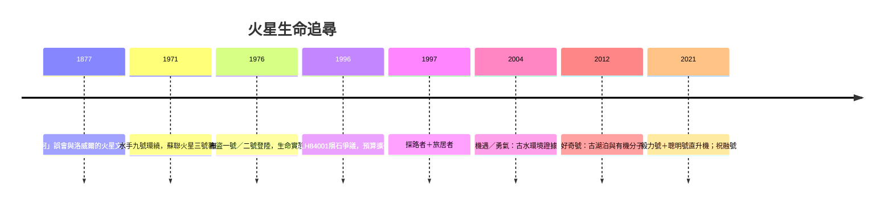

# 8.2 海盜號與火星車：尋找火星上的水與生命

## 1976：兩艘海盜號的「生命實驗」

火星自古就是「可能有人」的想像之地（1877年斯基亞帕雷利描繪的「水道」（canali）被媒體誤譯為運河，洛威爾據此鼓吹火星文明——這場誤會成為科幻文學的養分，也成為20世紀天文學的陰影）。1971年水手九號首次環繞火星，拍下水手谷與奧林帕斯山，揭示一個有巨大地質構造的世界；1971年先後抵達的兩艘探測器亦首度成功軟著陸（蘇聯火星三號著陸後傳回數秒訊號，NASA的海盜號則真正打開了局面）。

1976年，NASA的兩艘「海盜號」（Viking 1 於7月20日、Viking 2 於9月3日）先後軟著陸於火星，各攜一套生物學實驗艙：氣相層析質譜儀（GCMS，檢測土壤有機分子）、三項生命代謝實驗（標記釋放、氣體交換、光合成）。結果是天文生命科學最著名的「半懸案」：

- GCMS 未檢出任何有機分子（靈敏度約ppb級）。
- 標記釋放實驗（LR）最初顯示放射性氣體釋放，貌似代謝；但加入後續培養步驟後訊號消失，行為不符合生物特徵。
- 主流解釋：火星土壤含超氧化物（後續鳳凰號2010年代證實高氯酸鹽），其氧化性可造成假陽性代謝訊號。

海盜號的結論因此是：「未檢出生命，也未完全排除」，土壤異常活躍但化學解釋合理。這個「中性但誘人」的結果，開啟了此後五十年「找水」與「找有機物」的接力。

## 找水的年代

1990年代的方法革命是「不僅看火星，還看火星的過去」。1996年，在南極發現的ALH84001火星隕石（含碳酸鹽球粒與疑似納米細菌形貌）被NASA團隊提出可能含生命證據——該主張後來主流並不支持，但它促使美國政府大幅增加火星探測預算，形成「跟著水走」（follow the water）的戰略。1997年，「探路者」號登陸（首輛火星車旅居者Sojourner小試身手）；2001年火星奧德賽號以伽瑪譜儀測得淺層土壤含水冰；2003年歐洲火星快車在極冠與中緯度確認大量水冰；2004年起，兩輛「機遇」與「勇氣」號火星車的地質調查，發現沉積岩、赤鐵礦球、鹽類沉積——火星曾有液態水環境的直接地質證據。2008年鳳凰號在北極掘出純水冰；2012年好奇號落於蓋爾坑，確證古湖泊系統與有機分子（噴氣質譜儀檢出噻吩類等）；2018年，火星快車以雷達探得南極冰蓋下疑似液態鹹水湖（此結論至今仍有爭議）。

## 火星車的分工與技術進化

火星探測形成了成熟的分工：軌道器測繪與通訊中繼（MRO、火星快車）、著陸器就地分析（鳳凰、洞察號的地質與地震）、火星車移動採樣（旅居者7公斤 → 機遇/勇氣185公斤 → 好奇899公斤 → 2021年毅力號與其搭載的「聰明號」直升機，首度在另一行星實現動力飛行）。毅力號還首度「採樣封存」，計畫由未來任務帶回地球（火星樣本返回任務，現仍處規劃與預算掙扎中）。中國則於2021年以「天問一號＋祝融號火星車」成為第二個成功運行火星車的國家。

## 生命問題的科學框架

半世紀的火星探測確立了天文生物學的方法論：生命跡象的判定必須同時滿足「環境證據（曾宜居）＋化學證據（有機物）＋形貌或代謝證據」，且每項都可被非生物過程解釋（如蛇紋石化、異化鐵反應）時，最謹慎的結論才是科學的。目前為止，火星尚未給出決定性答案——這正是它持續吸引人類的原因。而下一章，我們把鏡頭從行星拉回近地軌道：人類在那裡建立了第一個長期居住的太空家園，也把哈伯望遠鏡送上了天。
