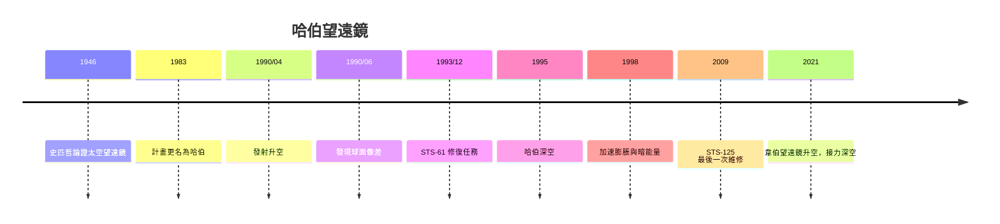

# 9.1 1990年哈伯太空望遠鏡：從磨鏡失誤到深空之眼

## 為什麼要把望遠鏡送上太空

地面望遠鏡有兩個先天限制：大氣擾動使星像模糊（視相度限制解析度），大氣吸收紫外與大部分紅外。早在1923年，德國火箭先驅奧伯斯（Hermann Oberth）就提出太空望遠鏡的構想；1946年，天文學家史匹哲（Lyman Spitzer）發表專文論證太空望遠鏡的科學價值，成為此後數十年倡議的基石。1962年起，美國以火箭搭載的小型望遠鏡（OAO系列）驗證可行性；1970年代，NASA與歐洲太空總署（ESA）合作推動「大型太空望遠鏡」（LST）計畫，並在國會預算攻防中獲得關鍵支持（天文學界的公開遊說功不可沒），1983年計畫更名以致敬1929年發現宇宙膨脹的愛德溫·哈伯。

## 1990年4月24日升空與一場災難

哈伯太空望遠鏡（HST）以太空梭發現號送入約550公里高的軌道。主鏡口徑2.4米，攜帶多台科學儀器，設計壽命15年（後經多次維修延展）。發射數週後的噩耗是天文史上著名的品質事故：星像無法聚焦成點，成像球面像差（spherical aberration）嚴重。1990年6月調查確認，主鏡研磨時使用的零位補償器（null corrector）被組裝錯誤（墊片位置差了1.3毫米），使鏡面邊緣磨淺了約2微米——整面主鏡成為史上最昂貴的「次品」。

NASA的反應成為太空工程管理的教科書案例：短期，以電腦補償（deconvolution）部分恢復成像；中期，設計含矯正光學的替換儀器（COSTAR，1993年由太空人安裝，像一副眼鏡校正主鏡的像差）；長期，徹底改寫質量管理制度（建立獨立審查與追溯要求）。

## 1993–2009：五次太空梭維修的黃金年代

1993年12月的STS-61任務，太空人以五次太空漫步更換COSTAR與廣域行星相機，哈伯「手術」成功。此後1997、1999、2002、2009年多次維修（換儀器、修陀螺儀、換太陽能板、加裝新相機與光譜儀）。2003年哥倫比亞號失事後，太空梭停飛期限一度使最後一次維修被取消；2004–08年天文界與國會（包括參議員米庫斯基的預算翻案）力爭，2009年STS-125完成第五次也是最後一次維修，哈伯以全新儀器（WFC3、COS）迎接2010年代。2011年太空梭退役後，哈伯再無維修，但依靠品質管理升級持續運行至今。

## 哈伯看見了什麼

哈伯的科學產出徹底改寫宇宙學：

- 1994年：舒梅克—李維九號彗星撞木星，哈伯記錄撞擊痕跡。
- 1995–98年：哈伯深空（HDF）、極深空（HUDF）：長曝一個小天區，揭示數千個遙遠星系——宇宙的「深空」本質被直觀呈現。
- 1990年代：以造父變星與Ia型超新星測定哈伯常數（「關鍵計畫」），精確度提高一個量級。
- 1998年：兩組超新星團隊（借助哈伯追蹤遙遠Ia超新星）發現宇宙膨脹在加速——暗能量登上舞台，獲2011年諾貝爾物理學獎（佩爾穆特、施密特、里斯）。
- 2000年代：哈伯太空望遠鏡測得星系核心的超大質量黑洞（如M87與仙女座），支持黑洞普遍存在於星系中心。
- 2010年代：以重力透鏡與星系演化調查，追溯第一代星系的成形過程。

## 一個鏡子的社會學教訓

哈伯的球面像差事件不只是工程故事，更是品質文化的反面教材：一個小組的檢測偏誤未被獨立驗證，代價是數億美元與科學的延遲。它與1986年挑戰者號、2003年哥倫比亞號共同構成NASA的安全文化演進史。而哈伯的成功則展示了另一件事：當科學儀器成為「可維修的公共財」，人類第一次把天文台從「一次性的工程」變成「可持續升級的基礎設施」。這個思維也延續到下一個太空工程：國際太空站——人類在軌道上的長期家園。
