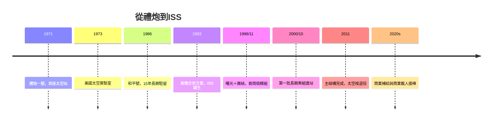

# 9.2 國際太空站：微重力中的長期棲居

## 從對抗到合作：空間站的政治史

人類長期駐留太空的構想，先由冷戰兩邊各自實現。蘇聯1971年發射禮炮一號（首座太空站），1986年起「和平號」成為第一個長期有人駐留的軌道實驗室（15年間創下單次駐留400餘天的紀錄，並經歷1997年火災與碰撞等嚴重事故）。美國1973年的太空實驗室（Skylab）則以阿波羅改裝件建構，三批太空人各駐留一至三個月，驗證了微重力下的長期生活與太陽物理觀測。

冷戰結束改變了遊戲規則。1984年，雷根總統批准「自由號」（Freedom）太空站計畫；1980年代末美蘇關係緩和、蘇聯解體後（1991年），俄羅斯的太空工業面臨預算斷崖，美國則希望以合作取代對抗並避免俄羅斯火箭工程師流散到敏感國家。1993年，柯林頓政府把自由號與俄羅斯的米爾-2方案合併，加上歐洲（ESA）、日本（JAXA前身）、加拿大（CSA）的模組，形成國際太空站（ISS）——人類史上最大規模的跨國工程合作（16國參與）。

## 1998–2011：從團結號到完全體

1998年11月20日，俄羅斯質子火箭發射第一個模組「曙光」（Zarya）；12月，美國太空梭送來「團結」（Unity）節點艙。2000年10月31日，第一批長期乘組（美、俄兩人）升空，ISS自此連續有人駐留至今（超過24年）。2011年，太空梭退役前的最後一次組裝任務完成主結構；ISS總質量約420噸，加壓容積相當於一架波音747，太陽能翼展開逾70米，成為夜空中可肉眼辨識的亮點。

ISS的制度設計本身就是創新：1998年簽署的《國際太空站政府間協定》（IGA）確立各國模組的司法管轄、智力財產與乘組責任；美國、俄羅斯、歐洲、日本、加拿大各自管理自己的艙段與實驗，共享電力與生命維持資源；乘組由各合作方提名、聯合訓練。這是冷戰後國際科學合作的旗艦，也是「太空作為人類公共領域」從條文（1967年外太空條約）走向實踐的最大案例。

## 微重力中的科學

ISS的科學主線有四：

1. 人體與生物學：長期失重造成骨密度流失、肌肉萎縮、體液上移與視力變化（視神經水腫，SANS症候群），太空人每日運動2小時對抗；這些研究對抗老化與骨質疏鬆的地面醫學亦有迴響。
2. 物理科學：微重力下的燃燒（無浮力對流，火焰呈球形）、流體、蛋白質晶體生長、冷原子實驗（如冷原子實驗室 CAL）。
3. 地球與天文觀測：ISS作為觀測平台（如AMS-02阿爾法磁譜儀，2011年安裝，長期測量宇宙線與暗物質訊號；以及多部地球觀測儀器）。
4. 技術驗證：再生生保系統（水回收率高達九成以上）、機器人操作（加拿大臂2）、艙外活動技術、乃至商業載荷與小型衛星部署。

ISS還意外成為「文化與教育」的載體：航天員的日常影像、與學生的天地通話、乃至在軌藝術與宗教活動（例如2014年俄羅斯航天員在站上舉行奧運聖火儀式、多國領袖與站內的視訊），使人類在太空的存在第一次成為日常新聞而非奇觀。

## 商業時代的接力

ISS的後半段見證了太空運輸模式的轉型：2000年代NASA以「商業補給服務」（CRS）合同，扶植SpaceX（龍飛船）與軌道ATK（天鵝座）執行貨運；2011年太空梭退役後，美國載人一度完全依賴俄羅斯聯盟號（每座6,000萬美元級）；2020年起，SpaceX載人龍與波音星際線（CST-100）以「商業載人」（Commercial Crew）模式接手，NASA成為「客戶」而非「營運商」。2020年11月，ISS開放「私人太空人任務」（Axiom任務等），2024年起預告ISS退役後由商業空間站（Axiom、Orbital Reef等）接棒。

ISS的故事是「太空合作」的極致，也是「太空商業化」的前奏。當火箭可以成為商品、當空間站可以成為企業資產，太空探索的驅動力從冷戰意識形態轉向市場與資本——這正是下一章的主題：商業太空革命。
