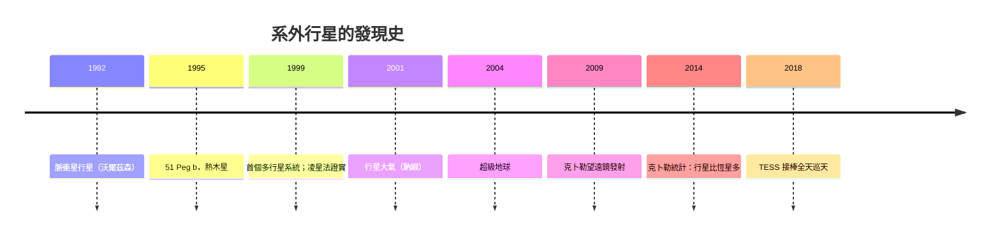

# 10.1 1995年51 Pegasi b：系外行星時代來臨

## 為什麼找行星這麼難

行星自己不發光，只反射母星的光——直接成像在技術上極難（對比度動輒十億比一）。20世紀的天文學家因此發展「間接法」：不找行星本身，找行星對母星的影響。主要有兩條路：

1. 視向速度法（RV）：行星環繞時，母星也繞共同質心輕微擺動，造成光譜的週期性多普勒偏移。這正是夫朗和斐光譜線的應用：以極高精度追蹤某條譜線的微小紅移與藍移。
2. 凌星法（transit）：行星從母星面前經過時，恆星亮度會微降（如地球凌日僅使太陽變暗約0.008%）——需要極高的光度測量精度與長期監測。

1990年代初的先驅包括波蘭裔天文學家沃爾茲森（Aleksander Wolszczan）：1992年他宣布在脈衝星PSR B1257+12周圍發現行星——這是第一個被證實的系外行星系統（圍繞一顆死去恆星的殘骸行星，極不尋常）。但主流期待的「類太陽恆星行星」尚未現身。

## 1995年10月6日：51 Pegasi b

瑞士日內瓦天文台的米歇爾·梅耶（Michel Mayor）與迪迪埃·奎洛茲（Didier Queloz）以Elodie光譜儀長期監測飛馬座51（51 Pegasi，一顆類太陽恆星），發現其視向速度以4.23天為週期劇烈擺動（速度振幅約57米/秒）。唯一的解釋是：一顆質量至少約半個木星的行星，以4天繞母星一圈——軌道半徑僅約0.05天文單位（水星軌道的八分之一），表面溫度估計上千度。

這顆行星（後命名51 Pegasi b，綽號「熱木星」）震撼了行星形成理論：按當時的模型，氣態巨行星應形成於雪線之外的低溫區，不可能在母星旁以4天周期燒烤。天文界起初懷疑觀測錯誤；同年秋天，美國舊金山州立大學的馬西（Geoff Marcy）與巴特勒（Paul Butler）獨立確認。結論成立：行星系統比太陽系多元得多，行星可以遷移（理論隨後發展出「行星遷移」機制，解釋熱木星）。梅耶與奎洛茲因此獲2019年諾貝爾物理學獎（與皮布爾斯分享）。

## 大發現的年代

51 Peg b 打開閘門後，發現數量指數增長：1999年第一個多行星系統（仙女座υ）、1999年首次凌星觀測（HD 209458 b，其凌星深度也證實了行星半徑）、2001年首度探測行星大氣（鈉線）、2004年首顆「超級地球」（Gliese 876 d，約7倍地球質量）、2007年首顆位於宜居帶的超級地球（Gliese 581 c，後經修正宜居性存疑）。

## 克卜勒望遠鏡：以凌星法普查銀河

2009年NASA發射克卜勒太空望遠鏡（Kepler），以0.95米口徑持續凝視一片天區，以毫星等級的精度監測逾15萬顆恆星，尋找微小的凌星訊號。九年的任務（2018年燃料耗盡）產出超過2,600顆確認行星，並統計出銀河系的行星統計學：行星比恆星多（平均每顆恆星至少一顆行星）、類地大小的行星常見、宜居帶岩質行星在銀河系中估計數以億計。2014年起，克卜勒又以「K2」模式繼續巡天。2018年NASA的TESS接棒，以全天巡天鎖定近距離亮星，為韋伯望遠鏡提供「優先目標清單」。

## 「第二個地球」的意義

系外行星革命把哲學問題變成觀測問題：宇宙中有多少行星？多少宜居？我們是特例還是常態？今日的答案傾向：行星極為常見，宜居帶行星不稀有，但「是否真有生命」仍待大氣光譜（氧、甲烷、水汽等生物標記）的判定。這正是韋伯太空望遠鏡的使命——下一節，我們轉向那台造價百億、延宕二十年的紅外巨眼。
