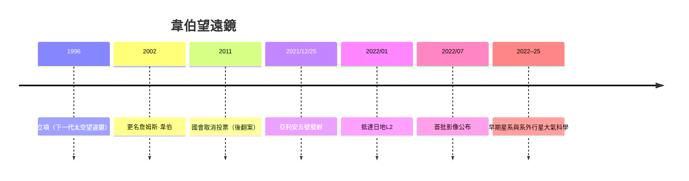

# 10.2 2021年韋伯望遠鏡：穿透星塵的紅外之眼

## 為什麼需要紅外線

哈伯望遠鏡是光學與近紫外之眼，但它有兩個先天盲區。其一，宇宙膨脹會把遙遠天體的光「拉長」到紅外（紅移）；越遠的光越紅，第一代星系的光到達地球時已移到近紅外波段，哈伯幾乎看不到。其二，可見光被星際塵埃吸收，恆星形成區與行星大氣的光譜需要紅外穿透。因此，天文學界1990年代就提出「接替哈伯的紅外太空望遠鏡」構想，1996年正式立項，初名「下一代太空望遠鏡」，2002年更名致敬阿波羅時代NASA局長詹姆斯·韋伯（James Webb，1961–68年任職，主導了阿波羅時代的工程管理）。

## 一項極限工程

韋伯望遠鏡（JWST）的設計是天文工程史上的賭注：

- 主鏡口徑6.5米（哈伯的2.4米），由18塊鍍金鈹鏡片拼成，發射時折疊，入軌後太空展開。
- 四層遮陽傘（Kapton薄膜鍍鋁與矽），展開後如一個網球場大小，把鏡面與儀器冷卻到約40K（依靠被動輻射，不加製冷）。
- 軌道選在日地第二拉格朗日點（L2），距地球150萬公里，與地球同向繞日，可以長時間背對太陽與地球；但這意味著無法派太空人維修——與哈伯「可修」的設計哲學相反，韋伯必須「一次做對」。

工程代價驚人：原訂2007年發射、預算約10億美元，實際推遲到2021年、總成本近百億美元；2011年美國國會一度投票取消（天文界與政府遊說後翻案）。韋伯因此成為「大科學工程」超支與治理的經典案例，也成為極限測試文化的典範（每個機構、每個部件都經過超規格的震動、熱真空測試）。

## 2021年12月25日：完美的一次展開

2021年12月25日，韋伯由歐洲太空總署的亞利安五號火箭自法屬圭亞那發射。隨後的兩週，被工程界稱為「史上最驚險的太空任務」：太陽能板展開、遮陽傘五層分離與張緊、鏡片展開與對位——每一步都無備援。2022年1月24日抵達L2。同年7月11日，美國總統拜登公布首批科學影像：SMACS 0723星系團的重力透鏡深空照，背景中可見數十億年前（紅移遠超哈伯極限）的星系。韋伯自此開啟紅外深空的新紀元。

## 韋伯看見了什麼

- 早期宇宙：紅移z > 10的星系（大爆炸後數億年）已被證認，早期星系的形成與化學演化（首次確認遙遠星系中的碳、氧、氖）改寫了星系形成的時間線。
- 系外行星大氣：韋伯以凌星光譜測得系外行星大氣中的二氧化碳、水汽與一氧化碳（如熱木星WASP-39b）；2025年前後亦在宜居帶行星（如K2-18 b）的大氣中探測到含碳分子（包括疑似二甲基砷的爭議訊號，仍在科學爭議中）。
- 恆星與行星形成：以中紅外穿透塵埃，直接拍攝原行星盤與年輕星團的內部。
- 太陽系：拍攝木衛二、土衛六、小行星帶與遠日天體，為「冰洋世界」的生命可能性提供線索。

## 從仰望到抵達的交會點

韋伯與航海家、海盜號、哈伯、ISS共同構成21世紀前葉人類太空探索的四大支柱：望（韋伯、哈伯）、走（探測器）、住（ISS）、找（系外行星與生物標記）。而當望遠鏡的目光愈來愈深，另一股力量正在改變人類抵達太空的方式：商業火箭、可重複使用、以及以「多行星文明」為口號的新太空革命。下一章，我們進入SpaceX的時代。
