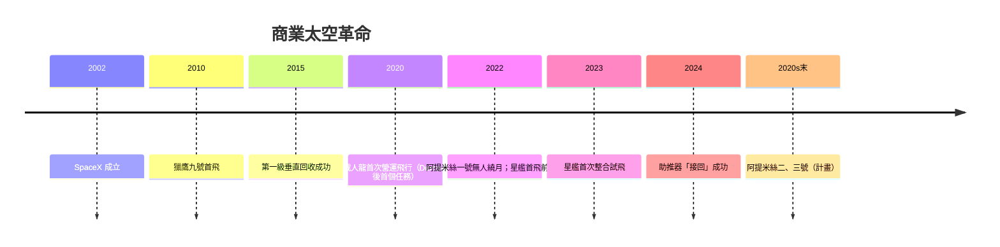

# 11.1 SpaceX與阿提米絲：可回收火箭與重返月球

## 一個矽谷式的新太空

2002年，賣掉PayPal股份的艾隆·馬斯克（Elon Musk）成立太空探索科技公司（SpaceX），初期目標看似荒謬：把入軌成本降低一個數量級，最終使人類成為多行星物種。這個野心背後的工程哲學很簡單：化學火箭的推進劑成本極低（占發射成本不到1%），昂貴的是「用一次就丟」的硬體——所以關鍵不是造更好的火箭，而是造「飛得回來的火箭」。

NASA從2000年代起以「商業化」政策配合這條路：商業軌道運輸服務（COTS）、商業補給服務（CRS）、商業載人（Commercial Crew），以固定價格合約代替傳統成本加成採購，扶植SpaceX、軌道ATK、波音、內華達山脈等公司。2010年12月，SpaceX的獵鷹九號首飛；2015年12月，獵鷹九號第一級成功垂直降落——人類第一次把入軌級火箭「收回來」。2017年起，SpaceX開始重複使用飛行的第一級，某些單枚助推器飛行次數達20次以上。入軌單價從太空梭時代每公斤數萬美元，降到獵鷹九號的數千美元級，徹底改寫了全球太空產業的經濟結構。

## 星艦（Starship）與火星的藍圖

SpaceX的終極載具是星艦（Starship）：不鏽鋼材質、全可重複使用、兩級總高約120米、設計酬載逾100噸（可重複使用模式）、以33台猛禽發動機（液氧甲烷全流量循環）驅動。2019年起在德州博卡奇卡（Starbase）展開跳跳式試飛；2023年4月首次整合試飛（升空後失控爆炸），歷經多次迭代，2024年6月首次成功引導熱分離與受控濺落，2024年10月首度以「機械臂夾取」（Mechazilla tower catch）接回超重型助推器。星艦仍處於測試期，但其「快速迭代＋大幅低價＋全可重複使用」的模式已被全球航太業視為範式（藍色起源的新格倫、中國的可回收火箭計畫都在追趕）。

## 阿提米絲（Artemis）：重返月球的聯盟

2017年，美國總統川普簽署第一號太空政策指令，把歐巴馬時代的「小行星 redirected」計畫轉向為重返月球；2020年計畫正式命名「阿提米絲」（Artemis，月神，阿波羅的孿生姊妹——刻意象徵性別多元）。核心架構：

- 太空發射系統（SLS）：NASA自研的超重型火箭（基於太空梭技術遺產），2022年11月首次飛行（阿提米絲一號，無人繞月）。
- 獵戶座（Orion）太空船：載人重返月球並返回地球。
- 月球門戶（Gateway）：月球軌道的小型太空站（多國合作，ESA、JAXA、CSA參與）。
- 載人登陸系統（HLS）：2021年SpaceX贏得合約，以星艦改裝版作為阿提米絲三號的登月器。
- 國際夥伴與《阿提米絲協定》（2020年起）：以「安全、可持續、透明」為原則的月球資源利用框架（已有數十國簽署，中國與俄羅斯另推「國際月球科研站」計畫，形成新的太空陣營競爭）。

阿提米絲二號（載人繞月）與阿提米絲三號（載人登月，含首位登月女性）持續因SLS研製、獵戶座隔熱罩與星艦成熟度而延期；但「政府和商業、傳統火箭與新創迭代並行」的模式，已成為21世紀太空探索的基本格局。

## 為什麼「可回收」是分水嶺

回望1960年代：土星五號每發射一次就是幾十億美元的「一次性」投入，太空探索因此必然是國家級項目。可回收火箭把發射從「消耗品」變成「運輸服務」，把太空從政府壟斷轉為市場競爭：星鏈衛星群（逾萬顆在軌）、商業成像、太空旅遊、小型衛星群發射全部建立在新成本結構之上。太空不再是「偶爾登陸的遠征」，而可能成為「持續經營的產業」——這正是下一節要面對的問題：當太空成為產業，人類該如何治理太空、保護地球、以及走向多行星文明？
