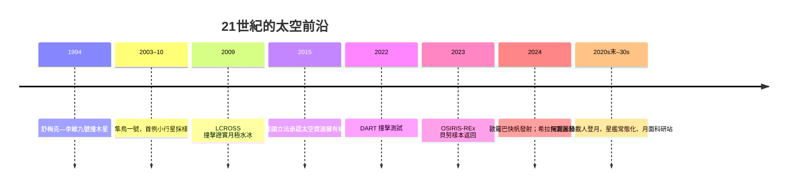

# 11.2 DART、太空資源與多行星文明的叩問

## 保衛地球：2022年DART撞擊

2022年9月26日，NASA的「雙小行星重定向測試」（DART）以每秒約6公里的速度，主動撞上小行星迪迪莫斯（Didymos）的衛星「迪莫弗斯」（Dimorphos）。這是人類第一次以「行星防禦演習」為目的的主動撞擊：撞擊使迪莫弗斯繞主星的公轉週期縮短約32分鐘（遠超預期的10分鐘門檻），證明「動能撞擊器」可以實際改變小行星軌道。歐洲太空總署的「希拉」（Hera）探測器於2024年發射，2026年抵達現場，對撞擊坑與質量分布做詳細測量。

DART的故事背後是三十年的科學準備：1994年舒梅克—李維九號彗星撞木星（哈伯記錄了撞擊）震動了行星科學界，說明天體撞擊是真實的地質過程；1990年代起，各國建立近地天體（NEO）巡天網（美國的LINEAR、Pan-STARRS、NEOWISE，及2023年開始營運的維拉魯賓天文台），目前已知逾三萬顆近地小行星，多數大於1公里的天體已被追蹤。2020年12月，NASA的OSIRIS-REx（2016年發射）首次從小行星貝努（Bennu）採樣並於2023年成功帶回地球（約121克），日本早前的「隼鳥一號／二號」則是全球最早完成小行星採樣返回的任務（2010年、2020年）。小行星採樣的科學收穫極大：貝努樣本中檢出多種胺基酸與核鹼基前驅物，支持「生命原料可能由小行星遞送地球」的假說。

## 太空資源：從科幻到法條

月球與小行星被視為下一階段的資源邊疆。月球極區的永久陰影坑中已由探測器（1998年月球勘探者、2009年LCROSS撞擊實驗、月船一號的月礦物測繪儀等）確認水冰存在；月球風化層含氧（以氧化物形式），可作為推進劑與生保的原料。2000年代起，美國通過「太空資源探採權」相關立法（2015年《商業太空發射競爭力法》承認美國公民對小行星與太空資源的擁有權），盧森堡、阿聯酋、日本相繼立法；《阿提米絲協定》則主張資源利用須「透明、可持續、安全」。反方主張（源於1967年《外太空條約》「太空為全人類共同利益」的原則）則擔心資源圈地與新太空軍備競賽（2019年美國成立太空軍、太空司令部，正凸顯這一張力）。

## 多行星文明的命題

回到整個故事的主軸：太空科學的驅動力，從神話與曆法（古代）、到哲學與數學（希臘與啟蒙）、到國家威望與軍事（冷戰）、到科學合作與公共財（1990年代後）、再到資本與市場（21世紀）。今天，「成為多行星物種」這個命題，同時面對三個層面的檢驗：

1. 技術：可回收火箭、長期生保系統（ISS的經驗）、月面與火星的就地資源利用（ISRU）、輻射防護（深空超出地球磁層，銀河宇宙線是最大威脅）。
2. 科學：火星是否曾有生命、生命是否宇宙常態、地球生命的單一起源是否可被第二例證實——這些是韋伯望遠鏡、火星採樣返回、乃至未來的歐羅巴快帆（2024年發射，2030年抵木衛二）與泰坦蜻蜓（Dragonfly）計畫正在逼近的問題。
3. 哲學與治理：若人類成為多行星物種，誰制定規則？原住微生物權（若存在）如何權衡？行星保護（避免污染）與資源利用的界線何在？

## 故事的終點與起點

回望五千年：從巨石陣對齊夏至日出的石頭，到韋伯望遠鏡在L2點凝視宇宙第一代星系；從托勒密的圓輪，到星艦的迭代爆炸與再飛；從加加林的108分鐘，到ISS上連續24年的燈光。太空科學的故事，本質上是人類把「看不見的」變成「可以驗證的」——把神話變成模型，把模型變成觀測，把觀測變成工程，把工程變成可以居住的地方。

庫恩會說這是一連串的典範轉移；薩根會說這是「暗淡藍點」上的生物第一次抬頭並決定走出去。兩種說法都對。而故事仍在進行：今天仍在軌道上的哈伯與韋伯、正在木衛二途中的探測器、等待返月的人，都在寫下一章。這一章的標題，或許就是下一個故事的第一行。
