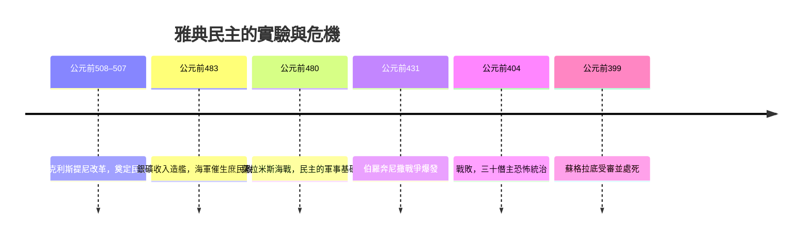

# 1.1 雅典公民大會與蘇格拉底之死

時間：西元前399年，以及它背後整個雅典民主的一百年實驗。

## 一座為辯論而建的城

公元前五世紀的雅典是希臘世界最富有的城邦之一。公元前483年，勞里昂銀礦的新礦脈被發現，雅典執政者地米斯托克利沒有把這筆錢分給公民，而是說服眾人用它建造了兩百艘三列槳座戰船。這支海軍在公元前480年的薩拉米斯海戰中擊敗波斯，也改寫了雅典的政治結構：海軍的水手是划槳的窮人，他們為保衛城邦流血，於是也要求分享權力。船上的階級平等，回頭重塑了陸上的政治權利。

雅典的直接民主因此不只是理念，而是被戰爭與經濟推動的制度現實。公民大會（Ekklesia）每十日開會一次，出席的公民（二十歲以上男性）多達六千人；五百人議事會用抽籤產生，幾乎任何職位都可以輪到普通人；陶片放逐制度讓城邦每年有權投票放逐一位可能成為僭主的人。奴隸、女性與外邦人被排除在外，這是這場實驗最深的污點，但在當時的人類史上，這仍是第一批用抽籤、輪流與辯論來治理的平民。

技術也參與了這場實驗。抽籤機（kleroterion）用石球隨機選官，硬幣與貨幣化經濟讓普通人可以從事遠洋貿易而累積財富，這些「庶人的豪華」正是民主的社會基礎：當農夫不再被貴族的債務綁在土地上，他們就成為有選票的公民。

## 蘇格拉底的死亡陷阱

公元前431年，伯羅奔尼撒戰爭爆發，雅典與斯巴達纏鬥近三十年。長牆、瘟疫、西西里遠征的慘敗，接連榨乾了民主的自信。公元前404年戰敗後，斯巴達扶植了「三十僭主」的寡頭恐怖政權；次年民主派雖然復辟，但整座城市病了：對辯論感到疲倦，對言論感到恐懼。

公元前399年，七十歲的蘇格拉底被三名公民起訴，罪名是不敬城邦之神、敗壞青年。他也曾經是三十僭主手下惹禍的異議者，曾拒絕非法逮捕命令，但他選擇留在城邦受審。在五百人陪審團前，他沒有流淚求饒，反而把法庭變成了他自己最擅長的辯論場，用反詰法逐條拆解控方的邏輯。第一輪投票以約三十票之差判他有罪；當他提議以「城邦公費供養我終身」作為處罰時，陪審團被激怒，以更大的多數判他死刑。

蘇格拉底拒絕了越獄的機會。他的理由是：我曾一生受惠於這座城的法律，若以此約為可背棄之物，則我畢生的哲學（論證要經得起檢驗）也一併破產。於是他飲下毒芹。

## 哲學史的源頭一殺

這場死亡成為西方政治哲學的創傷性起點，三個追問至今仍在迴響：

- 多數人可以處死一個講理的人，多數決不等於正義。
- 一個關心個人道德養成的哲學，在城邦的制度下竟是危險的。
- 我們能否設計出一種制度，讓智慧與權力不再互相殘殺？

第三個追問，由他的學生接了下來。

## 迷思破除

蘇格拉底並非死於「民主處死異見者」的鐵案：起訴由三名公民提出，依雅典法律由五百人陪審團決定；民主一方也曾在去世十一年後正式為他平反，起訴者之一被判死刑。真正複雜的是：在一個把辯論當成政治燃料的制度裡，最會辯論的人成了政治燃料的犧牲品。這才是柏拉圖求學路上的陰影。
