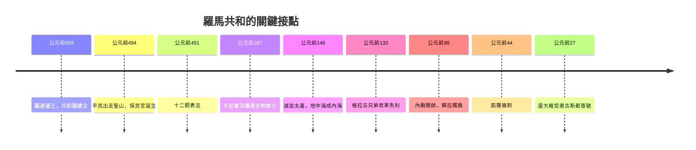

# 2.2 羅馬共和與西塞羅的混合政體

時間：公元前509年建國到公元前27年，約五百年的制度實驗。

## 一台拒絕「單一人統治」的機器

關於羅馬人的傳說是他們曾趕走最後一位國王塔克文。此後近五百年，羅馬人把「王」字當作髒話，把權力切成一堆互相咬合的齒輪：

- 兩名執政官（任期一年、可否決彼此）
- 元老院（由曾任高階官職者組成，掌握財政與外交實權）
- 各類公民大會（選舉與立法，按財富分投票單位，財富越高者的票權重越大，這是制度內建的偏斜）
- 獨裁官（存亡之際任命，法定最長六個月；唯有在內戰末期，屋大維以「無限期獨裁官」之名打破此機制，宣告共和死期）

這套機器的目的不是追求最高智慧，而是明確的反單一權力：一個人決不成為王，任何權力都面對否決者。

## 保民官：公民反抗的內建機制

公元前494年，平民因債務奴役與土地集中離城出走，在聖山設營。貴族被迫讓步，允許平民選出保民官（Tribune），職責是保護平民免受官員暴力與債務壓迫，並獲得否決權（veto，拉丁文原意是「我禁止」）。全程不需流血遊行，只在制度中長出一個永遠說「不」的位置。

此後約兩百年，平民以「集體出走」為武器不斷迫使貴族讓步：公元前451年頒布十二銅表法，公元前445年允許貴賤通婚，公元前287年《霍騰西阿法》承認平民大會決議具全邦法律效力。換句話說，羅馬憲政不是一份文件，而是兩個階層連續兩街兩百年談判出來的凝固體。

## 混合政體理念的推手：波利比烏斯與西塞羅

把這套「權力切片加否決」的機器寫成理論的人有兩位。

第一位是希臘人質波利比烏斯（Polybius）。他被押到羅馬住了十七年，親眼看見羅馬三次打敗迦太基、征服地中海，而他要回答的是：這個城邦為什麼不會被自己的權力衝突拆掉？他的答案是《歷史》第六卷：羅馬憲法混合了君主制元素（執政官）、貴族制（元老院）、民主制（公民大會），任一方企圖獨大，另兩方就摩擦阻力。所以他寫出「混合政體」一詞，這是後世「制衡」思想的祖字。

第二位是西塞羅（Marcus Tullius Cicero），律師、演說家、執政官。他以拉丁文把希臘哲學本土化，在《論共和國》《論法律》中系統闡述混合政體：自然的正義高於人定法，若人定法違反自然正義，它便不是真法。這條「自然法」線索將在千年後被教會法學者接手，變成中世紀與啟蒙時代的原力。

## 為什麼那麼好的機器仍然崩壞

內部機器再精巧，擋不住三個咬合處生鏽：

- 羅馬軍隊從農民自裝備兵種轉成職業軍人，軍隊效忠對象從元老院轉成有錢發薪、分地的將軍。
- 每次征服都帶來更多土地、奴隸與財富集中，貧農破產，公民身分因而變質，富人變得更富。
- 執政官與元老院負責國土規模已是地中海，一年任期與小城體量不再匹配。

馬略的軍事改革、格拉古兄弟的農地改革（兄弟皆被暴力殺害，第一個在羅馬城內被公民殺公民的事件）、蘇拉以獨裁官身份殺信件名單（proscription）、凱撒跨過盧比孔河——每一次衝突都更血腥，羅馬人把「內戰」一詞（bellum civile）寫入了自己的辭典。公元前44年凱撒被刺，不是共和的拯救，而是內戰的加速器；十三年後屋大維在亞克興戰役取勝，接受「奧古斯都」尊號，共和國名存實亡。

西塞羅自己在這場內戰中被安東尼擊殺，頭與雙手懸在羅馬廣場示眾，舌頭被用簽戳穿。混合政體理論的拉丁文播種者，死在這個理論所防範的那種暴力裡。

## 為何這條線會一直跑下去

羅馬共和的失敗不是死刑，而是一份持續兩千年的警示樣本：當軍隊只效忠個人、貧富差距撕開公民認同、制度規模跟不上國土規模，機器就會被拆掉。文藝復興時期佛羅倫斯讀的正是這些拉丁文件；英國內戰中霍布斯的戰場上，讀他的雙方引用的也是羅馬史；美國開國者直接拿波利比烏斯與西塞羅的混合政體當成圖紙。羅馬沒有防禦成正義，但它把自己的失敗刻成教材，提升了後世的防禦能力。

而此後的時代裡，城邦的公共空間將逐漸讓位給一個新的焦點：神。下一章的主角不是城邦，而是上帝之城。
