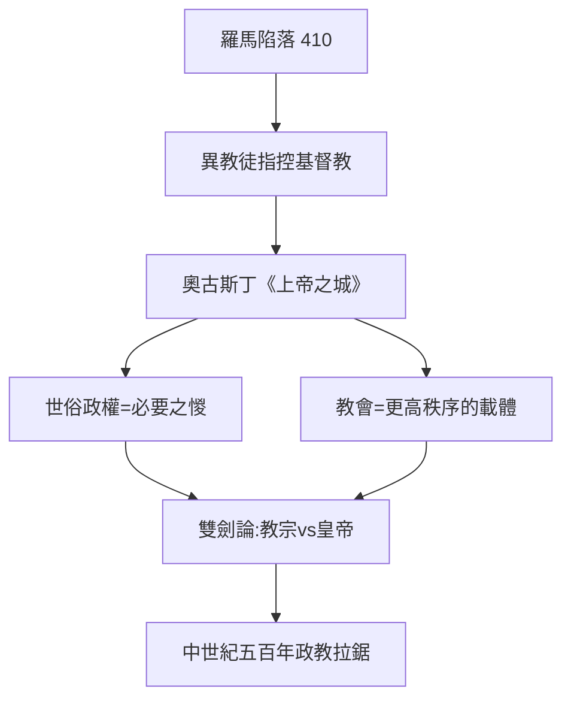

# 3.1 奧古斯丁上帝之城

時間：西元410年至426年，《上帝之城》寫作期間。

## 羅馬陷落，哲學界嚇壞了

西元410年8月，西哥德國王阿拉里克攻入羅馬城，洗劫三日。自公元前390年高盧人之後，八百年來羅馬城首次被外族攻陷，而帝國此時已奉基督教為官方信仰。異教徒把它當成證據：你們放棄了舊神，所以城市被毀。護教者朱庇特派辯士在街頭與書信中咬緊這一點，努力為基督教卸責。

此時距離君士坦丁時代已過近百年。北非希波城的主教奧古斯丁已年過五十，聽到消息後花了十三年，寫下《上帝之城》共二十二卷。這不僅是護教之作，更是政治哲學史上的一次大轉向：它把「城邦」從政治的中心位置拉下來，換上一個更高、也更抽象的共同體概念。

## 兩座城的分與合

奧古斯丁的答案是：羅馬城陷落，只是地上之城（civitas terrena）無數災難之一，真正要緊的是另一種更高、也更抽象的共同體——上帝之城（civitas Dei）。兩座城的差別不是地理位置，而是愛的秩序：地上之城由「愛自己、貶低神」推動，追求榮耀與支配；上帝之城由「愛神、貶低自己」推動，追求秩序與永恆。這兩座城在世界歷史中交錯運行，要等最後審判才真正分離。

關鍵的政治後果有三條：

1. 國家的合法性降低了。世俗政權最好也不過是「防止強者暴虐弱者的必要之惡」，它之所以存在是因為人的原罪性；它不是通往完美正義的道路，只是一張繃帶。
2. 教會獲得了一種獨立的權威基礎。當世俗政權自認只是地上的警察，那麼在哪裡尋求「更高的正義」？在教會。這為後世教權與政權對立隱含了伏筆。
3. 統治者被拉到道德法庭之下。羅馬皇帝不再因為是羅馬皇帝而神聖，他也是墮落的凡人，需要救贖。

## 從個人的罪到制度的劫

奧古斯丁真正的政治遠見，在於他理解暴力不只是「壞人做壞事」。他在《懺悔錄》中承認自己在青年時偷摘鄰人樹上的梨子，不是為了餓，而是為了偷的樂趣。這段閱讀至今仍令讀者不安：邪惡不一定是為了獲利，惡可以是「無目的的虛無」（憑空毀壞善的動力）。這一視野，一路穿透阿倫特的「平庸之惡」與二十世紀的戰爭研究。

他把個人的墮落放大到制度史：羅馬為統治者榮耀而生，其歷史就是對榮耀之愛的鉅型紀念碑，因此即使是「俗世的英雄國」，其基座也早埋了腐壞的因子。換句話說，他把羅馬人自家的主權理論、榮耀政治與帝國眷戀，翻轉成一份批評。

## 從「兩座城」到「雙劍」的一條引

奧古斯丁絕未提出「教會應該治國」。但他建立了一套核心語彙：權威有兩層，靈魂層面（教會）與世俗層面（帝國），兩者同屬神的秩序，但功能不同。五百年後，教宗哲拉修斯一世把這個二元論寫成有名的「雙劍」理論：神將治理世界的兩把劍，交給教宗與皇帝。再過五百年，英諾森三世更進一步：兩劍皆屬教宗，一把由教宗直接用，一把交給世俗君主代為執行，這一升級立刻與神聖羅馬帝國皇帝撞車，接下五百年成為主教任命權、加冕禮、十字軍等眾多衝突的理論火藥。

## 迷思破除

- 奧古斯丁並未主張「教會取代國家」；《上帝之城》不是神權憲法。他後期對多納徒派的嚴厲處理，反過來引出了「世俗政權可以協助教會懲罰異端」的立場，實際上把兩權拉得更近。
- 羅馬的陷落與基督教的關係，在史學上有更複雜的版本：瘟疫、財政危機、軍隊蠻族化與疆域過長才是主因，吉朋著名的指控（基督教軟化了羅馬）是十八世紀的批判性挪用，不是四世紀的政策總結。

兩座城的緊張關係不會在一卷書中消解。七百年後，一位義大利的經院哲學家要把亞里斯多德舊哲學與教會新神學縫合起來，重新為統治權尋找基礎。
