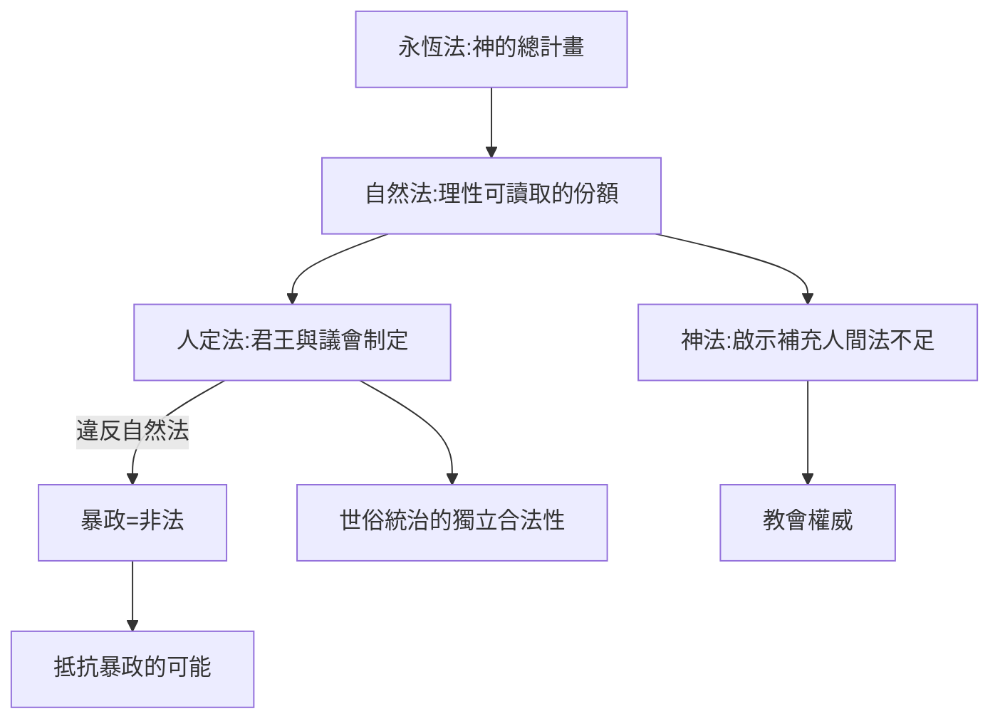

# 3.2 阿奎那自然法與雙劍論

時間：十三世紀，約西元1250–1274年，托馬斯·阿奎那的主要著作期。

## 大翻譯時代打開了亞里斯多德的門

十二世紀的西歐城市爆發了兩件事：大教堂在各地被蓋起來，偉大書籍被重新翻譯進來。托萊多、帕多瓦與南義的譯者團隊，把亞里斯多德的《政治學》《尼各馬可倫理學》《形而上學》從阿拉伯文與希臘文轉成拉丁文。對被神學壟斷了千年的世界來說，這像考古挖出了一座地下圖書館：書裡讚美公民，討論正義，並以人性而非啟示推導政治，一位異教哲學家的著作顯得令人震驚。

巴黎大學起初禁止閱讀亞里斯多德的自然哲學著作。但到了阿奎那出場時，經濟也在變化：義大利城邦的貿易與金融復甦，市民階級興起，法蘭西與英格蘭的王室司法行政化。城市需要一套不僅靠〈上帝之城〉就能回答的政治理論：統治的合法性來自何處？能不能既有信仰、又有市民論與法律論？阿奎那拿手的那套方案，是把亞里斯多德整合進神學。

## 四重法：把「合法性」分層

阿奎那在《神學大全》中把法分為四層，這是關於「法是什麼」最清晰的中世紀分類學：

1. 永恆法（lex aeterna）：神對宇宙的治理設計，一切秩序的總藍圖。
2. 自然法（lex naturalis）：人類以理性可以理解的那一部分永恆法。理性不只是神學工具，是凡人也能執行的羅盤。
3. 人定法（lex humana）：君王與議會訂立的實定法，必須承接自然法的判準。
4. 神法（lex divina）：啟示的關鍵，指向人間法無法完成的救贖目標。

這四層結構表面上是神學，實際上是一場安靜的革命：人定法有一個高於自己的標準（自然法），統治者若違背自然法，就是違背宇宙秩序，不是違背教會的偏好而已。這條路在兩百年後由洛克與盧梭一路追，才長出「人民有權反抗暴政」的完整理論。

## 雙劍：兩種權威的分工

關於政教關係，阿奎那不屬於「教宗說了算」的強勢派。他區分兩把劍的用途：世俗事務歸君王，靈魂事務歸教會；兩者各按其方式服務於同一個神的秩序。在此意義上，他替「世俗政權有它自身的合法性」留了一個不小的位置：政治不只是「防止惡」的必要之惡，亞里斯多德說的「政治是通往良善生活的形式」被他接住並基督教化。

他也放行了一句大膽的判準：暴政比民主更糟，面對長期不義的暴政，人民的抵抗可以是被允許的，雖然他不主張激進革命。這句話被後世的時代不斷拿去翻譯。

## 何謂良善生活？城市的基礎設施

阿奎那把亞里斯多德的「城邦」翻譯成他那個時代的形態：城市（civitas）。城市不只是貿易場所，而是一個以法律、公共財、共同教育、主教座堂與行會支撐起來的「共同追求良善生活的共同體」。他關心貿易與貨幣，甚至討論過「公平價格」，這是中世紀在資本主義萌芽前，思考經濟與正義關係的少見片刻：要不要重視「交易品是否合乎其勞動成本」這條倫理準則。

## 迷思破除

- 「雙劍論」的原型不是阿奎那創的：可上溯至教宗哲拉修斯一世（五世紀末），阿奎那的中世紀版本系統化並調整其範圍，而非「發明」。
- 他並未主張政教合一或神權國家；相反，他為亞里斯多德式的世俗政治保留了獨立空間。今日「世俗國家的先聲」名單上，他是少數得以列入的中世紀經院哲學家。

十三世紀末他去世時，一種新的可能性已經埋下：統治者不只要向神交代，也要向一部先於統治者的法交代。再過兩個世紀，一個被流放的佛羅倫斯外交官將把這些「更高的法」全部擋開，只留下赤裸的權力與計算。
