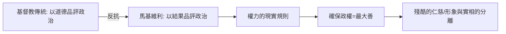

# 4.1 君王論與政治道德的切割

時間：西元1513年，翡冷翠郊外的小農舍；《君王論》於1532年出版。

## 被剝掉一切的外交官

1512年，西班牙軍隊協助美第奇家族重返佛羅倫斯，維持了十八年的共和政府垮台。馬基維利，這位曾為共和政府掌管外交與民兵、出使過法王路易十二與教廷的核心人物，在次年2月被革職，隨後又被誣涉入一件謀反案，入獄並受刑夾六次。他保住了性命，失去了職業、名譽與前途。

他退到父親在鄉下的小產業。在給友人韋托里的一封著名信件中，他描述了傍晚換上的習慣：脫下沾滿塵土的農民衣服，穿上朝服，走進自己的書房，與古人對話，「他們歡迎我，我便吃他們的食物，那就是我的正餐。四個小時裡，我不感覺無聊，忘記一切煩惱」。就是在那幾個小時裡，一個失業的外交官寫下了現代政治學的第一本書。

## 一本從頭到尾談「有效」的書

《君王論》的題材並不新（「君王之鏡」文體中古已有之），但它做的事前所未有：把「君王應當如何為善」的道德文體，反轉成「君王要保住政權，實際上必須如何行動」。

馬基維利的觀察起點是人性的現實：人是不知感恩、反覆無常、偽善而貪婪的。從「人實際上如何」出發，而非從「人應當如何」出發。

最大的典範轉移有兩條：

第一，效果的邏輯取代了意圖的道德。馬基維利在第十五章給了著名的尖刻例子：教宗儒略二世在位時仗著教會名義，靠著人們不敢也不同他討價還價的印象，一次次急攻冒進而竟然連連得手。他推而廣之：同一類行為，由道德家來評價是魯莽殘暴，由結果來評價卻可能是恰當而成功的。他最著名的一行是：「在君王的行動中，我們看見，有些被人稱為殘酷的事，其結果反而比被人稱為仁慈的事更仁慈。」例如切薩雷·波吉亞在羅曼涅以鐵腕迅速恢復秩序，被當地人認為比前任那些「仁慈的」統治者（放任仇殺與強奪）更少流血。政治的評價標準不是動機，而是結構性後果。

第二，表象不僅是道德瑕疵，往往是必要工具。君王最好看起來像仁慈、忠信、虔誠，但不必真的如此——因為幾乎沒有人有耐心去接觸政權的內層，眾人只看結果與形象。這不是「鼓勵虛偽」的荒誕主張，而是對一個「政治舞臺從此以傳播為主軸」的預言。

## 佛羅倫斯的政治菜譜：傭兵失敗與共和失敗

《君王論》是寫給掌權者的，但它的根源是馬基維利親手處理過的兩大危機：

第一場是軍事失敗。佛羅倫斯長期依賴僱傭兵，這支軍隊為錢而戰，也為錢而不戰，他親眼見到他們在皮薩戰場上丟人現眼。他推動《戰爭之藝》的核心主張：城市必須用自己公民組成民兵，武裝、訓練、榮譽屬於公民，而非商人的錢袋。這條「軍事技術決定政體」的路線，直接承接亞里斯多德與馬基維利自家的佛羅倫斯經驗。

第二場是共和的脆弱。他曾主持民兵，曾被流放、下獄、復職。他的《論李維》（Discourses on Livy）才是他真正的政治思想重量所在——共和不僅可以是理想國，只要制度上有「公眾 vs 私利」的張力與制衡（如同羅馬的元老院、執政官、保民官），它就會比君主制更穩。換句話說，馬基維利是被誤解的「邪惡導師」：寫《君王論》的那個人是個共和主義者，1700年代的啟蒙運動與美國開國者讀的正是《論李維》。

## 得勢的一幕：切薩雷·波吉亞

《君王論》第七章最著名的主角，是切薩雷·波吉亞（Cesare Borgia），亞歷山大六世之子。切薩雷受命征服羅曼涅，當地的秩序已混亂至死，他派酷吏雷米羅·德·奧爾科治理，待其明白需要有個宣洩民怨的出口時，便「把雷米羅切成二半放在廣場」，讓人民知道殘暴是那個代理人的，不是君主的。這一章往往被誤讀為教案；馬基維利藉此真正改寫了政治的邏輯：一個好的統治者，殘忍與得利機會都要拿捏節點，並在需要時偽裝毫無所知。

## 迷思破除

- 「馬基維利式」一詞意指「不擇手段」，《君王論》當然有教唆爾虞我詐的部分，但馬基維利本人與書中思想均非如此簡化；他的《論李維》正是共和主義的種子。
- 「為目的而手段是正當的」這句話被歸給馬基維利，但《君王論》原文並無此句；這是四百年後英國馬基維利主義論戰中被造出的結語。
- 書中被獻給的君王洛倫佐在1519年（書尚未出版）即過世；馬基維利並未見到它的影響。

馬基維利打開了「政治與道德分家」的大門，他仍假定一件事：國家沒有、君王有、市民有。英國內戰時期，一名流亡於巴黎的數學家兼哲學家把這個分離推到盡頭，問出了那個天花板的問題：若沒有道德，人與人的相處是什麼？
