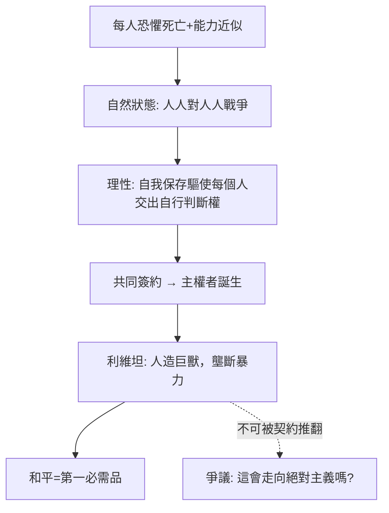

# 5.1 英國內戰與所有人對所有人的戰爭

時間：西元1640–1651；霍布斯流亡巴黎並寫作《利維坦》。

## 一位怕死的懦夫寫成的大書

托馬斯·霍布斯的膽小是出名之事。他自己說過，恐懼與他相伴而生：他母親聽聞西班牙無敵艦隊逼近時受驚而早產，霍布斯說「恐懼與我這對雙胞胎同時出生」。1640年政治風向轉變，他年過五十便自我流放巴黎。當英國的議會、貴族與國王把國家推進內戰，這位數學研究者出身的哲學家回到書桌，把眼前的崩壞寫成一個普遍的模型：若沒有人能做出最後的裁斷，人與人會如何相處？

從1642到1651，英國分裂為議會派與王黨，戰爭打到1651年，人口損失的比例高於英國在二十世紀兩次世界大戰的總和，並伴隨蘇格蘭與愛爾蘭戰場的大屠殺。這不是抽象的「混亂」，而是霍布斯的「自然狀態」被實地演示：沒有能有效裁斷的權威，任何事情都不安全——你的生命、你的財產、你的承諾、甚至明天的收成。

## 自然狀態的邏輯實驗

《利維坦》前幾章是英國內戰的哲學倒影。霍布斯的推理鏈，可以寫成幾條公設：

- 人是自我保存的機器。每個人想活下去，這不是罪，是機器的功能。
- 能力大致均等。即使在智力與體力上略有差異，任何人都可能在自己睡著時被另一個人殺害，所以沒有永久的絕對安全。
- 若無共同權威：資源、名譽、嫉妒與領土都可能成為衝突之引。人會先攻擊以求自保，也會先擴張威嚇以便阻止被攻擊。
- 在沒有共同權力的情況下：「每個人對每個人的戰爭」，一種每個人都得防備每個人的生活：「孤獨、貧困、卑污、殘忍而短壽」。

這是思想史上第一次把「為何需要國家」用純粹世俗的推理回答。沒有原罪神學、沒有自然目的論、沒有柏拉圖的理念；只有恐懼、理性與博弈結構。霍布斯把政治學完全從「討論道德理想」拉到「討論避免集體死亡」的底層邏輯。

## 然而「利維坦」之名源自聖經

《利維坦》書名取自《約伯記》第41章：海中巨獸利維坦，任何魚叉都無法穿透，「地上沒有像牠那樣被造之物，凡高大的，牠無不藐視」。霍布斯用它形容的主權國家是一具人造巨獸：人民是這具機械的關節與材料，主權者是靈魂，官員是肌肉，法律是絞鏈，警察是知識。

這具巨獸的結構如何成形？他寫下了社會契約的想像：在恐懼與求生的驅動下，每個人相互簽約，把「自我裁決與自我執行的權利」全部轉讓給一個共同的主權者，以「共同權力」終結戰爭狀態。因為契約是「人與人」之間的彼此允諾，而非人與主權者之間的允諾，故主權者本身從不參與契約，也不可被契約推翻——這正是它最大爭議所在。

## 迷思破除

- 《利維坦》的主權者不是必然的君王。霍布斯明說主權可以是君主制、貴族制或民主制，他自己的偏好是君主制，但邏輯上一個民選議會作為主權者同樣有效。他的重點不在人數，而在主權的不可分割性與不可撤回性。
- 霍布斯的「國家」不是為了善而存在，而是為了避免集體死亡。他的合法性訴求只問一件事：你能終結戰爭狀態嗎？若保不了和平，臣民保有一項他從未剝奪的權利——自我保存。這句話把「合法性」從君權神授改寫為「能力與功能」，是第一個功能主義國家論。

## 一本書的奇特出版史

《利維坦》1651年在倫敦印行，以簡明的英文（而且結構完整）迅速引起爭議。它既攻擊天主教教會主張教會高於國家的立場，也質疑清教徒把私人宗教確信引進政治的作法，以至於流亡中的保皇黨 Court 也視他為危險理論家：有人相信這本書的無神論害得霍布斯錯失了王室職位。1651年前後他返回倫敦，在克倫威爾治下安靜地生活；1666年倫敦大火後，議會曾傳聞立法管制無神論的《利維坦》，老人燒毀了部分手稿，做了自審。晚年被復辟的查理二世以年金禮遇，但他的哲學在牛津與劍橋長期被排拒在課程之外。

## 問題被留了下來

霍布斯用契約證成了絕對主權。但契約的出發點是自我保存——那麼當國家本身反而威脅生存與財產時，這紙契約還不作數嗎？他只是在書中留下破洞，下一章的洛克將把此洞擴成整座大門：契約的目的正是保護生命、自由與財產；政府一旦毀約，人民有反抗之權。
